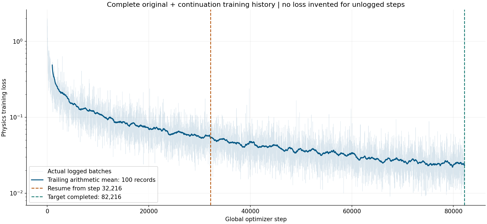

# Geometry-conditioned physics-informed DeepONet

**طراحی معکوس خروج ذرات — ۱۵ حالت ذخیره شد:** سه ذره با درگ استوکس و پنج هدف خروجی در Re=30، با وزن گام ۴۴۲٬۴۰۰. شکل تجمیعی خروجی را به شش قسمت تقسیم می‌کند. هر ۱۵ طرح نهایی در FEM با معیار ۱٪ عرض خروجی قبول شدند؛ ۹ طرح مستقیماً و ۶ طرح پس از اصلاح با FEM درشت. [گزارش و محدودیت‌ها](reports/inverse_stokes_particles_15/README.md) · [شکل تجمیعی](reports/inverse_stokes_particles_15/all_15_designs.png) · [PDF](reports/inverse_stokes_particles_15/designs_and_trajectories.pdf) · [جدول خطاها](reports/inverse_stokes_particles_15/results.csv) · [دانلود کامل](reports/inverse_stokes_particles_15/inverse_particle_results.zip).

**ران تا گام۴۴۲٬۴۰۰ کامل و آرشیو شد:** همهٔ۲۱وزن دوره‌ایِ ران اخیر، وضعیت کامل SOAP،۵۰۰۱رکورد آموزش،۵۱ارزیابی ثابت و۲۲ارزیابی مستقل FEM محفوظ‌اند. موجودی۳۰۹فایل خروجی سه اجرای اخیر با Molab تطبیق داده شد و محتوای مفقودی ندارد. [دانلود وزن نهایی، همهٔ نتایج، نمودارها و نوت‌بوک](reports/molab_soap_warmcos50k/completed/README.md). وزن‌های قبلی حفظ شده‌اند.

**ران جدید ۵۰هزارگامی SOAP با کسینوسی `1e-3 → 1e-4` شروع شد:** از همان وزن مشترک **۳۴۲٬۴۰۰**، محور مقایسه از صفر، هدف **۳۹۲٬۴۰۰** و batch32. منحنی جدید روی نمودارهای قبلی اضافه شد. ارزیاب جداگانه، خطای FEM را برای ۲۰ کانال داخل محدوده، شامل گروه ۱۲تایی با انحنای بیشتر، نمایش می‌دهد؛ جواب FEM وارد آموزش یا تنظیم نرخ نمی‌شود. [تنظیمات و جداسازی ارزیابی](reports/molab_soap_highlr50k/README.md) · [وزن‌ها و خطاهای دوره‌ای](artifacts/molab/soap-highlr50k-v1/).

**مقایسهٔ پنج حالت ۵هزارگامی SOAP کامل شد و ادامهٔ خودکار متوقف است:** کسینوسی `1e-4 → 2e-5` نامزد متعادل‌تر و ثابت `2e-5` مرجع مناسب‌ترِ کم‌نوسان است؛ ثابت `1e-4` برندهٔ مجموع معیارها نیست. پنج وزن انتهایی و یکسان‌بودن RNG بررسی شدند. حداقل ۳۰٬۴۹۰ گام مصرف شده و ادامهٔ بودجه هنوز تخصیص داده نشده است. [جدول مقایسه، نمودارها و نتیجه‌گیری](reports/molab_soap_sweep50k/comparison/README.md) · [وزن‌ها و داده‌ها](artifacts/molab/soap-sweep50k-v1/). برتری برای ران ۲۰۰هزارگامی هنوز ثابت نشده است.

**خروجی تصویری پایان ران SOAP تا ۴۲۲٬۴۰۰ بازیابی شد:** کاهش تقریبی loss ثابت control حدود **۱۶٪**، audit حدود **۱۴٪** و میانگین نمایشی آموزش حدود **۲۷٪** است؛ اعداد انتهایی از نمودار استخراج شده‌اند. فایل وزن نهایی و FEM انتهای ران در ماشین فعلی Molab موجود نیست؛ بالاترین وزن محفوظ این شاخه **۳۴۲٬۴۰۰** است. [نمودار اصلی، فایل‌های بازیابی‌شده و حدود تحلیل](reports/molab_soap_cosine100k/retained/README.md) · [آرشیو وزن‌ها و داده‌های موجود](artifacts/molab/soap-cosine100k-v1/).

اپراتور فیزیک‌آگاه برای جریان پایای دوبعدی در کانالی با **دو دیوارهٔ مستقل** و `10 <= Re <= 100`؛ یک checkpoint برای همهٔ هندسه‌ها. مشخصات درخواست در [سند پروژه](reports/PROJECT_SPECIFICATION.md) حفظ شده است.

**وضعیت: ادامهٔ SOAP تا گام ۳۲۲٬۴۰۰ کامل شد؛ کاهش loss کند و تغییرات خطای FEM یکدست نیست. مدل هنوز تأیید نهایی نشده است. وزن‌های تاریخی و شاخه‌های آزمایشی محفوظ‌اند.** [وضعیت ماشین‌خوان](STATUS.json) و [گزارش پیشرفت](reports/PROGRESS.md) میان موفقیت کد، پایان آموزش و صحت میدان تفاوت می‌گذارند. این مخزن بازتولید آمادهٔ حل NS از مقاله نیست؛ سازگارکردن جدید آن برای هندسهٔ متغیر است.

**ادامهٔ SOAP تا گام ۳۲۲٬۴۰۰ کامل شد:** loss ارزیابی ثابت طی ۲۰هزار گام فقط **۲٫۵۸٪** کاهش یافت. میانهٔ سرعتِ ۲۰ کیس **۱٫۳۶۱٪ → ۱٫۳۴۰٪** و فشار **۱٫۱۳۶٪ → ۱٫۱۷۱٪** شد؛ بهبود هم‌زمان تأیید نشد. [نتایج کامل](reports/molab_soap_continue20k/completed/README.md). آزمون‌های جداگانهٔ batch128، نرخ بالاتر و ثابت‌کردن trunk کاهش بزرگ و یکدستی ندادند و جایگزین مدل نشدند. [تحلیل توقف کاهش خطا](reports/plateau_diagnosis/README.md) · [نمودار آزمون‌ها](reports/plateau_diagnosis/comparison.png).

نمودار سراسری لاس از گام **۱ تا ۳۷۸٬۶۰۰**: [تصویر](reports/full_training_history/loss_from_start.png) · [PDF](reports/full_training_history/loss_from_start.pdf) · [داده‌ها و توضیح پوشش لاگ‌ها](reports/full_training_history/README.md). بازهٔ فاقد لاگ تاریخی با هاشور مشخص شده است.

**آزمایش SOAP کامل شد:** دو نرخ، هرکدام ۵هزار گام از ۲۸۷٬۴۰۰؛ همهٔ ۱۴ چک‌پوینت کامل ذخیره شدند. نرخ `2e-5` میانهٔ خطای فشارِ ۲۰ کیس را به **۱٫۲۲۵٪** رساند، اما میانهٔ سرعت **۱٫۴۰۷٪** شد و نسبت به وزن شروع بهبود نداشت. [تحلیل نهایی و قدم پیشنهادی](reports/molab_soap_trials/completed/README.md).

**ادامهٔ SOAP تا گام ۳۰۲٬۴۰۰ کامل شد:** در ۲۰ کیس، میانهٔ سرعت **۱٫۳۶۱٪** و فشار **۱٫۱۳۶٪**؛ وزن و وضعیت کامل SOAP ذخیره شدند. [مقایسهٔ هم‌بودجه با Adam و قدم بعدی](reports/molab_soap_continue10k/completed/README.md).

## ادامهٔ تطبیقی Adam از گام ۲۸۷٬۴۰۰

ران جدید با هدف **۳۸۷٬۴۰۰** آغاز شده است: نرخ شروع `2e-5`، آزمایش محدود نرخ فعلی/نصف/دوبرابر در هر ۱۰هزار گام، با حفظ Adam و RNG و مقایسه از وضعیت یکسان. ۳۲ هندسه برای انتخاب نرخ و ۳۲ هندسهٔ مجزا برای پایش استفاده می‌شوند. [تنظیمات، محدودیت‌ها و وضعیت راه‌اندازی](reports/molab_adaptive_100k/README.md). نتیجهٔ نهایی یا برتری دقت هنوز اعلام نشده؛ وزن‌های قبلی محفوظ‌اند.

## نتایج کامل molab ذخیره شد — گام ۲۸۷٬۴۰۰

[گزارش کامل و مقایسهٔ ۲۰ کیس](reports/molab_adam_100k/completed/README.md) · [PDF دو خروجی زنجیره‌ای جدید](reports/molab_adam_100k/completed/selected/two_result_chains.pdf) · [دانلود تصاویر و داده‌ها](reports/molab_adam_100k/completed/results_and_examples.zip) · [آرشیو کامل وزن‌ها، وضعیت Adam، لاگ‌ها و همهٔ snapshotها](artifacts/molab/adam-100k-v1/README.md).

در ۲۰ کیس قبلی با همان FEM، میانهٔ خطای L2 سرعتِ وزن نهایی **۱٫۶۳٪ → ۱٫۳۸٪** و فشار **۲٫۰۴٪ → ۱٫۴۷٪** شد. وزن گام ۲۸۲٬۴۰۰، که براساس ارزیابی ثابت انتخاب شده، میانهٔ خطای سرعت **۱٫۴۵٪** و فشار **۱٫۲۷٪** دارد؛ یک وزن در همهٔ معیارها برتر نیست. هر دو وزن و داده‌های قدیمی حفظ شده‌اند.

## ادامهٔ ۱۰۰هزارگامی پس از مقایسهٔ نرخ یادگیری

هر چهار آزمون ۱۵هزارگامی کامل شدند. خروجی کسینوسی، در میان چهار خروجی نهایی، بهترین loss ارزیابی ثابت و خطای FEM را داشت؛ بهبود همهٔ معیارها نسبت به نقطهٔ شروع تأیید نشده است. [تحلیل نتایج](reports/molab_lr_trials/README.md). ادامه از گام **۱۸۷٬۴۰۰** با کسینوسی `1e-4 → 2e-5` دقیقاً تا **۲۸۷٬۴۰۰** کامل شد. [گزارش ران جدید](reports/molab_adam_100k/README.md). ارزیابی ثابت هر ۵هزار گام و ذخیرهٔ جداگانهٔ بهترین checkpoint فعال است. مدل نهایی هنوز تأیید یا منتشر نشده است.

## مقایسهٔ چهار کنترل نرخ یادگیری روی molab

به درخواست کاربر، ران یک‌ساعته در checkpoint سالم **۱۷۲٬۴۰۰** متوقف شد و چهار شاخهٔ مستقل، هرکدام **۱۵هزار گام**، از همان وزن و وضعیت Adam/RNG شروع شدند: نرخ ثابت `2e-5`، `5e-5`، `1e-4` و کاهش کسینوسی `1e-4 → 2e-5`. نمودارها روی همان داشبورد نمایش داده می‌شوند و ارزیابی ثابت و پایلوت FEM هم ثبت می‌شوند. [گزارش و تنظیمات آزمون‌ها](reports/molab_lr_trials/README.md). هر چهار آزمون کامل شده‌اند؛ تحلیل نتایج و محدودیت انتخاب در گزارش آمده است.

## ادامهٔ یک‌ساعته روی molab

این اجرای اولیه اکنون برای آزمون‌های بالا متوقف شده است. ادامهٔ Adam از گام **۱۳۲٬۲۱۶** روی **RTX PRO 6000 Blackwell** شروع شده بود؛ همان داده‌ها، optimizer، RNG و تنظیمات ران قبلی با سقف **۳۶۰۰ ثانیه** حفظ شده‌اند. [گزارش راه‌اندازی، وضعیت ثبت‌شده و مسیر خروجی‌ها](reports/molab_adam_1h/README.md). داشبورد زنده و دانلود نتایج پس از پایان در نوت‌بوک molab قرار دارند. این بخش تأیید شروع ران است؛ پایان یا بهبود خطای آن هنوز اعلام نشده است.

## نتایج جدید گام ۱۳۲٬۲۱۶ و مقایسهٔ سه مرحله

[آرشیو کامل ران جدید، شامل وزن‌ها، وضعیت Adam، لاگ‌ها، داده‌ها و کد](artifacts/kaggle/adam-next50k-v1/README.md) · [تأیید سلامت تمام ۶۸ خروجی و ۲ فایل کد و تنظیمات اجرا](artifacts/kaggle/adam-next50k-v1/archive-verification.json) · [آخرین بررسی سهمیهٔ Kaggle](reports/adam_next50k/quota-snapshot.json).

[گزارش کامل ۲۰ حالت](reports/adam_next50k_comparison/README.md) · [نمودار خطای سه مرحله](reports/adam_next50k_comparison/three_stage_errors.png) · [PDF شش نمونهٔ تصادفی زنجیره‌ای](reports/adam_next50k_comparison/selected/six_random_chains.pdf) · [دانلود کامل تصاویر و داده‌ها](reports/adam_next50k_comparison/three_stage_20_cases.zip).

با همان FEM، هندسه و Re=30، میانهٔ خطای L2 سرعت در گام‌های ۳۲٬۲۱۶ ← ۸۲٬۲۱۶ ← ۱۳۲٬۲۱۶ برابر **۳٫۲۷٪ ← ۱٫۹۹٪ ← ۱٫۷۹٪** و فشار **۴٫۷۳٪ ← ۲٫۷۳٪ ← ۲٫۲۳٪** است. نسبت به مرحلهٔ قبل، سرعت در **۱۳ از ۲۰** و فشار در **۱۴ از ۲۰** حالت بهتر شده است؛ پسرفت‌های سایر موارد نیز گزارش شده‌اند. داده‌ها و نتایج قدیمی حفظ شده‌اند.

## دو پلهٔ نرم و جریان بین آن‌ها

[مقایسهٔ جدید Re=50 و Re=100 با هندسه و وزن یکسان](reports/double_step_re_comparison_82216/README.md) · [تصویر کنارهم](reports/double_step_re_comparison_82216/re50_vs_re100.png) · [دانلود هر دو حالت](reports/double_step_re_comparison_82216/double_step_re50_vs_re100.zip). در Re=50 خطای L2 سرعت **۱۸٫۷۰٪** و فشار **۹٫۹۳٪** است؛ FEM گردش ضعیف‌تری نشان می‌دهد، اما مدل همچنان جریان برگشتی بین دو پله را بازتولید نمی‌کند.

[مقایسهٔ مدل ذخیره‌شده با FEM، همراه با خطوط جریان متراکم در Re=100](reports/double_step_82216/README.md) · [نمای نزدیک بین دو پله](reports/double_step_82216/between_steps_zoom.png) · [دانلود کامل](reports/double_step_82216/double_step_82216.zip). دو برآمدگی روی دیوارهٔ پایین مطابق طرح کاربر، با رعایت همهٔ حدود اصلی هندسه ساخته شده‌اند. **FEM گردش بین دو پله را نشان می‌دهد، اما مدل گام ۸۲٬۲۱۶ آن را بازتولید نمی‌کند؛ خطای L2 سرعت ۲۲٫۹۹٪ و فشار ۱۵٫۷۱٪ است.**

## جریان روی پلهٔ نرم با مدل ذخیره‌شده

[نمای بزرگ‌شدهٔ پله و گردش](reports/rounded_backward_step_82216/step_enlarged.png) · [خطوط جریان مدل گام ۸۲٬۲۱۶ و مقایسه با FEM در Re=100](reports/rounded_backward_step_82216/README.md) · [تصویر](reports/rounded_backward_step_82216/streamlines.png) · [دانلود کامل](reports/rounded_backward_step_82216/rounded_step_82216.zip). هندسه در محدودهٔ اصلی مدل است؛ این یک تقریب نرم از پلهٔ پس‌رونده است و با بنچمارک پلهٔ قائم یکسان نیست.

## نتایج جدید به‌روزرسانی شد — هر ۲۵ حالت با وزن گام ۸۲٬۲۱۶

پاسخ‌های جدید مدل برای **مجموعهٔ ۱۵تایی و دو مجموعهٔ پنج‌تایی** تولید و ذخیره شدند. پاسخ FEM، هندسه و نقاط ارزیابی همان داده‌های قبلی هستند؛ فقط پیش‌بینی مدل و خطاها دوباره محاسبه شده‌اند. **نسخه‌های قدیمی گام ۳۲٬۲۱۶ نیز حفظ شده‌اند.**

| مجموعه | گزارش و تصاویر جدید | PDF جدید | بستهٔ کامل ZIP |
| --- | --- | --- | --- |
| ۱۵ شکل اصلی | [مشاهده](reports/checkpoint_82216/channel_chain_15/README.md) | [دانلود PDF](reports/checkpoint_82216/channel_chain_15/all_chains.pdf) | [دانلود ZIP](reports/checkpoint_82216/downloads/channel_chain_15_step_82216.zip) |
| ۵ شکل متنوع | [مشاهده](reports/checkpoint_82216/random_channel_chain_5/README.md) | [دانلود PDF](reports/checkpoint_82216/random_channel_chain_5/all_chains.pdf) | [دانلود ZIP](reports/checkpoint_82216/downloads/random_channel_chain_5_step_82216.zip) |
| ۵ شکل stress | [مشاهده](reports/checkpoint_82216/extreme_channel_chain_5/README.md) | [دانلود PDF](reports/checkpoint_82216/extreme_channel_chain_5/all_chains.pdf) | [دانلود ZIP](reports/checkpoint_82216/downloads/extreme_channel_chain_5_step_82216.zip) |

[صفحهٔ اصلی نتایج جدید و راهنمای دانلود](reports/checkpoint_82216/README.md)

هر بسته شامل میدان‌های سرعت و فشار جدید، مقایسه با FEM، نقشهٔ خطا، داده‌های عددی و جدول خطاهای قدیم/جدید است. مجموعهٔ stress همچنان خارج از حدود اصلی آموزش است و جداگانه گزارش می‌شود؛ این نتایج به‌معنای تأیید نهایی مدل نیستند.

- [اجرای اصلی GPU در Kaggle](https://www.kaggle.com/code/mohrezsayeh/geometry-pi-deeponet-main)؛ خصوصی در حساب مالک.
- [آزمایش دسترسی GPU](https://www.kaggle.com/code/mohrezsayeh/geometry-pi-deeponet-gpu-probe).
- [گالری هشت خانوادهٔ دیواره](reports/geometry_gallery.png).
- [شناسه‌ها، پارامترهای هندسی و هش مجموعه‌های ثابت](reports/split_manifest.json).

## Completed new Adam continuation: 132,216

ادامهٔ آموزش با **Adam** از وزن موفقِ گام **۸۲٬۲۱۶**، برای **۵۰هزار گام دیگر** اجرا شد و دقیقاً در گام **۱۳۲٬۲۱۶** به پایان رسید. [اجرای Kaggle](https://www.kaggle.com/code/mohrezsayeh/geometry-pi-deeponet-adam-next50k) · [تنظیمات و وضعیت مشاهده‌شده](reports/adam_next50k/README.md).

The original float32 trainer, random sampling, batch 32, Adam moments, RNG and global learning-rate schedule are retained. The L-BFGS checkpoint is not used. The final Adam checkpoint at step 132,216 has been retrieved and verified; see the completion record and three-stage comparison above.

## L-BFGS experiment — not adopted

The separate [L-BFGS experiment](reports/lbfgs_stage/README.md) ended after 448 accepted iterations at its time budget. Its fixed-bank loss improved, but the disjoint training probe and pilot FEM medians worsened. It was not selected for continuation; the workflow returns to the preserved Adam checkpoint. Results are retained for provenance.

## Completed continuation: step 82,216

ادامهٔ آموزش از **۳۲٬۲۱۶ تا ۸۲٬۲۱۶** دقیقاً با ۵۰هزار گام اضافه پایان یافت (`target_completed`). وزن‌های قدیمی حفظ شده‌اند و وزن‌های جدید در پوشه‌ای مستقل قرار دارند.

- [Latest research weights, logs and complete archive](artifacts/kaggle/continue-50k-v1/README.md)
- [Before/after FEM comparison and full training history](reports/continuation_50k/completed/README.md)
- [Latest checkpoint pointer with SHA-256](artifacts/kaggle/latest_checkpoint.json)

On the same eight Re=10 pilot cases, median velocity error improved **2.59% → 1.83%**, pressure **2.68% → 1.05%**, and pressure drop **2.53% → 0.30%**. This is 8/400 development cases; family-median and momentum gates still fail. No accepted-model claim is made. The original 15-channel gallery, random-five and stress-five figures remain results of **step 32,216**, with their original weights and data retained.

## Training history

[بررسی کامل میانگین loss در پنجره‌های ۱۰هزارگامی](reports/continuation_50k/completed/windows_10k/README.md) · [نمودار](reports/continuation_50k/completed/windows_10k/training_windows.png) · [نسخهٔ میانی قبلی](reports/training_windows_10k/README.md)

[نمودار روند آموزش و توضیح گام در برابر ایپاک](reports/training_curves/README.md) · [PDF نمودار](reports/training_curves/loss_vs_step.pdf) · [داده‌های CSV](reports/training_curves/training_history.csv)



Training uses random batches with replacement and fresh Re/collocation points, so the primary axis is optimizer updates. The secondary axis shows equivalent geometry-pool passes, not actual epochs. The latest combined history contains 8,223 actual logged records; the original 3,222-record graph remains archived in `reports/training_curves`. No training-time FEM validation curve was recorded.

## Five extreme channel stress tests — archived step 32,216

[پنج کانال با تغییرات شدید و مقایسهٔ FEM](reports/extreme_channel_chain_5/README.md) · [هندسه‌ها](reports/extreme_channel_chain_5/geometry_overview.png) · [PDF نتایج](reports/extreme_channel_chain_5/all_5_chains.pdf)

These local CPU experiments use the original step-32,216 checkpoint at Re=30 without accessing Kaggle. Severe pinching, a large serpentine shift, interlocking smooth teeth, a wide asymmetric cavity and rough multiscale walls probe outside the training geometry envelope while remaining inside the declared stress-input bounds. They are explicitly labeled extrapolation tests; input acceptance does not imply field accuracy. The report includes independent FEM mesh checks, full field comparisons, relative L2 and mean absolute/relative L1 errors.

## Five different random wall-shape examples — archived step 32,216

[پنج هندسهٔ متفاوت و زنجیرهٔ کامل نتایج](reports/random_channel_chain_5/README.md) · [نمای هندسه‌ها](reports/random_channel_chain_5/geometry_overview.png) · [PDF پنج مقایسه](reports/random_channel_chain_5/all_5_chains.pdf)

These seeded examples use a plateau roof, chirped waves, rounded steps, irregular spline walls and random Fourier mixtures. The operator predicts flow given wall geometry; it is not restricted to the repeated bump shapes used in the first gallery. All cases remain smooth single channels inside the declared geometric envelope. FEM errors are measured rather than assuming accuracy from valid geometry.

## 15 channel result chains — archived step 32,216

[نمودار تغییر خطای u، v، فشار و سرعت در ترتیب ساده‌به‌پیچیده](reports/complexity_error_curves_15/README.md) · [PDF نمودارها](reports/complexity_error_curves_15/error_dashboard.pdf)

برای **۱۵ کانال از ساده تا پیچیده**، زنجیرهٔ «هندسه ← سرعت و فشار مدل ← حل مستقل FEM ← نقشه و معیارهای خطا» آماده شده است. عدد رینولدز همهٔ موارد **۳۰** است و از وزن‌های ثابت موجود استفاده شده؛ آموزش جدیدی انجام نشده است.

- [گالری کامل ۱۵ زنجیره در گیت‌هاب](reports/channel_chain_15/README.md)
- [PDF پانزده‌صفحه‌ای](reports/channel_chain_15/all_15_chains.pdf)
- [جدول خطاها](reports/channel_chain_15/summary.csv)
- [نمای کلی هندسه‌ها](reports/channel_chain_15/geometry_overview.png)

Each case includes separate geometry, model, FEM and absolute-error figures for `u`, `v`, speed magnitude and pressure, plus the complete comparison panel and numerical arrays. FEM mesh checks and physical-area-weighted errors are recorded. These prescribed cases are additional research results, not the locked final benchmark; the checkpoint remains unaccepted. Reproduce with `python -m scripts.channel_chain --workers 2` in the documented CPU environment.

For these 15 prescribed cases, median relative velocity error is **2.93%** (maximum **7.81%**), median pressure error is **6.15%** (maximum **16.18%**), and median pressure-drop error is **3.15%**. All FEM coarse/fine discrepancies are below **0.73%**. [Verification details](reports/channel_chain_15/validation.json) include a flat-channel analytic check, independent metric recomputation, 13 passing tests and PDF/image checks.

## Collected Kaggle run

[Complete v1 artifacts and restore instructions](artifacts/kaggle/main-v1/README.md) include the checkpoint with optimizer/RNG state, full logs, all geometry pools, eight FEM references and predictions/plots, precision/runtime metadata, and the exact downloaded source. The checksummed archive preserves every one of the **69 output files**, plus the two source/metadata files.

Kaggle reports `COMPLETE`; the trainer stopped at **32,216/100,000** steps after its 17,400-second budget. The eight-case development pilot has median velocity error **2.59%**, median pressure error **2.68%**, and median pressure-drop error **2.53%**. Only 8/400 development cases were evaluated, all at Re=10; velocity-median and momentum gates fail. These are provisional research weights, not an accepted release. No new training or locked-test evaluation was performed during collection.

```bash
python scripts/restore_kaggle.py
```

This verifies all archive/file SHA-256 hashes and restores the original output under `runs/restored-kaggle-v1/`. The checkpoint and readable reports are also available directly in the artifact directory. See [the collection report](reports/KAGGLE_COMPLETED_RUN.md) for validation and remaining work.

## Model and physics

The branch receives 257 samples each of `centerline - .5` and `gap - 1`, plus normalized log(Re). Independent streamfunction/pressure DeepONets use width 192, four gated updates and rank 128. The trunk receives reference coordinates and differentiable local wall features. Walls are C4 quintic splines, flat on the inlet/outlet 10% strips. The production mode has access to the complete wall functions. Sensor-only reconstruction is a separate API and is not claimed equivalent to exact-wall mode.

`x=5*xi`, `y=b(x)+eta*(t(x)-b(x))`. Production autodiff wraps the full inverse map and differentiates in **physical Cartesian coordinates**, including all geometry terms. A separate mapped-derivative path is tested against analytic physical functions.

```text
psi = 3*eta^2 - 2*eta^3
      + (1-exp(-xi/.05))^2 * 16*eta^2*(1-eta)^2 * N_psi
p = 12*(5-x)/Re + N_p
u = dpsi/dy, v = -dpsi/dx
L = mean(Ru^2+Rv^2) + 10*mean(Tx^2+Ty^2)
```

No-slip, prescribed parabolic inlet, unit flux and incompressibility follow from the ansatz. They do not prove momentum balance or field accuracy. Outlet conditions are `du/dx/Re-p=0`, `dv/dx/Re=0`; no extra pressure gauge is imposed. The independent P2/P1 FEM uses this same Laplacian weak form.

## Install and verify

Python 3.12 CPU setup tested in this cloud environment:

```bash
python -m venv .venv
. .venv/bin/activate
pip install -r reports/environment-cpu.txt
python -m pytest -q
```

**Do not install the CPU lock over working CUDA JAX on Kaggle.** The self-contained Kaggle script preserves the existing CUDA JAX and installs only scikit-fem and pytest. Precision profiling compares initialization residuals and update timing in float64/float32; the selected precision and its limited comparison scope are logged. Final structural verification uses float64.

The tests cover map recovery, physical chain rules and Laplacian, mixed derivatives, random-correction wall/inlet/flux/divergence, exact Poiseuille momentum/traction, independent FEM, finite training gradients, checkpoint equality, immutable split hashes and sensor-only input rejection. Numerical field validation is separate.

## Generate immutable geometries

```bash
python -m geometry_operator.sampling --output data/geometries
python -m scripts.geometry_gallery
```

10,000 train / 400 development / 1,000 locked test / 200 stress geometries. Each split is family-balanced. Re is independently drawn during training; reference Re values are preassigned and balanced. Near duplicates across splits are screened on 33-point wall vectors including axial and centerline reflections, with a declared RMS threshold. This is a numerical grouping criterion, not proof of distinctness in every possible function-space norm. Re-running generation checks immutable hashes. Training-only normalization is retained.

## Train and resume

```bash
python -m geometry_operator.train --pool data/geometries \
  --config configs/production.json --output runs/main \
  --steps 100000 --batch 32 --points 128 --outlet 48 --require-gpu

python -m geometry_operator.train --pool data/geometries \
  --config configs/runtime.json --output runs/continued \
  --steps 100000 --batch 32 --points 128 --outlet 48 \
  --resume runs/main/checkpoint.npz --require-gpu
```

Use the exact config saved with the checkpoint; `configs/runtime.json` is produced by the Kaggle precision probe. With the unmodified production float64 config, resume with that config instead. Checkpoints retain Adam moments, exact NumPy RNG state, step, wall-pool hash, model config and normalization. One-geometry microbatches accumulate the global batch without reducing it. There is no per-geometry optimizer in inference. FEM labels do not enter training.

The later trainer supports `--devices 2` (global gradient averaging) and `--archive-every 1000` for development checkpoint selection. Matched serial/parallel updates were checked on two virtual CPU devices. The collected Kaggle v1 used the earlier single-device trainer snapshot, not this later trainer. After archives/references are available, use `python -m scripts.select_checkpoint --candidates runs/main --output runs/selected`; its selection is provisional until all 400 development references are evaluated.

Kaggle's observed quota was **6 GPU hours**, not an unlimited training allocation. The run targets 100,000 steps with a time-budget stop and atomic checkpoints. A time-budget checkpoint remains provisional; the code does not label a partial run completed or accepted. Selecting by full development FEM and implementing the remaining comparisons are outstanding release tasks.

## Kaggle packaging and collection

```bash
python scripts/build_kaggle.py --output notebooks/kaggle_main --kind main
kaggle kernels push -p notebooks/kaggle_main --timeout 20400 --accelerator NvidiaTeslaT4
python scripts/collect_kaggle.py
python scripts/collect_kaggle.py --logs --seconds 30
python scripts/collect_kaggle.py --download --output runs/kaggle
```

The pushed script embeds the exact source archive and revision and is private by default. It runs tests, profiles precision, generates the full pool and starts the global run. The first eight development references after training are a **pilot at Re=10**, not a balanced substitute for the 400-case benchmark. No final test is opened automatically. Live numeric training logs can be read through the Kaggle API. Artifact downloads require network grants to `www.kaggleusercontent.com` and the actual redirect destination, commonly `storage.googleapis.com`; a successful status/log call does not prove artifact download access.

## Independent reference and evaluation

```bash
python -m scripts.reference_batch --pool data/geometries --split dev --workers 2
python -m geometry_operator.evaluate --checkpoint runs/main/checkpoint.npz \
  --pool data/geometries --references data/references --split dev \
  --output runs/main/development
```

Mapped meshes retain inlet/top/bottom/outlet facet tags. The solver uses Reynolds continuation and checks the complete nonlinear velocity-pressure update. Coarse/fine references compare velocity, pressure and pressure drop and refine when necessary. Interpolators reject points outside the mesh. For straight-sided wall approximation, the common interior is explicit and its excluded physical quadrature area is reported, capped at .5%. Wall stress has not yet been verified.

Evaluation saves per-case physical-area-weighted velocity/pressure error, absolute transverse RMS, pressure drop between x=.25 and 4.75, momentum/traction, wall/inlet/divergence/flux, mesh uncertainty, first-call and steady timings, fields and plots. Missing/failed references remain visible and prevent acceptance. Relative-field metrics use a norm floor of 1e-8; pressure-drop denominator uses an absolute floor of 1e-8.

Only after model selection, generate final test references and explicitly open the test:

```bash
python -m geometry_operator.reference --pool data/geometries --split test --unlock-test
python -m geometry_operator.evaluate --checkpoint runs/frozen/checkpoint.npz \
  --split test --unlock-test --output runs/final
```

Opening evaluation records the checkpoint hash and prevents silently using the same locked test for a different model. The full specification additionally requires 80-geometry Re sweeps, stress results and matched baseline/ablation evidence. The evaluator deliberately leaves `release_comparisons_complete=false` until those separate requirements are supplied; no automatic accepted-model claim is possible yet.

## Physical-coordinate API

```python
from geometry_operator.api import FlowOperator

model = FlowOperator('runs/main/checkpoint.npz', allow_unvalidated=True)
# walls: canonical (2,6,80) smooth coefficients; xy: physical (N,2) array
uvp = model.evaluate(walls, reynolds=55., xy=xy)
# Alternative, explicitly reconstructed geometry:
uvp, geometry_diagnostics = model.evaluate_samples(bottom257, top257, 55., xy)
```

The default rejects a checkpoint without a matching passing benchmark report. `allow_unvalidated=True` is for research; it does not certify the prediction. Geometry envelope, Re and physical domain checks run before prediction. Branch embeddings are cached for repeated queries. Generate two example predictions with the same weights:

```bash
python -m scripts.predict --checkpoint runs/main/checkpoint.npz --allow-unvalidated
```

## Sources

Wang, Wang & Perdikaris, *Science Advances* (2021), DOI [10.1126/sciadv.abi8605](https://doi.org/10.1126/sciadv.abi8605); [reference repository](https://github.com/PredictiveIntelligenceLab/Physics-informed-DeepONets/tree/77e7c747d653b34e79e43df7d88bad87de5c27d8). The user's [fixed-channel research code](https://github.com/mohrezsayeh90-ai/inverse_fromtrajectory_to_FlowReconstruction/tree/92897a6962e537a4bea88042609be102095db037) supplies the architectural/FEM lineage. Its old weights are not used or represented as geometry-generalizing weights.
