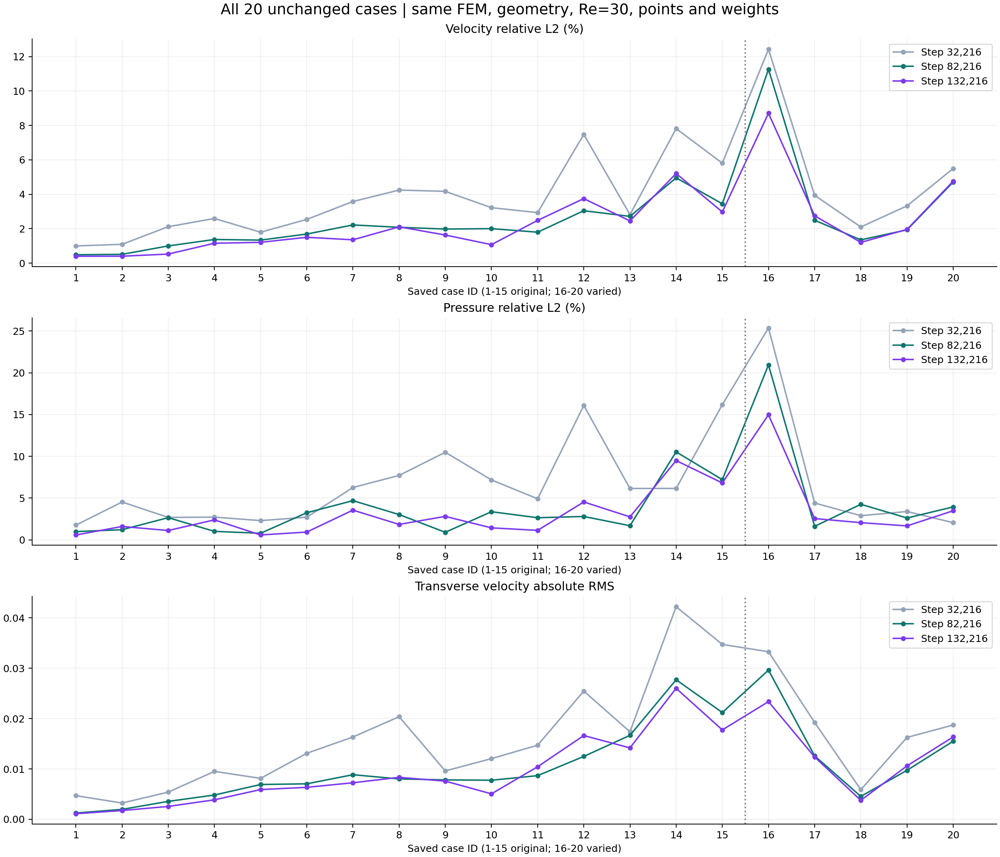
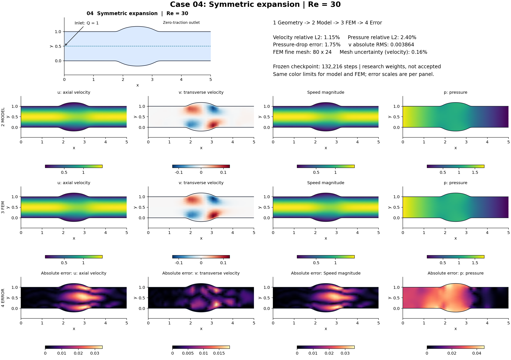
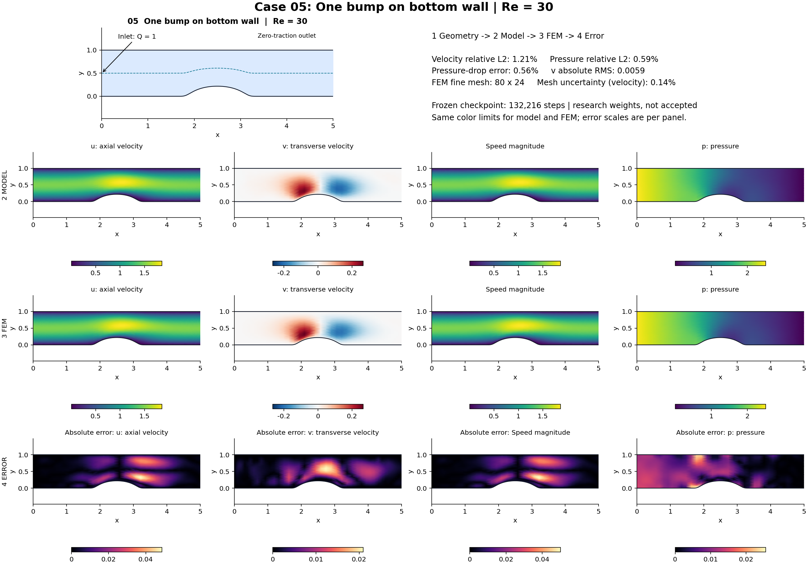
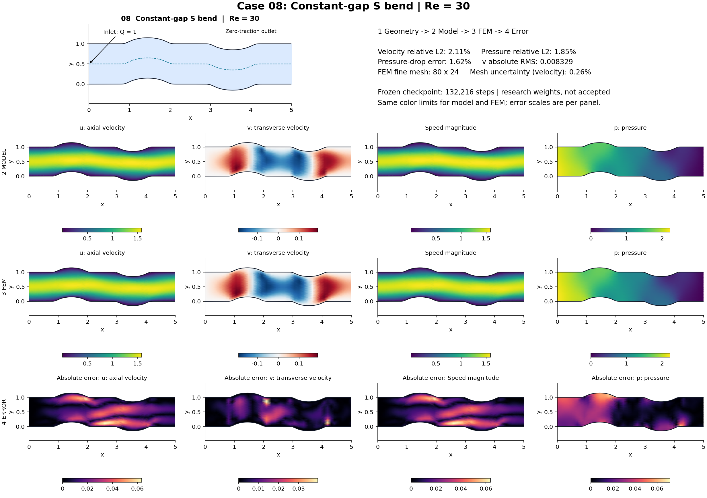
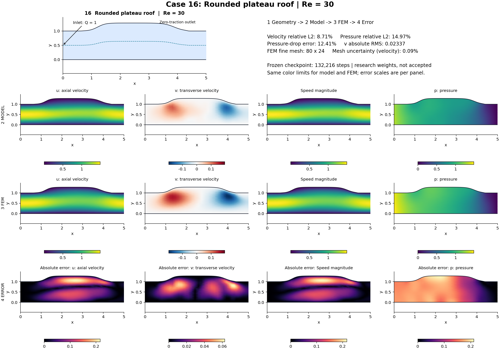
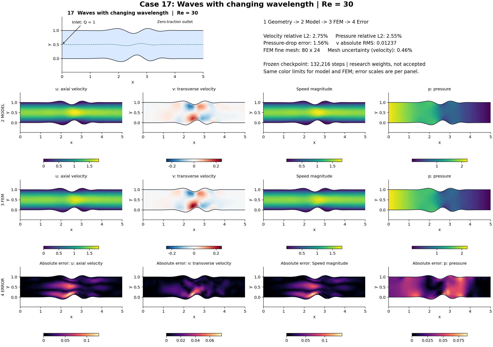
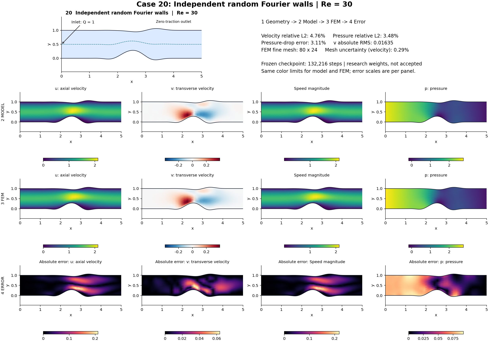

# Three Adam stages: all 20 saved cases and six seeded random chains

**New checkpoint: 132,216. Previous stages: 32,216 and 82,216. All 20 standard-envelope examples use Re=30.** Same geometry, FEM fields, physical quadrature points and weights were verified exactly. No FEM solve or retraining was performed. Full benchmark acceptance is not claimed.

[Six random chains PDF](selected/six_random_chains.pdf) · [All-error comparison CSV](comparison.csv) · [Full metrics](summary.json) · [Complete ZIP](three_stage_20_cases.zip)

| Metric (median over all 20) | 32,216 | 82,216 | 132,216 | Improved cases vs 82,216 |
| --- | ---: | ---: | ---: | ---: |
| Velocity L2 | 3.27% | 1.99% | 1.79% | 13/20 |
| Pressure L2 | 4.73% | 2.73% | 2.23% | 14/20 |
| Pressure drop | 2.87% | 1.88% | 1.39% | 14/20 |

| Case | Velocity L2: 32k → 82k → 132k | Pressure L2: 32k → 82k → 132k |
| --- | ---: | ---: |
| 01 Straight channel | 1.00% → 0.49% → 0.40% | 1.77% → 0.99% → 0.59% |
| 02 Mild symmetric constriction | 1.09% → 0.51% → 0.40% | 4.53% → 1.22% → 1.61% |
| 03 Moderate symmetric constriction | 2.12% → 1.00% → 0.52% | 2.69% → 2.66% → 1.12% |
| 04 Symmetric expansion | 2.59% → 1.37% → 1.15% | 2.73% → 1.02% → 2.40% |
| 05 One bump on bottom wall | 1.79% → 1.33% → 1.21% | 2.31% → 0.79% → 0.59% |
| 06 One bump on top wall | 2.54% → 1.69% → 1.50% | 2.72% → 3.25% → 0.94% |
| 07 Constant-gap centerline bend | 3.58% → 2.22% → 1.35% | 6.27% → 4.70% → 3.56% |
| 08 Constant-gap S bend | 4.24% → 2.08% → 2.11% | 7.72% → 3.04% → 1.85% |
| 09 Two symmetric constrictions | 4.17% → 1.98% → 1.63% | 10.49% → 0.91% → 2.81% |
| 10 Constriction followed by expansion | 3.22% → 2.00% → 1.07% | 7.18% → 3.37% → 1.44% |
| 11 Staggered independent wall bumps | 2.93% → 1.80% → 2.48% | 4.92% → 2.65% → 1.14% |
| 12 Three symmetric constrictions | 7.48% → 3.04% → 3.75% | 16.09% → 2.80% → 4.54% |
| 13 Four alternating gap features | 2.82% → 2.71% → 2.45% | 6.15% → 1.70% → 2.76% |
| 14 Oscillating centerline and gap | 7.81% → 4.95% → 5.21% | 6.16% → 10.53% → 9.50% |
| 15 Mixed independent multiscale walls | 5.81% → 3.45% → 2.97% | 16.18% → 7.21% → 6.82% |
| 16 Rounded plateau roof | 12.43% → 11.26% → 8.71% | 25.36% → 20.94% → 14.97% |
| 17 Waves with changing wavelength | 3.94% → 2.49% → 2.75% | 4.42% → 1.63% → 2.55% |
| 18 Rounded stepped S-shaped walls | 2.10% → 1.35% → 1.20% | 2.90% → 4.26% → 2.06% |
| 19 Independent irregular spline walls | 3.32% → 1.93% → 1.96% | 3.40% → 2.62% → 1.68% |
| 20 Independent random Fourier walls | 5.49% → 4.70% → 4.76% | 2.06% → 3.94% → 3.48% |

## Random chain gallery

Seed **20261116** selects IDs 4, 5, 8, 16, 17, 20 uniformly without replacement from all 20 before evaluating the new errors. The selection was not adjusted for favorable results. Each chain shows geometry → new u/v/speed/p → unchanged FEM → absolute error. Separate panels and numerical fields are included.

### 04. Symmetric expansion

[Full chain](selected/04_expansion/chain.png) · [Metrics](cases/04_expansion/metrics.json)

### 05. One bump on bottom wall

[Full chain](selected/05_bottom_bump/chain.png) · [Metrics](cases/05_bottom_bump/metrics.json)

### 08. Constant-gap S bend

[Full chain](selected/08_s_bend/chain.png) · [Metrics](cases/08_s_bend/metrics.json)

### 16. Rounded plateau roof

[Full chain](selected/16_roof_plateau/chain.png) · [Metrics](cases/16_roof_plateau/metrics.json)

### 17. Waves with changing wavelength

[Full chain](selected/17_chirped_wave/chain.png) · [Metrics](cases/17_chirped_wave/metrics.json)

### 20. Independent random Fourier walls

[Full chain](selected/20_random_fourier/chain.png) · [Metrics](cases/20_random_fourier/metrics.json)

## Error definitions and limits

Relative L2 = sqrt(sum(w |prediction-FEM|²) / sum(w |FEM|²)); velocity uses both components. MAE is the physical-area mean absolute scalar error or vector error magnitude. Relative L1 divides integrated absolute error by integrated reference magnitude. Denominator floors match the existing protocol. Pressure has no fitted gauge shift. Near-zero transverse velocity is reported using absolute RMS. CSV/JSON errors are ratios, while README L2 entries are percentages. Every regression is retained. These illustrative cases do not cover all Re or the locked test.

Reproduce: `OPENBLAS_NUM_THREADS=1 OMP_NUM_THREADS=1 JAX_ENABLE_X64=true .venv/bin/python -m scripts.compare_three_adam_stages`. ZIP contains all 20 new numerical cases, all six illustrated chains, PDF, selection manifest and three-stage metrics; model weights are stored separately at the recorded checkpoint path.

## Per-group progress and regressions

[Per-case reduction percentages CSV](improvements.csv). Positive reduction means improved; negative means worsened. Percent reductions compare error magnitudes, not percentage-point differences.

| Group | Velocity median 82k → 132k | Pressure median 82k → 132k |
| --- | ---: | ---: |
| channel_chain_15 | 1.98% → 1.50% | 2.66% → 1.85% |
| random_channel_chain_5 | 2.49% → 2.75% | 3.94% → 2.55% |

The varied five-case group has a higher median velocity error after the new run, despite the overall 20-case median improving. Improvements are not uniform across geometries or quantities.
