# Fifteen channels: geometry → model → FEM → error

Frozen step-32,216 checkpoint, **Re=30 for every case**. These illustrative, prescribed cases do not open or replace the locked test. No new model training was performed.

[Interactive gallery](index.html) (download/open locally; GitHub does not render HTML) · [All 15 chains PDF](all_15_chains.pdf) · [CSV metrics](summary.csv) · [Full JSON](summary.json)

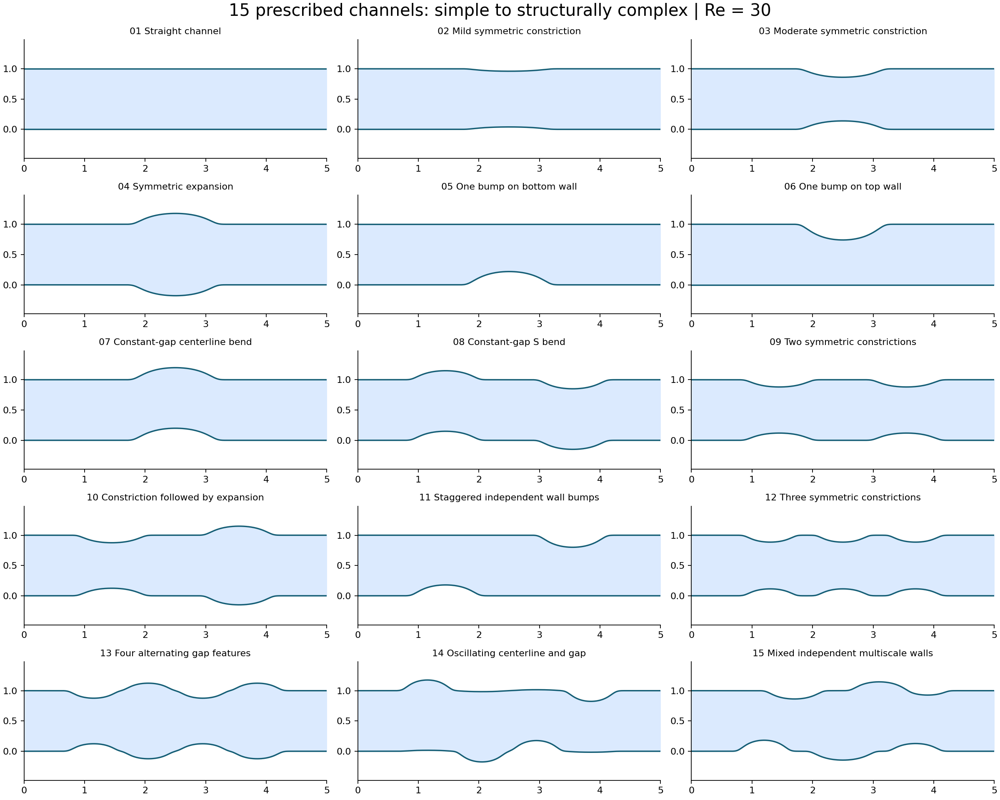

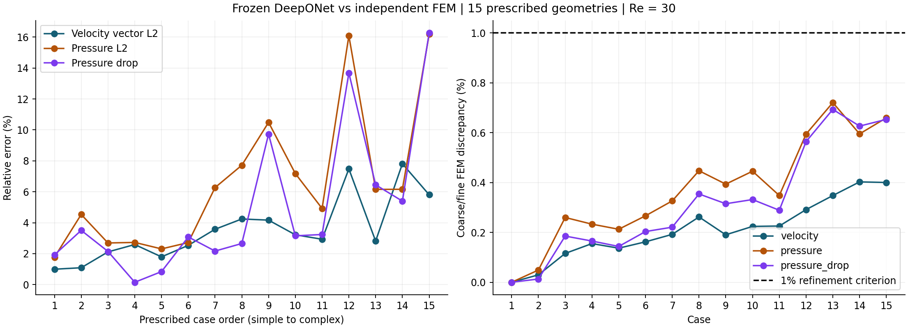

| Case | Velocity L2 error | Pressure L2 error | Pressure-drop error |
| --- | ---: | ---: | ---: |
| [01 Straight channel](#01_straight) | 1.00% | 1.77% | 1.92% |
| [02 Mild symmetric constriction](#02_mild_constriction) | 1.09% | 4.53% | 3.51% |
| [03 Moderate symmetric constriction](#03_moderate_constriction) | 2.12% | 2.69% | 2.14% |
| [04 Symmetric expansion](#04_expansion) | 2.59% | 2.73% | 0.15% |
| [05 One bump on bottom wall](#05_bottom_bump) | 1.79% | 2.31% | 0.84% |
| [06 One bump on top wall](#06_top_bump) | 2.54% | 2.72% | 3.08% |
| [07 Constant-gap centerline bend](#07_centerline_bend) | 3.58% | 6.27% | 2.17% |
| [08 Constant-gap S bend](#08_s_bend) | 4.24% | 7.72% | 2.66% |
| [09 Two symmetric constrictions](#09_double_constriction) | 4.17% | 10.49% | 9.73% |
| [10 Constriction followed by expansion](#10_constriction_expansion) | 3.22% | 7.18% | 3.15% |
| [11 Staggered independent wall bumps](#11_staggered_walls) | 2.93% | 4.92% | 3.24% |
| [12 Three symmetric constrictions](#12_triple_constriction) | 7.48% | 16.09% | 13.68% |
| [13 Four alternating gap features](#13_oscillating_gap) | 2.82% | 6.15% | 6.45% |
| [14 Oscillating centerline and gap](#14_oscillating_walls) | 7.81% | 6.16% | 5.40% |
| [15 Mixed independent multiscale walls](#15_mixed_independent) | 5.81% | 16.18% | 16.27% |

## Method and limits

Geometry uses the same exact C4 quintic wall representation as the operator. The order describes increasing structural variety (single feature → multiple features → independent mixed walls), not a mathematically monotonic complexity score or a ranking by prediction error. All designs are fixed before solving, validated within the declared geometry envelope, and retain flat inlet/outlet strips. Coefficients, sampled walls and geometric descriptors are saved for each case.

Independent Taylor–Hood P2/P1 FEM uses the same inlet, no-slip walls, Laplacian viscous form and natural zero-traction outlet as the model. Meshes start at 40×12 and 80×24 and refine as necessary. All three coarse/fine discrepancies (velocity, pressure, pressure drop) must be ≤1%; algebraic convergence is checked. This controls a mesh-discrepancy estimate, not a rigorous error bound. Exact curved walls and straight-edged FEM meshes differ; only their common physical quadrature domain is used and the excluded area fraction is recorded (≤0.5%).

At quadrature samples, error = model − FEM. Relative field L2 = sqrt(sum(w |model−FEM|²) / max(sum(w |FEM|²), 1e−16)), with physical-area weights. Velocity error uses the vector (u,v). Pressure is compared with its physical outlet anchoring, without a fitted pressure shift. Transverse velocity also has absolute RMS because its relative norm is ill-conditioned in a straight channel. Speed = sqrt(u²+v²). Pressure drop is section-averaged p(0.25)−p(4.75); relative-drop denominator has a 1e−8 floor. Full signed errors, weights, reference fields and predictions are saved in fields.npz.

Model/FEM color limits match per case and field; transverse velocity uses a symmetric color scale. Absolute-error scales are per panel. Maps interpolate only the saved common-domain quadrature points on masked triangles; the small unsampled edge strip is blank, not extrapolated. Max errors refer to the quadrature samples, not the continuous domain. All quantities are nondimensional.

Research weights remain unaccepted. These cases at one Reynolds number do not establish the full-domain benchmark, wall-stress accuracy, learned-baseline comparisons or completion of the 100,000-step training target.

## Reproduce

```bash
export MPLBACKEND=Agg MPLCONFIGDIR=/workspace/.cache/matplotlib JAX_PLATFORMS=cpu
export OMP_NUM_THREADS=1 OPENBLAS_NUM_THREADS=1
  .venv/bin/python -m scripts.channel_chain --workers 2
```

The run is restartable: existing geometry is checked, reference caches bind geometry and Re, and failed FEM cases are recorded explicitly. `--stage prepare`, `--stage references`, and `--stage render` can be run separately. Reproduction uses the pinned CPU environment documented at the repository root.

<a id="01_straight"></a>
## 01. Straight channel

[1 Geometry](01_straight/01_geometry.png) → [2 Model](01_straight/02_model.png) → [3 FEM](01_straight/03_fem.png) → [4 Error](01_straight/04_error.png) · [Metrics](01_straight/metrics.json) · [Fields](01_straight/fields.npz) · [FEM reference](01_straight/reference.npz)

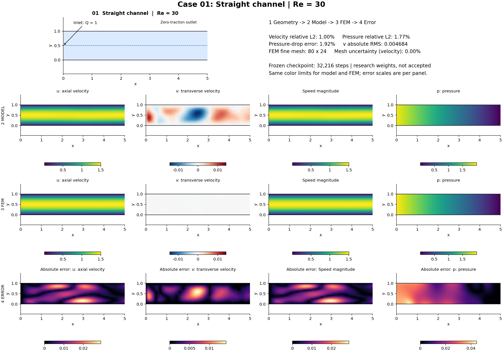

<a id="02_mild_constriction"></a>
## 02. Mild symmetric constriction

[1 Geometry](02_mild_constriction/01_geometry.png) → [2 Model](02_mild_constriction/02_model.png) → [3 FEM](02_mild_constriction/03_fem.png) → [4 Error](02_mild_constriction/04_error.png) · [Metrics](02_mild_constriction/metrics.json) · [Fields](02_mild_constriction/fields.npz) · [FEM reference](02_mild_constriction/reference.npz)

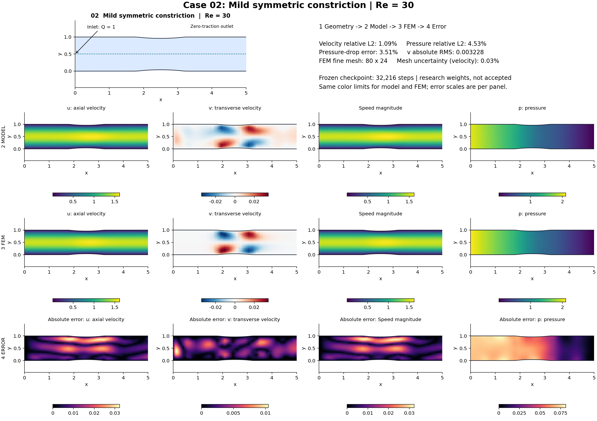

<a id="03_moderate_constriction"></a>
## 03. Moderate symmetric constriction

[1 Geometry](03_moderate_constriction/01_geometry.png) → [2 Model](03_moderate_constriction/02_model.png) → [3 FEM](03_moderate_constriction/03_fem.png) → [4 Error](03_moderate_constriction/04_error.png) · [Metrics](03_moderate_constriction/metrics.json) · [Fields](03_moderate_constriction/fields.npz) · [FEM reference](03_moderate_constriction/reference.npz)

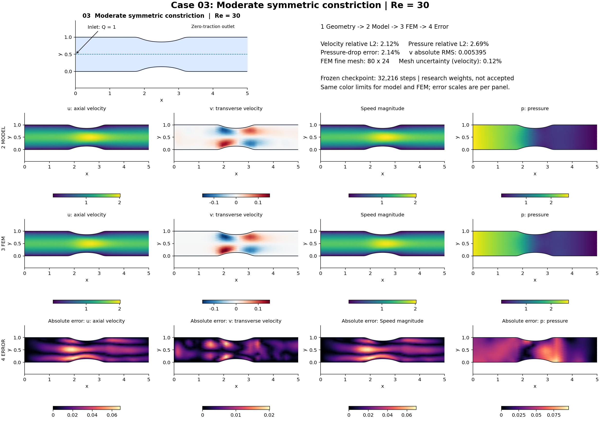

<a id="04_expansion"></a>
## 04. Symmetric expansion

[1 Geometry](04_expansion/01_geometry.png) → [2 Model](04_expansion/02_model.png) → [3 FEM](04_expansion/03_fem.png) → [4 Error](04_expansion/04_error.png) · [Metrics](04_expansion/metrics.json) · [Fields](04_expansion/fields.npz) · [FEM reference](04_expansion/reference.npz)

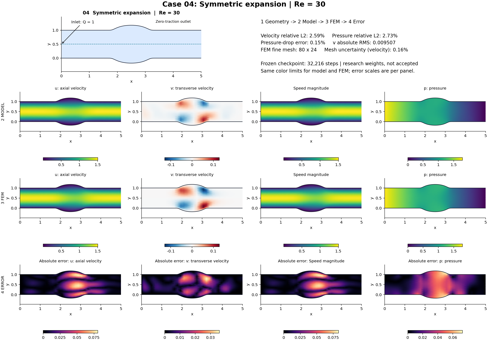

<a id="05_bottom_bump"></a>
## 05. One bump on bottom wall

[1 Geometry](05_bottom_bump/01_geometry.png) → [2 Model](05_bottom_bump/02_model.png) → [3 FEM](05_bottom_bump/03_fem.png) → [4 Error](05_bottom_bump/04_error.png) · [Metrics](05_bottom_bump/metrics.json) · [Fields](05_bottom_bump/fields.npz) · [FEM reference](05_bottom_bump/reference.npz)

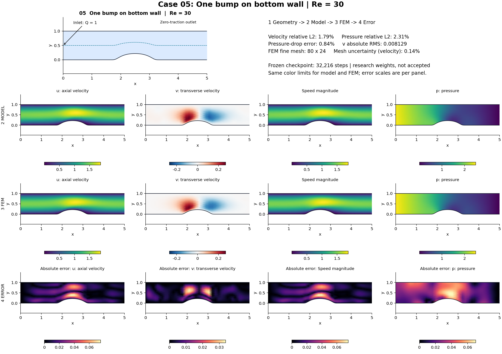

<a id="06_top_bump"></a>
## 06. One bump on top wall

[1 Geometry](06_top_bump/01_geometry.png) → [2 Model](06_top_bump/02_model.png) → [3 FEM](06_top_bump/03_fem.png) → [4 Error](06_top_bump/04_error.png) · [Metrics](06_top_bump/metrics.json) · [Fields](06_top_bump/fields.npz) · [FEM reference](06_top_bump/reference.npz)

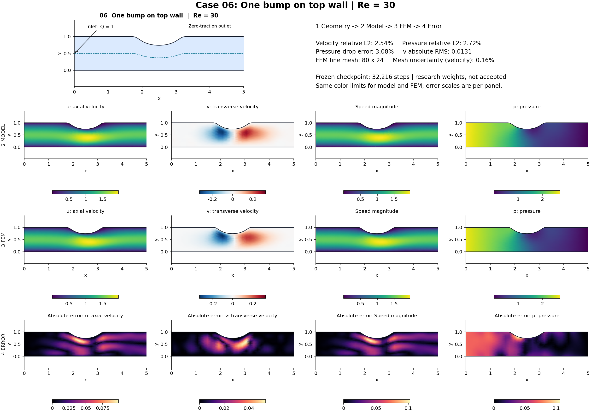

<a id="07_centerline_bend"></a>
## 07. Constant-gap centerline bend

[1 Geometry](07_centerline_bend/01_geometry.png) → [2 Model](07_centerline_bend/02_model.png) → [3 FEM](07_centerline_bend/03_fem.png) → [4 Error](07_centerline_bend/04_error.png) · [Metrics](07_centerline_bend/metrics.json) · [Fields](07_centerline_bend/fields.npz) · [FEM reference](07_centerline_bend/reference.npz)

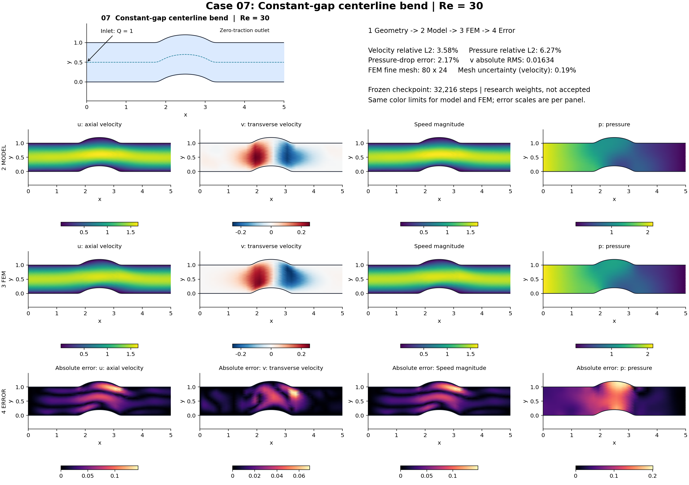

<a id="08_s_bend"></a>
## 08. Constant-gap S bend

[1 Geometry](08_s_bend/01_geometry.png) → [2 Model](08_s_bend/02_model.png) → [3 FEM](08_s_bend/03_fem.png) → [4 Error](08_s_bend/04_error.png) · [Metrics](08_s_bend/metrics.json) · [Fields](08_s_bend/fields.npz) · [FEM reference](08_s_bend/reference.npz)

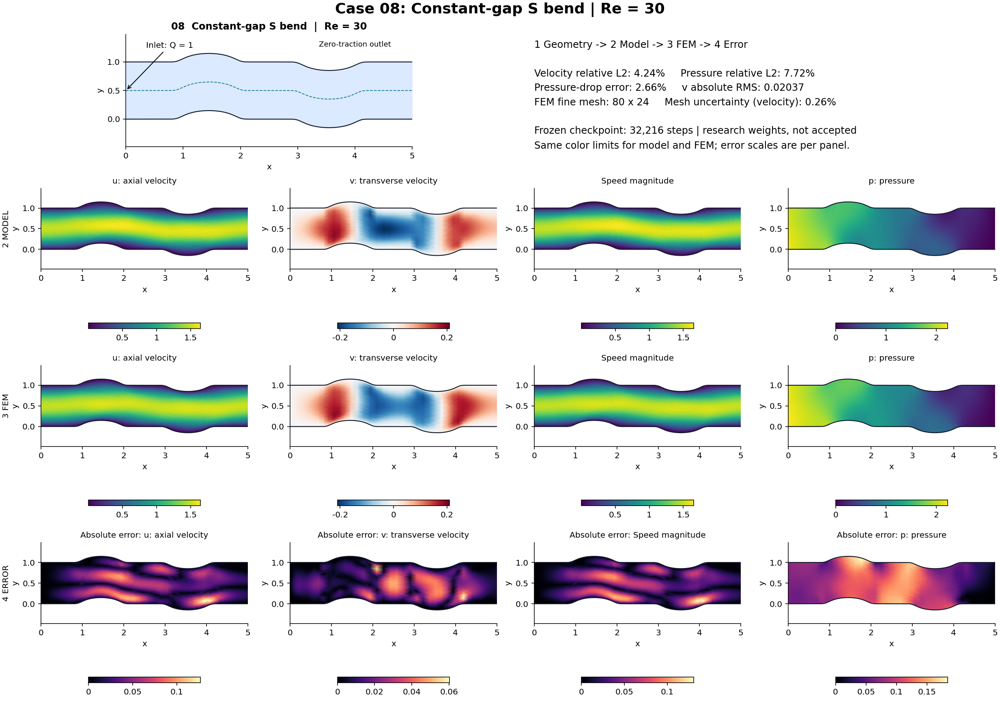

<a id="09_double_constriction"></a>
## 09. Two symmetric constrictions

[1 Geometry](09_double_constriction/01_geometry.png) → [2 Model](09_double_constriction/02_model.png) → [3 FEM](09_double_constriction/03_fem.png) → [4 Error](09_double_constriction/04_error.png) · [Metrics](09_double_constriction/metrics.json) · [Fields](09_double_constriction/fields.npz) · [FEM reference](09_double_constriction/reference.npz)

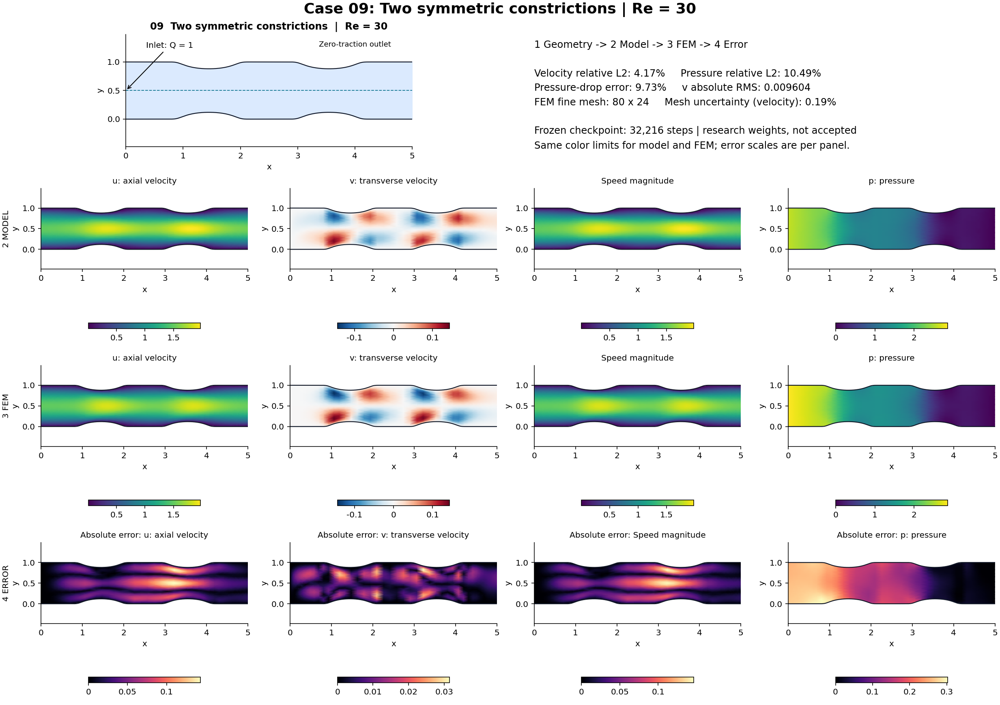

<a id="10_constriction_expansion"></a>
## 10. Constriction followed by expansion

[1 Geometry](10_constriction_expansion/01_geometry.png) → [2 Model](10_constriction_expansion/02_model.png) → [3 FEM](10_constriction_expansion/03_fem.png) → [4 Error](10_constriction_expansion/04_error.png) · [Metrics](10_constriction_expansion/metrics.json) · [Fields](10_constriction_expansion/fields.npz) · [FEM reference](10_constriction_expansion/reference.npz)

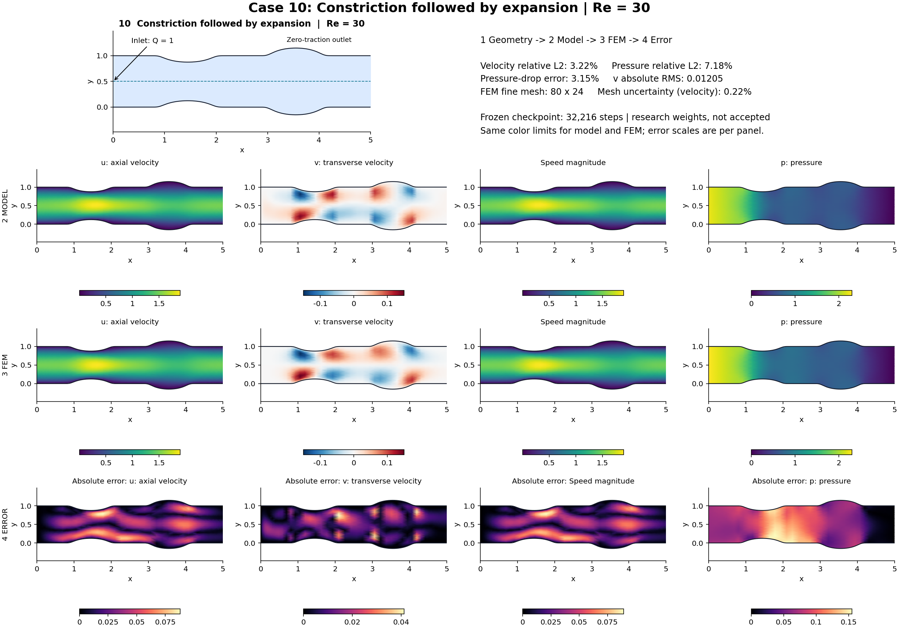

<a id="11_staggered_walls"></a>
## 11. Staggered independent wall bumps

[1 Geometry](11_staggered_walls/01_geometry.png) → [2 Model](11_staggered_walls/02_model.png) → [3 FEM](11_staggered_walls/03_fem.png) → [4 Error](11_staggered_walls/04_error.png) · [Metrics](11_staggered_walls/metrics.json) · [Fields](11_staggered_walls/fields.npz) · [FEM reference](11_staggered_walls/reference.npz)

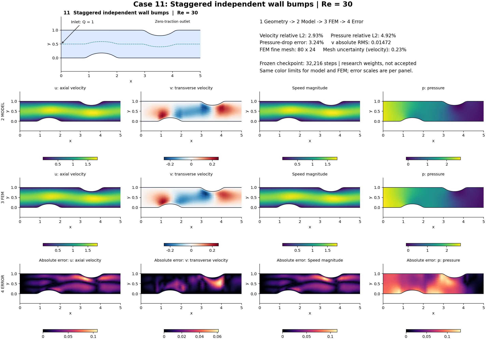

<a id="12_triple_constriction"></a>
## 12. Three symmetric constrictions

[1 Geometry](12_triple_constriction/01_geometry.png) → [2 Model](12_triple_constriction/02_model.png) → [3 FEM](12_triple_constriction/03_fem.png) → [4 Error](12_triple_constriction/04_error.png) · [Metrics](12_triple_constriction/metrics.json) · [Fields](12_triple_constriction/fields.npz) · [FEM reference](12_triple_constriction/reference.npz)

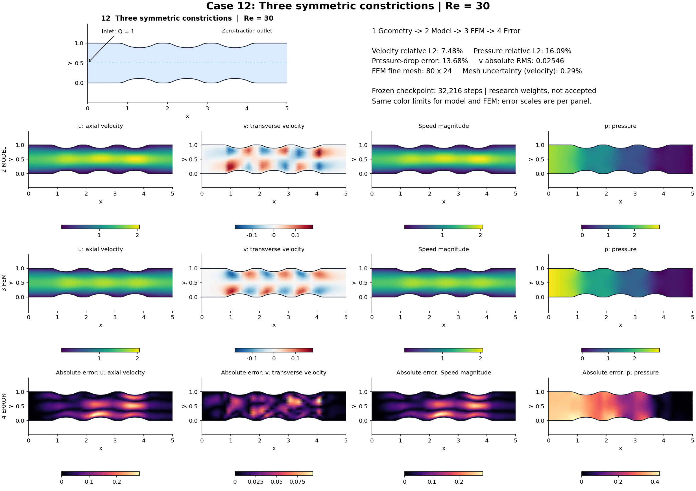

<a id="13_oscillating_gap"></a>
## 13. Four alternating gap features

[1 Geometry](13_oscillating_gap/01_geometry.png) → [2 Model](13_oscillating_gap/02_model.png) → [3 FEM](13_oscillating_gap/03_fem.png) → [4 Error](13_oscillating_gap/04_error.png) · [Metrics](13_oscillating_gap/metrics.json) · [Fields](13_oscillating_gap/fields.npz) · [FEM reference](13_oscillating_gap/reference.npz)

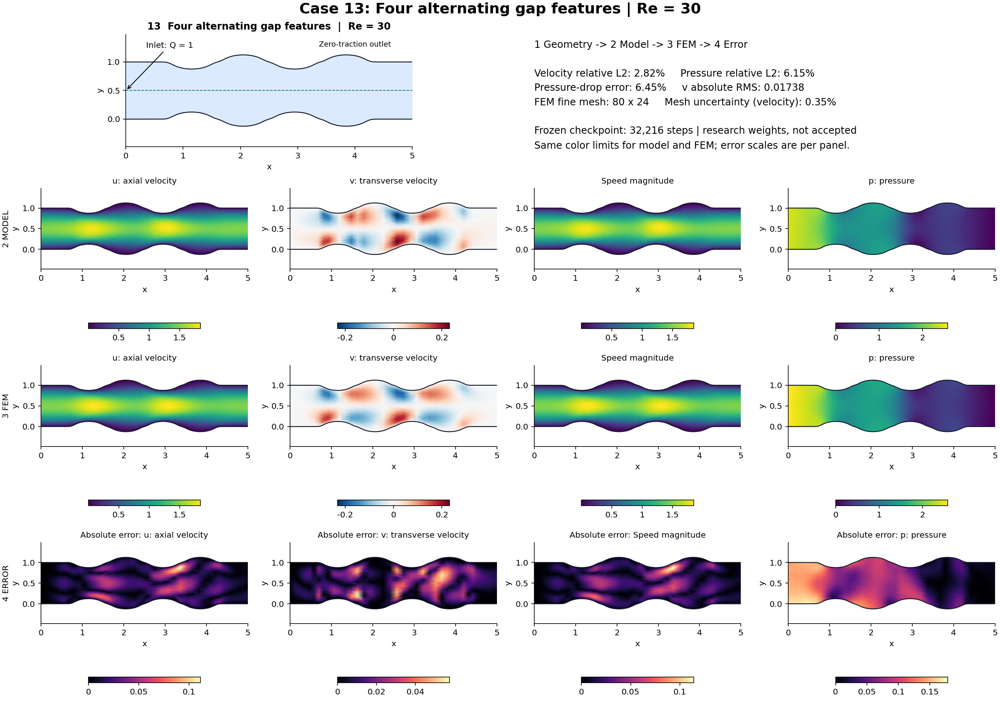

<a id="14_oscillating_walls"></a>
## 14. Oscillating centerline and gap

[1 Geometry](14_oscillating_walls/01_geometry.png) → [2 Model](14_oscillating_walls/02_model.png) → [3 FEM](14_oscillating_walls/03_fem.png) → [4 Error](14_oscillating_walls/04_error.png) · [Metrics](14_oscillating_walls/metrics.json) · [Fields](14_oscillating_walls/fields.npz) · [FEM reference](14_oscillating_walls/reference.npz)

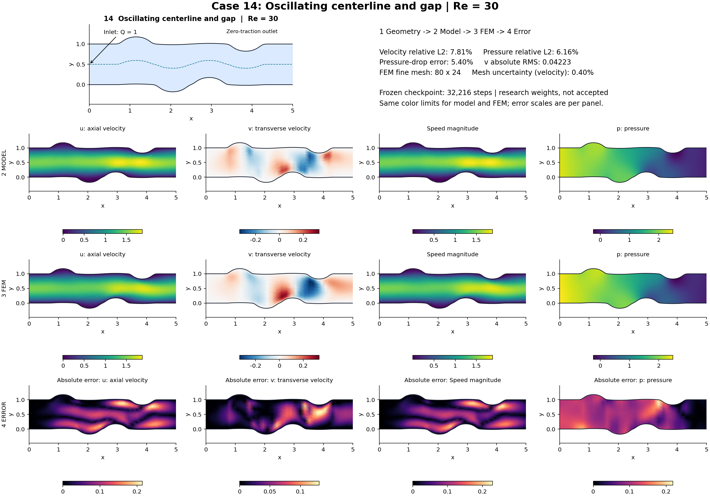

<a id="15_mixed_independent"></a>
## 15. Mixed independent multiscale walls

[1 Geometry](15_mixed_independent/01_geometry.png) → [2 Model](15_mixed_independent/02_model.png) → [3 FEM](15_mixed_independent/03_fem.png) → [4 Error](15_mixed_independent/04_error.png) · [Metrics](15_mixed_independent/metrics.json) · [Fields](15_mixed_independent/fields.npz) · [FEM reference](15_mixed_independent/reference.npz)

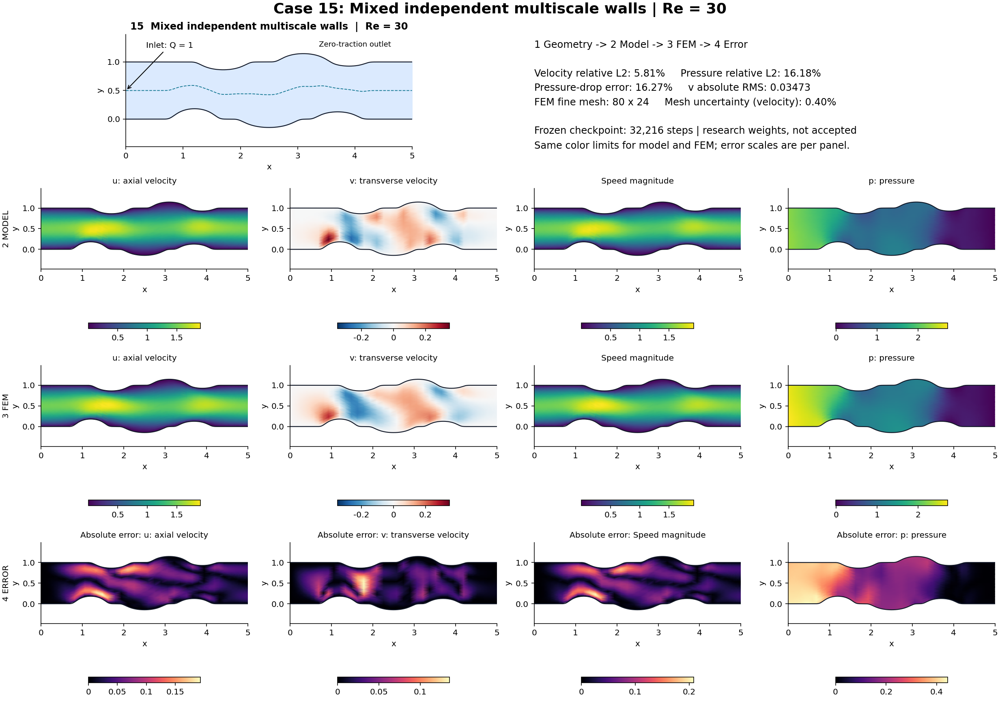
