# 15 cases refreshed with checkpoint 82,216

[All case chains PDF](all_chains.pdf) · [Old/new comparison CSV](comparison.csv) · [Absolute MAE and relative L1 CSV](mean_errors.csv) · [Full numerical metrics](summary.json)

**Only model inference was rerun**, using the exact saved geometry and FEM quadrature points. Reference NPZ files, FEM fields, weights and geometry arrays were verified unchanged. The original results remain in `reports/channel_chain_15`. All cases use Re=30. New weights: step 82,216; old weights: step 32,216. Research weights remain unaccepted.

These are the original prescribed examples inside the declared geometry envelope, not the locked final benchmark.

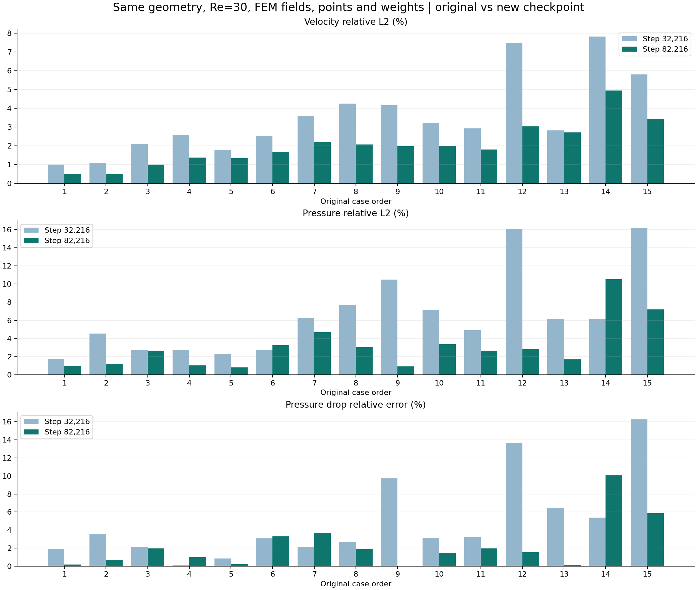

| Case | Velocity L2 old → new | Pressure L2 old → new | Drop error old → new |
| --- | ---: | ---: | ---: |
| 01 Straight channel | 1.00% → 0.49% | 1.77% → 0.99% | 1.92% → 0.17% |
| 02 Mild symmetric constriction | 1.09% → 0.51% | 4.53% → 1.22% | 3.51% → 0.71% |
| 03 Moderate symmetric constriction | 2.12% → 1.00% | 2.69% → 2.66% | 2.14% → 1.97% |
| 04 Symmetric expansion | 2.59% → 1.37% | 2.73% → 1.02% | 0.15% → 0.99% |
| 05 One bump on bottom wall | 1.79% → 1.33% | 2.31% → 0.79% | 0.84% → 0.23% |
| 06 One bump on top wall | 2.54% → 1.69% | 2.72% → 3.25% | 3.08% → 3.29% |
| 07 Constant-gap centerline bend | 3.58% → 2.22% | 6.27% → 4.70% | 2.17% → 3.73% |
| 08 Constant-gap S bend | 4.24% → 2.08% | 7.72% → 3.04% | 2.66% → 1.91% |
| 09 Two symmetric constrictions | 4.17% → 1.98% | 10.49% → 0.91% | 9.73% → 0.04% |
| 10 Constriction followed by expansion | 3.22% → 2.00% | 7.18% → 3.37% | 3.15% → 1.47% |
| 11 Staggered independent wall bumps | 2.93% → 1.80% | 4.92% → 2.65% | 3.24% → 1.96% |
| 12 Three symmetric constrictions | 7.48% → 3.04% | 16.09% → 2.80% | 13.68% → 1.56% |
| 13 Four alternating gap features | 2.82% → 2.71% | 6.15% → 1.70% | 6.45% → 0.16% |
| 14 Oscillating centerline and gap | 7.81% → 4.95% | 6.16% → 10.53% | 5.40% → 10.08% |
| 15 Mixed independent multiscale walls | 5.81% → 3.45% | 16.18% → 7.21% | 16.27% → 5.86% |

Relative L2 uses physical-area quadrature weights and the FEM field norm as denominator. Velocity uses the vector norm. MAE is the area-weighted mean absolute scalar error or Euclidean vector error. Relative L1 divides integrated error magnitude by integrated reference magnitude (1e-16 floor). It is not pointwise percentage error. CSV L1 values are percentages; absolute MAE is in nondimensional field units. For nearly zero reference v, use absolute MAE/RMS rather than interpreting an ill-conditioned relative v ratio; the floor flag and reference mean magnitude are in JSON. Pressure is not shifted to fit FEM. Colors match model and FEM per field/case; absolute-error scales are per panel. Original common-domain exclusions and FEM uncertainty are retained.

## 01. Straight channel

[Geometry](01_straight/01_geometry.png) → [New model](01_straight/02_model.png) → [Saved FEM](01_straight/03_fem.png) → [New errors](01_straight/04_error.png) · [Fields](01_straight/fields.npz) · [Metrics](01_straight/metrics.json)

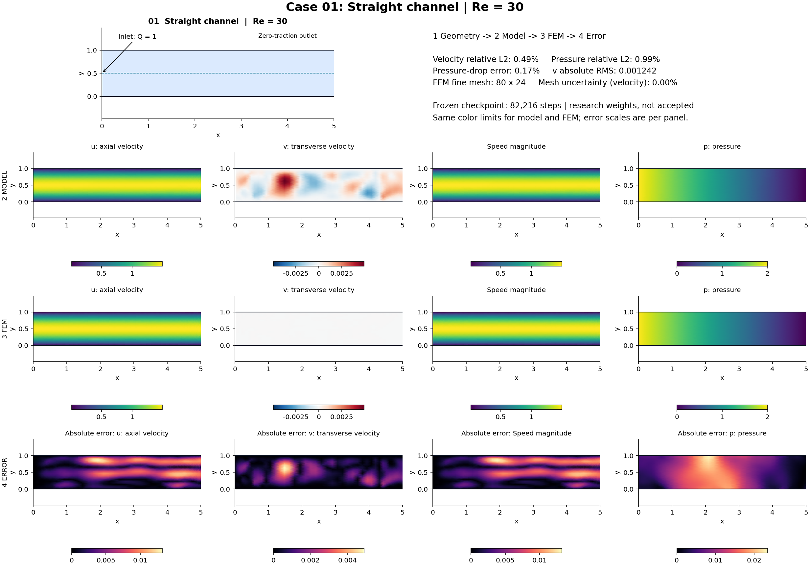

## 02. Mild symmetric constriction

[Geometry](02_mild_constriction/01_geometry.png) → [New model](02_mild_constriction/02_model.png) → [Saved FEM](02_mild_constriction/03_fem.png) → [New errors](02_mild_constriction/04_error.png) · [Fields](02_mild_constriction/fields.npz) · [Metrics](02_mild_constriction/metrics.json)

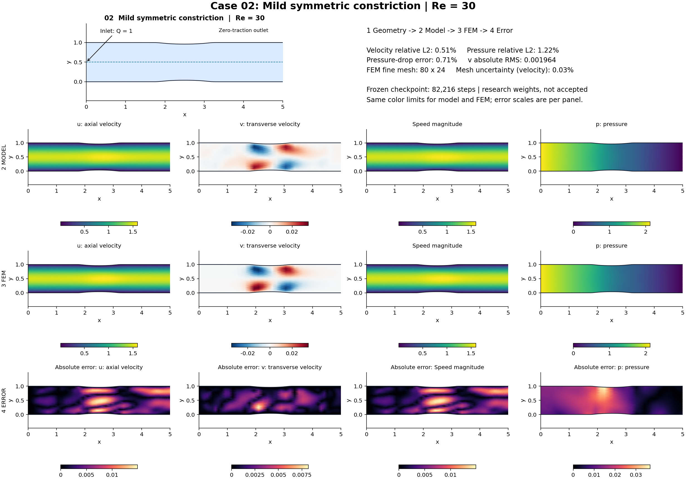

## 03. Moderate symmetric constriction

[Geometry](03_moderate_constriction/01_geometry.png) → [New model](03_moderate_constriction/02_model.png) → [Saved FEM](03_moderate_constriction/03_fem.png) → [New errors](03_moderate_constriction/04_error.png) · [Fields](03_moderate_constriction/fields.npz) · [Metrics](03_moderate_constriction/metrics.json)

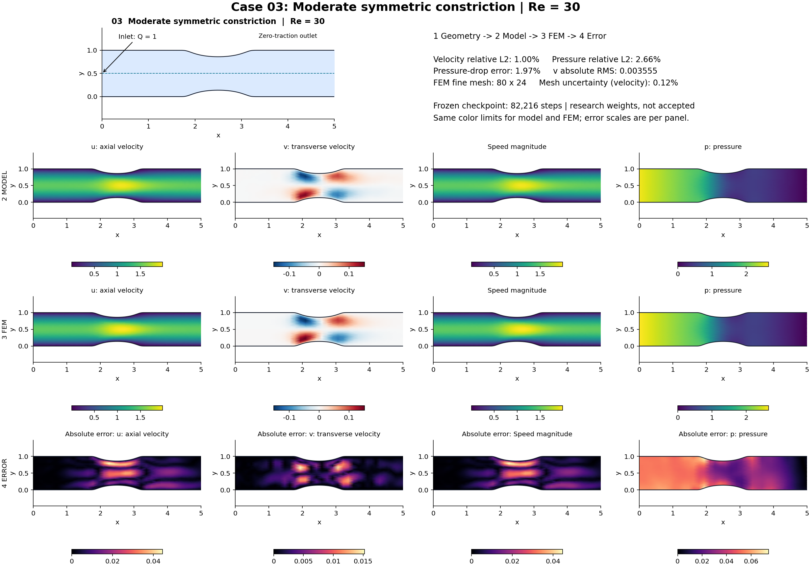

## 04. Symmetric expansion

[Geometry](04_expansion/01_geometry.png) → [New model](04_expansion/02_model.png) → [Saved FEM](04_expansion/03_fem.png) → [New errors](04_expansion/04_error.png) · [Fields](04_expansion/fields.npz) · [Metrics](04_expansion/metrics.json)

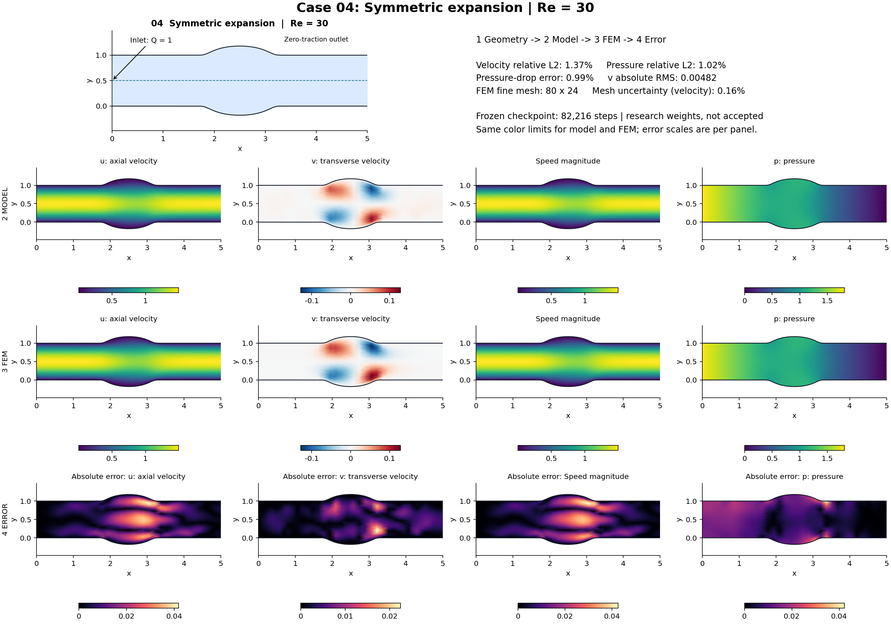

## 05. One bump on bottom wall

[Geometry](05_bottom_bump/01_geometry.png) → [New model](05_bottom_bump/02_model.png) → [Saved FEM](05_bottom_bump/03_fem.png) → [New errors](05_bottom_bump/04_error.png) · [Fields](05_bottom_bump/fields.npz) · [Metrics](05_bottom_bump/metrics.json)

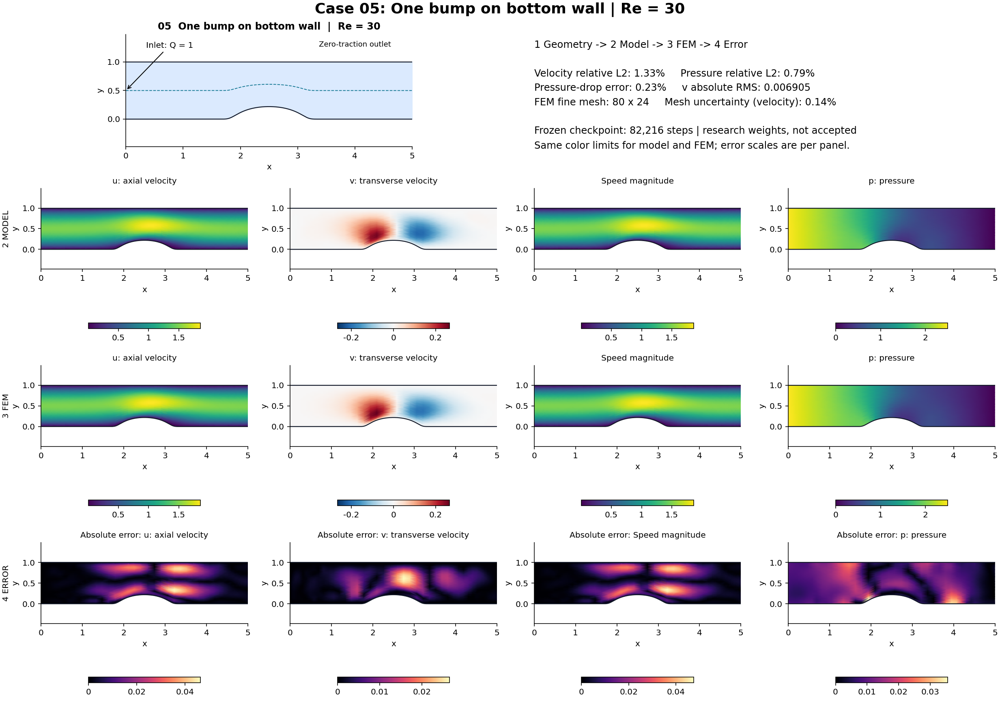

## 06. One bump on top wall

[Geometry](06_top_bump/01_geometry.png) → [New model](06_top_bump/02_model.png) → [Saved FEM](06_top_bump/03_fem.png) → [New errors](06_top_bump/04_error.png) · [Fields](06_top_bump/fields.npz) · [Metrics](06_top_bump/metrics.json)

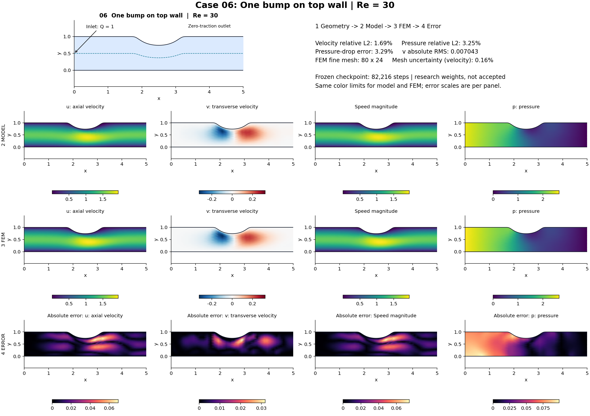

## 07. Constant-gap centerline bend

[Geometry](07_centerline_bend/01_geometry.png) → [New model](07_centerline_bend/02_model.png) → [Saved FEM](07_centerline_bend/03_fem.png) → [New errors](07_centerline_bend/04_error.png) · [Fields](07_centerline_bend/fields.npz) · [Metrics](07_centerline_bend/metrics.json)

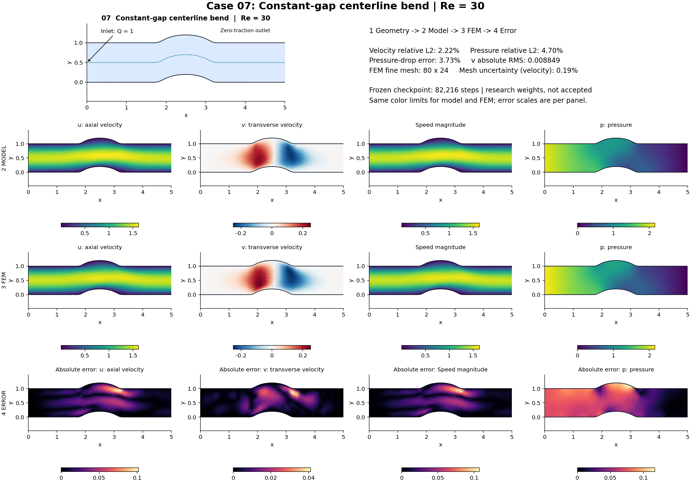

## 08. Constant-gap S bend

[Geometry](08_s_bend/01_geometry.png) → [New model](08_s_bend/02_model.png) → [Saved FEM](08_s_bend/03_fem.png) → [New errors](08_s_bend/04_error.png) · [Fields](08_s_bend/fields.npz) · [Metrics](08_s_bend/metrics.json)

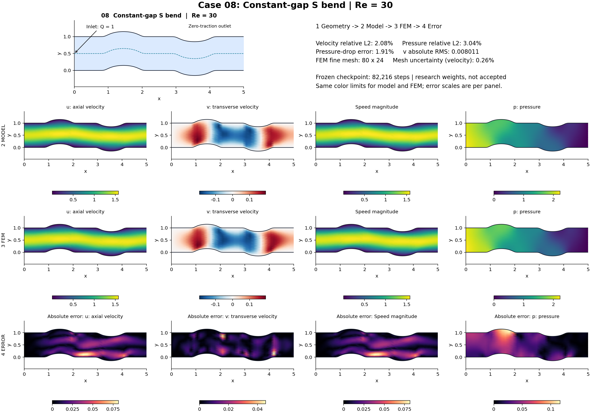

## 09. Two symmetric constrictions

[Geometry](09_double_constriction/01_geometry.png) → [New model](09_double_constriction/02_model.png) → [Saved FEM](09_double_constriction/03_fem.png) → [New errors](09_double_constriction/04_error.png) · [Fields](09_double_constriction/fields.npz) · [Metrics](09_double_constriction/metrics.json)

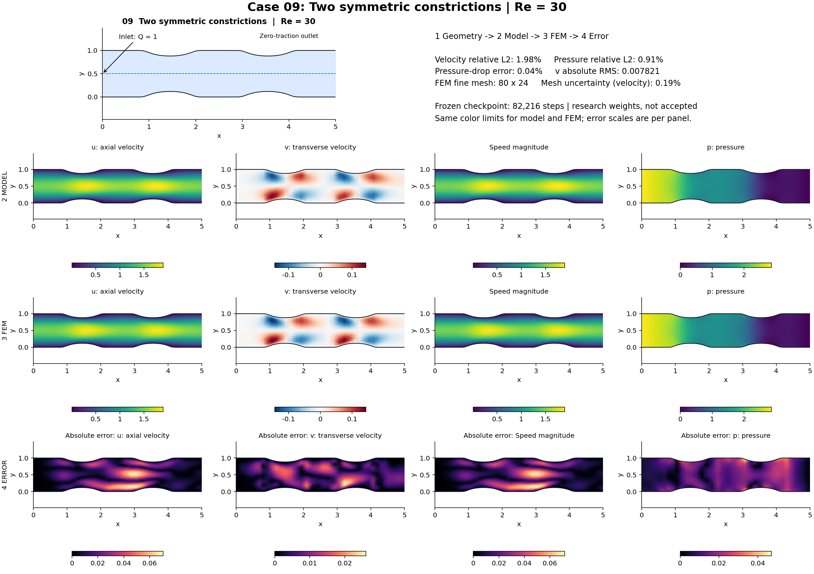

## 10. Constriction followed by expansion

[Geometry](10_constriction_expansion/01_geometry.png) → [New model](10_constriction_expansion/02_model.png) → [Saved FEM](10_constriction_expansion/03_fem.png) → [New errors](10_constriction_expansion/04_error.png) · [Fields](10_constriction_expansion/fields.npz) · [Metrics](10_constriction_expansion/metrics.json)

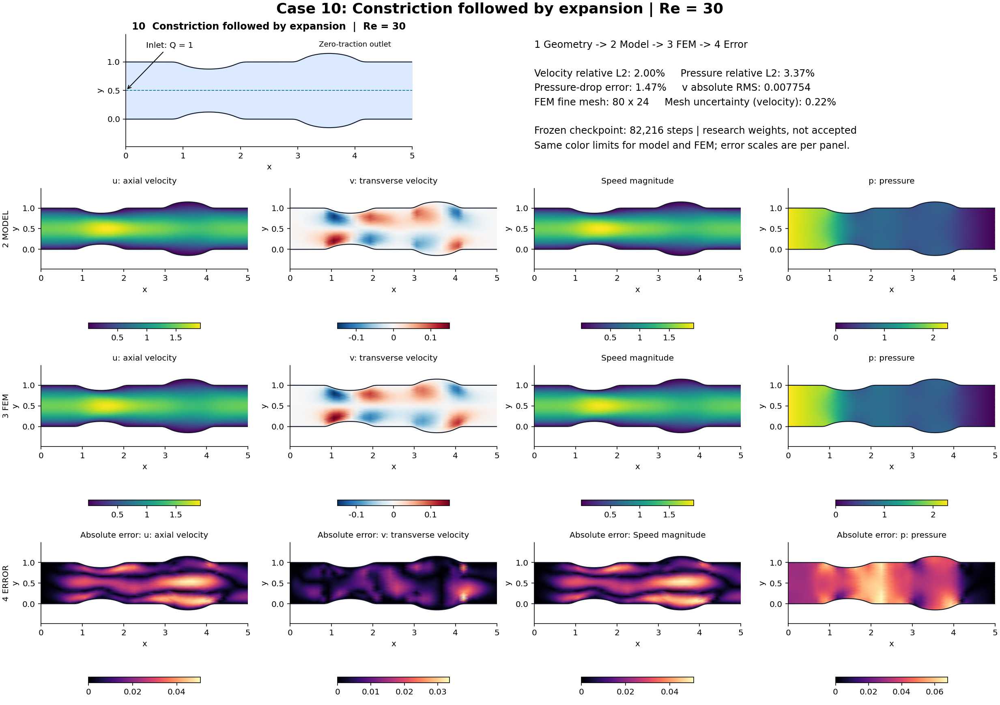

## 11. Staggered independent wall bumps

[Geometry](11_staggered_walls/01_geometry.png) → [New model](11_staggered_walls/02_model.png) → [Saved FEM](11_staggered_walls/03_fem.png) → [New errors](11_staggered_walls/04_error.png) · [Fields](11_staggered_walls/fields.npz) · [Metrics](11_staggered_walls/metrics.json)

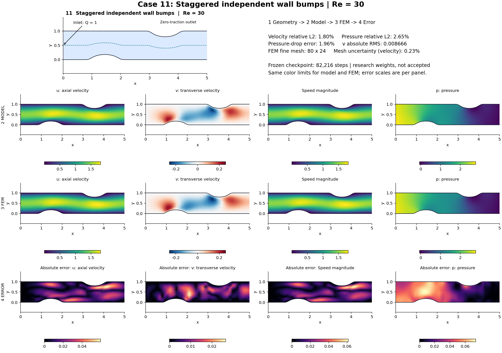

## 12. Three symmetric constrictions

[Geometry](12_triple_constriction/01_geometry.png) → [New model](12_triple_constriction/02_model.png) → [Saved FEM](12_triple_constriction/03_fem.png) → [New errors](12_triple_constriction/04_error.png) · [Fields](12_triple_constriction/fields.npz) · [Metrics](12_triple_constriction/metrics.json)

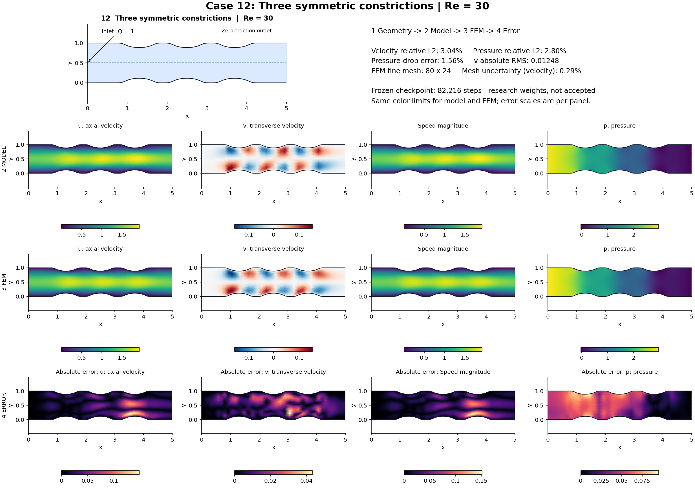

## 13. Four alternating gap features

[Geometry](13_oscillating_gap/01_geometry.png) → [New model](13_oscillating_gap/02_model.png) → [Saved FEM](13_oscillating_gap/03_fem.png) → [New errors](13_oscillating_gap/04_error.png) · [Fields](13_oscillating_gap/fields.npz) · [Metrics](13_oscillating_gap/metrics.json)

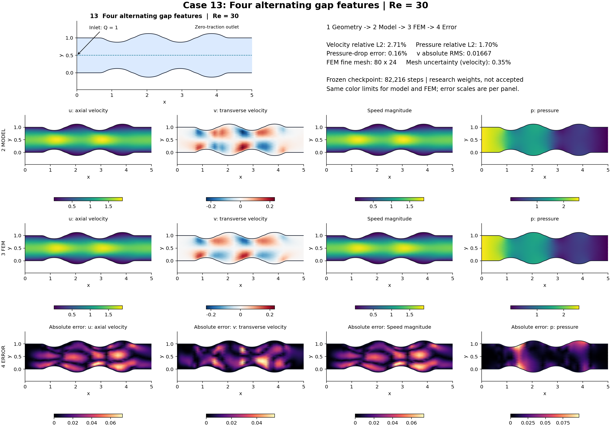

## 14. Oscillating centerline and gap

[Geometry](14_oscillating_walls/01_geometry.png) → [New model](14_oscillating_walls/02_model.png) → [Saved FEM](14_oscillating_walls/03_fem.png) → [New errors](14_oscillating_walls/04_error.png) · [Fields](14_oscillating_walls/fields.npz) · [Metrics](14_oscillating_walls/metrics.json)

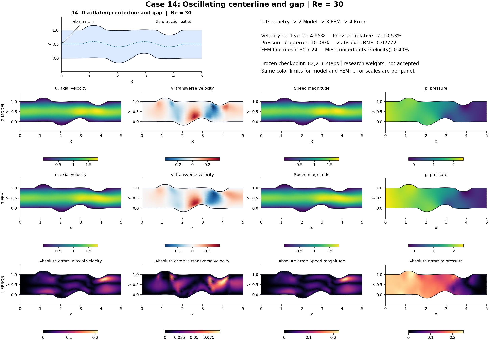

## 15. Mixed independent multiscale walls

[Geometry](15_mixed_independent/01_geometry.png) → [New model](15_mixed_independent/02_model.png) → [Saved FEM](15_mixed_independent/03_fem.png) → [New errors](15_mixed_independent/04_error.png) · [Fields](15_mixed_independent/fields.npz) · [Metrics](15_mixed_independent/metrics.json)

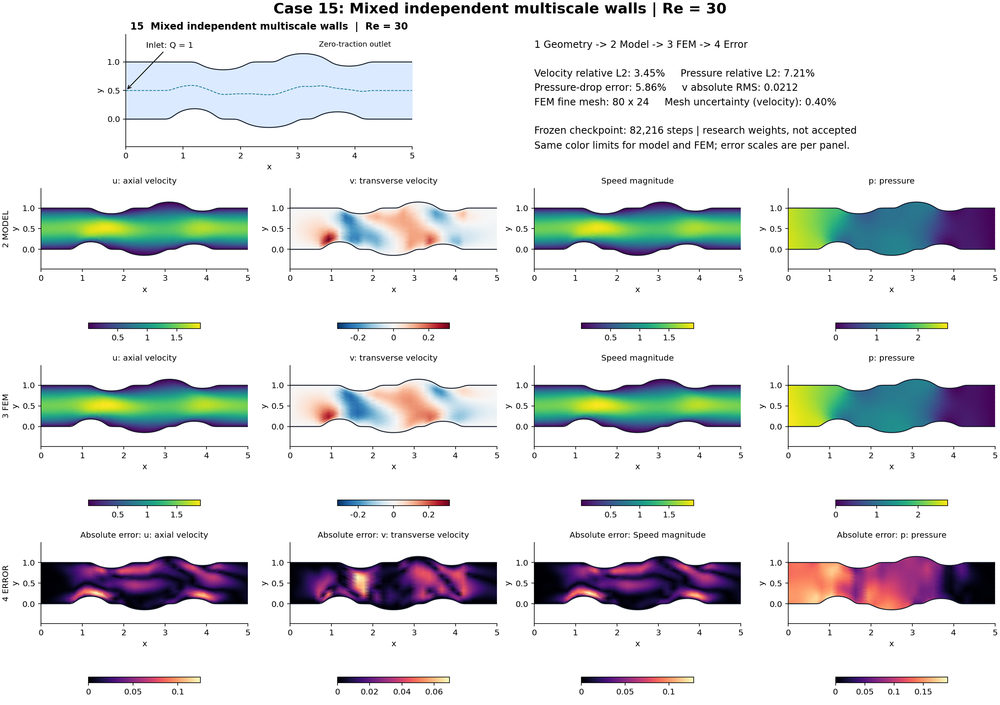
