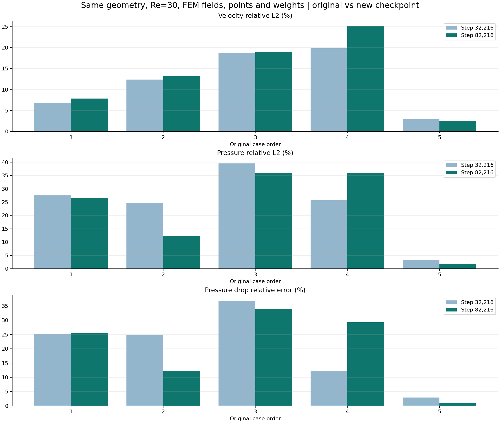
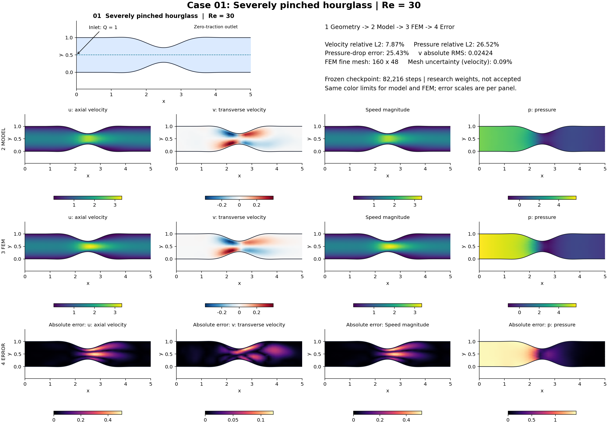
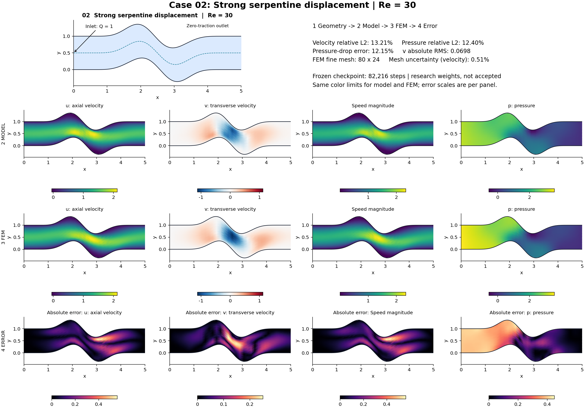
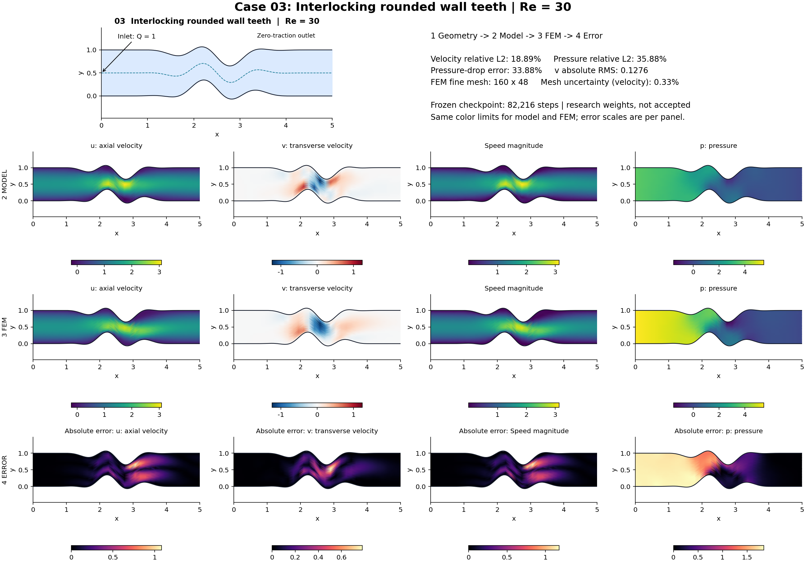
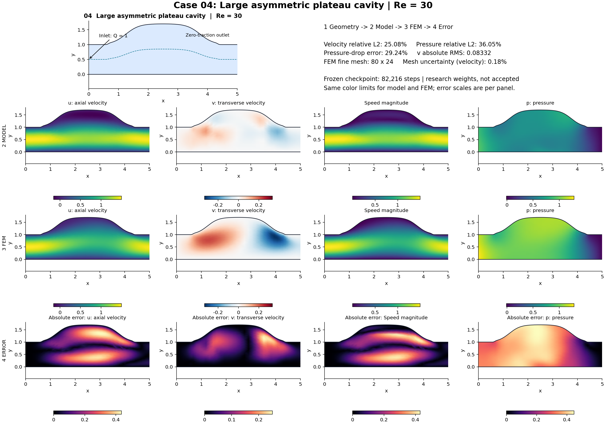
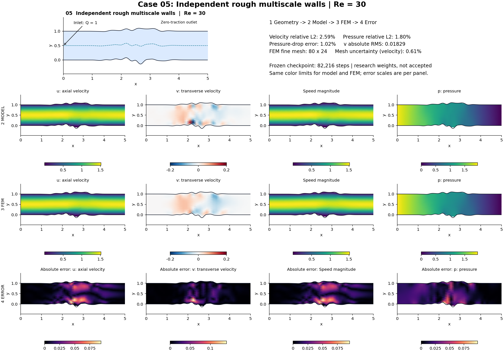

# 5 cases refreshed with checkpoint 82,216

[All case chains PDF](all_chains.pdf) · [Old/new comparison CSV](comparison.csv) · [Absolute MAE and relative L1 CSV](mean_errors.csv) · [Full numerical metrics](summary.json)

**Only model inference was rerun**, using the exact saved geometry and FEM quadrature points. Reference NPZ files, FEM fields, weights and geometry arrays were verified unchanged. The original results remain in `reports/extreme_channel_chain_5`. All cases use Re=30. New weights: step 82,216; old weights: step 32,216. Research weights remain unaccepted.

**All five cases in this group are stress/extrapolation queries outside at least one training-geometry bound. They are not evidence of accuracy inside the training envelope.**

| Case | Velocity L2 old → new | Pressure L2 old → new | Drop error old → new |
| --- | ---: | ---: | ---: |
| 01 Severely pinched hourglass | 6.86% → 7.87% | 27.54% → 26.52% | 25.16% → 25.43% |
| 02 Strong serpentine displacement | 12.36% → 13.21% | 24.72% → 12.40% | 24.82% → 12.15% |
| 03 Interlocking rounded wall teeth | 18.72% → 18.89% | 39.51% → 35.88% | 36.84% → 33.88% |
| 04 Large asymmetric plateau cavity | 19.85% → 25.08% | 25.70% → 36.05% | 12.15% → 29.24% |
| 05 Independent rough multiscale walls | 2.91% → 2.59% | 3.28% → 1.80% | 2.96% → 1.02% |

Relative L2 uses physical-area quadrature weights and the FEM field norm as denominator. Velocity uses the vector norm. MAE is the area-weighted mean absolute scalar error or Euclidean vector error. Relative L1 divides integrated error magnitude by integrated reference magnitude (1e-16 floor). It is not pointwise percentage error. CSV L1 values are percentages; absolute MAE is in nondimensional field units. For nearly zero reference v, use absolute MAE/RMS rather than interpreting an ill-conditioned relative v ratio; the floor flag and reference mean magnitude are in JSON. Pressure is not shifted to fit FEM. Colors match model and FEM per field/case; absolute-error scales are per panel. Original common-domain exclusions and FEM uncertainty are retained.

## 01. Severely pinched hourglass

[Geometry](01_hourglass/01_geometry.png) → [New model](01_hourglass/02_model.png) → [Saved FEM](01_hourglass/03_fem.png) → [New errors](01_hourglass/04_error.png) · [Fields](01_hourglass/fields.npz) · [Metrics](01_hourglass/metrics.json)

## 02. Strong serpentine displacement

[Geometry](02_serpentine/01_geometry.png) → [New model](02_serpentine/02_model.png) → [Saved FEM](02_serpentine/03_fem.png) → [New errors](02_serpentine/04_error.png) · [Fields](02_serpentine/fields.npz) · [Metrics](02_serpentine/metrics.json)

## 03. Interlocking rounded wall teeth

[Geometry](03_interlocking/01_geometry.png) → [New model](03_interlocking/02_model.png) → [Saved FEM](03_interlocking/03_fem.png) → [New errors](03_interlocking/04_error.png) · [Fields](03_interlocking/fields.npz) · [Metrics](03_interlocking/metrics.json)

## 04. Large asymmetric plateau cavity

[Geometry](04_wide_cavity/01_geometry.png) → [New model](04_wide_cavity/02_model.png) → [Saved FEM](04_wide_cavity/03_fem.png) → [New errors](04_wide_cavity/04_error.png) · [Fields](04_wide_cavity/fields.npz) · [Metrics](04_wide_cavity/metrics.json)

## 05. Independent rough multiscale walls

[Geometry](05_rough_multiscale/01_geometry.png) → [New model](05_rough_multiscale/02_model.png) → [Saved FEM](05_rough_multiscale/03_fem.png) → [New errors](05_rough_multiscale/04_error.png) · [Fields](05_rough_multiscale/fields.npz) · [Metrics](05_rough_multiscale/metrics.json)

