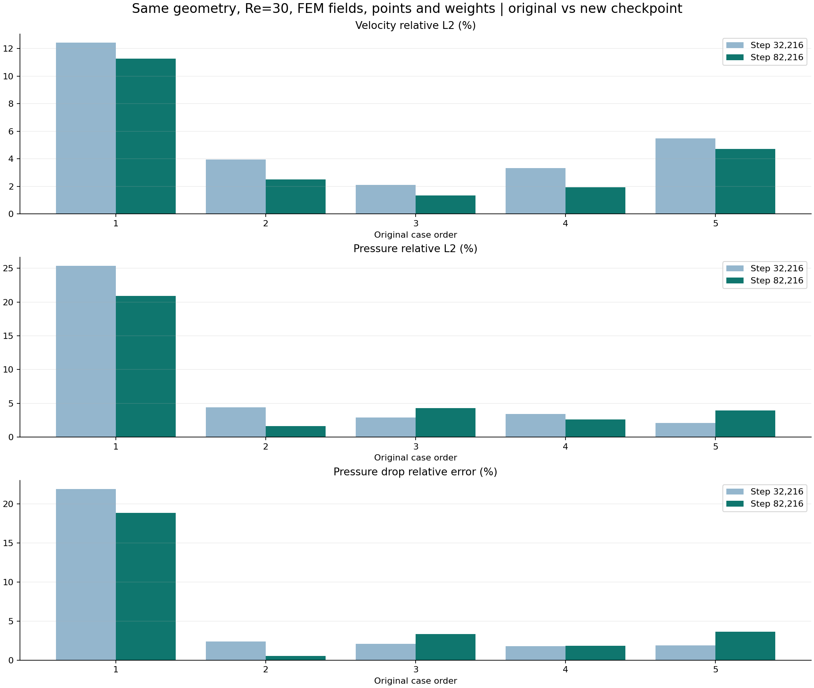
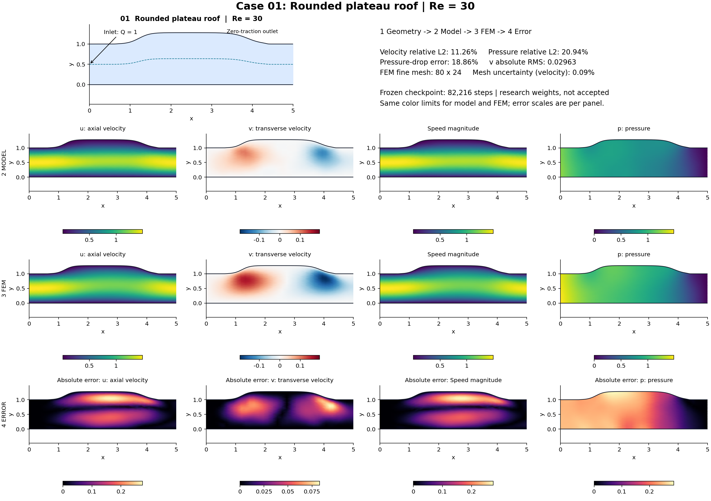
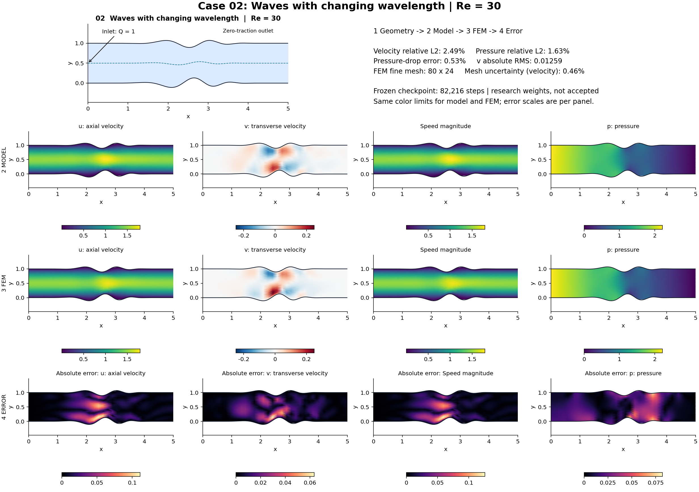
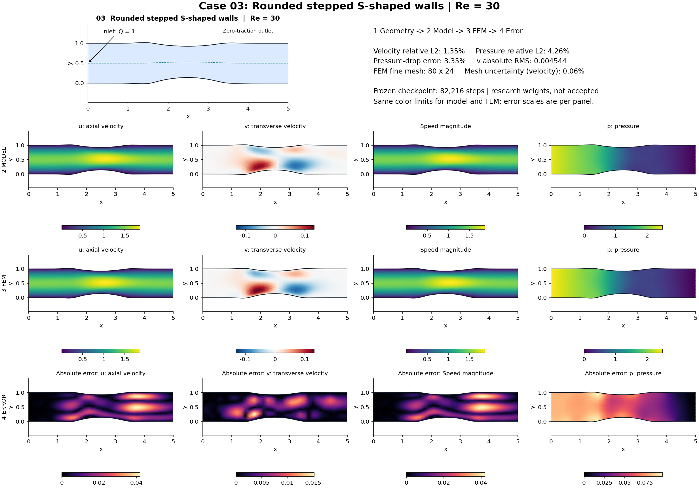
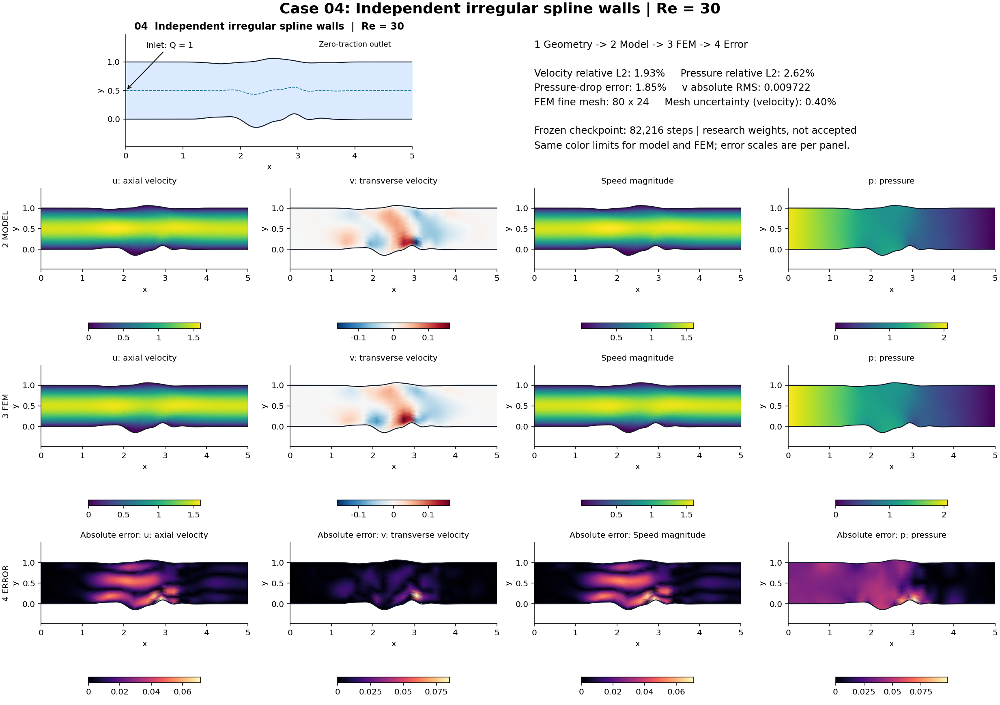
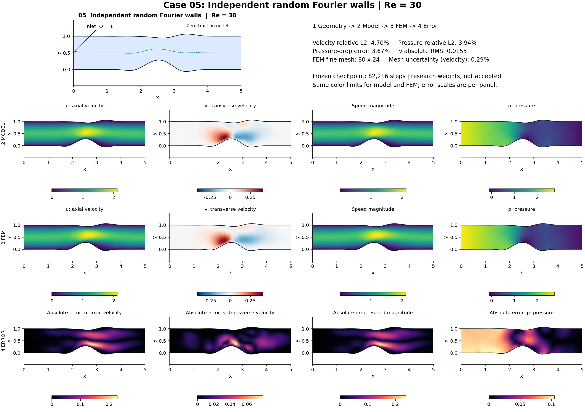

# 5 cases refreshed with checkpoint 82,216

[All case chains PDF](all_chains.pdf) · [Old/new comparison CSV](comparison.csv) · [Absolute MAE and relative L1 CSV](mean_errors.csv) · [Full numerical metrics](summary.json)

**Only model inference was rerun**, using the exact saved geometry and FEM quadrature points. Reference NPZ files, FEM fields, weights and geometry arrays were verified unchanged. The original results remain in `reports/random_channel_chain_5`. All cases use Re=30. New weights: step 82,216; old weights: step 32,216. Research weights remain unaccepted.

These are the original prescribed examples inside the declared geometry envelope, not the locked final benchmark.

| Case | Velocity L2 old → new | Pressure L2 old → new | Drop error old → new |
| --- | ---: | ---: | ---: |
| 01 Rounded plateau roof | 12.43% → 11.26% | 25.36% → 20.94% | 21.93% → 18.86% |
| 02 Waves with changing wavelength | 3.94% → 2.49% | 4.42% → 1.63% | 2.41% → 0.53% |
| 03 Rounded stepped S-shaped walls | 2.10% → 1.35% | 2.90% → 4.26% | 2.12% → 3.35% |
| 04 Independent irregular spline walls | 3.32% → 1.93% | 3.40% → 2.62% | 1.78% → 1.85% |
| 05 Independent random Fourier walls | 5.49% → 4.70% | 2.06% → 3.94% | 1.89% → 3.67% |

Relative L2 uses physical-area quadrature weights and the FEM field norm as denominator. Velocity uses the vector norm. MAE is the area-weighted mean absolute scalar error or Euclidean vector error. Relative L1 divides integrated error magnitude by integrated reference magnitude (1e-16 floor). It is not pointwise percentage error. CSV L1 values are percentages; absolute MAE is in nondimensional field units. For nearly zero reference v, use absolute MAE/RMS rather than interpreting an ill-conditioned relative v ratio; the floor flag and reference mean magnitude are in JSON. Pressure is not shifted to fit FEM. Colors match model and FEM per field/case; absolute-error scales are per panel. Original common-domain exclusions and FEM uncertainty are retained.

## 01. Rounded plateau roof

[Geometry](01_roof_plateau/01_geometry.png) → [New model](01_roof_plateau/02_model.png) → [Saved FEM](01_roof_plateau/03_fem.png) → [New errors](01_roof_plateau/04_error.png) · [Fields](01_roof_plateau/fields.npz) · [Metrics](01_roof_plateau/metrics.json)

## 02. Waves with changing wavelength

[Geometry](02_chirped_wave/01_geometry.png) → [New model](02_chirped_wave/02_model.png) → [Saved FEM](02_chirped_wave/03_fem.png) → [New errors](02_chirped_wave/04_error.png) · [Fields](02_chirped_wave/fields.npz) · [Metrics](02_chirped_wave/metrics.json)

## 03. Rounded stepped S-shaped walls

[Geometry](03_stepped_s_bend/01_geometry.png) → [New model](03_stepped_s_bend/02_model.png) → [Saved FEM](03_stepped_s_bend/03_fem.png) → [New errors](03_stepped_s_bend/04_error.png) · [Fields](03_stepped_s_bend/fields.npz) · [Metrics](03_stepped_s_bend/metrics.json)

## 04. Independent irregular spline walls

[Geometry](04_random_spline/01_geometry.png) → [New model](04_random_spline/02_model.png) → [Saved FEM](04_random_spline/03_fem.png) → [New errors](04_random_spline/04_error.png) · [Fields](04_random_spline/fields.npz) · [Metrics](04_random_spline/metrics.json)

## 05. Independent random Fourier walls

[Geometry](05_random_fourier/01_geometry.png) → [New model](05_random_fourier/02_model.png) → [Saved FEM](05_random_fourier/03_fem.png) → [New errors](05_random_fourier/04_error.png) · [Fields](05_random_fourier/fields.npz) · [Metrics](05_random_fourier/metrics.json)

