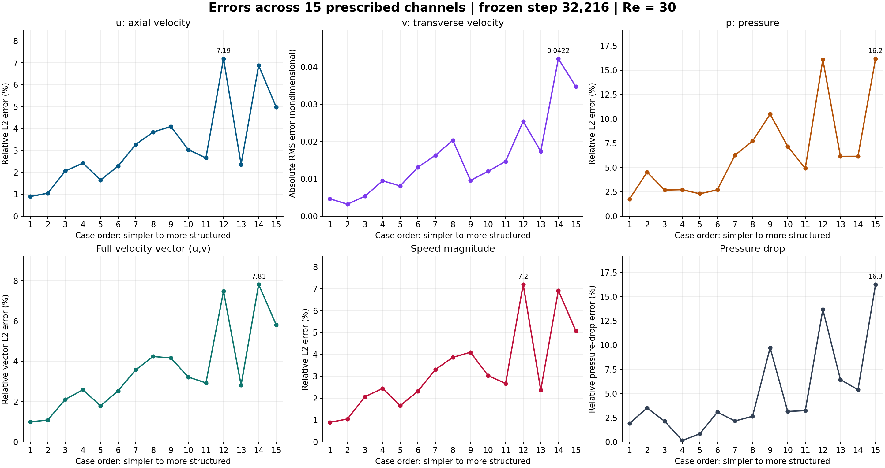
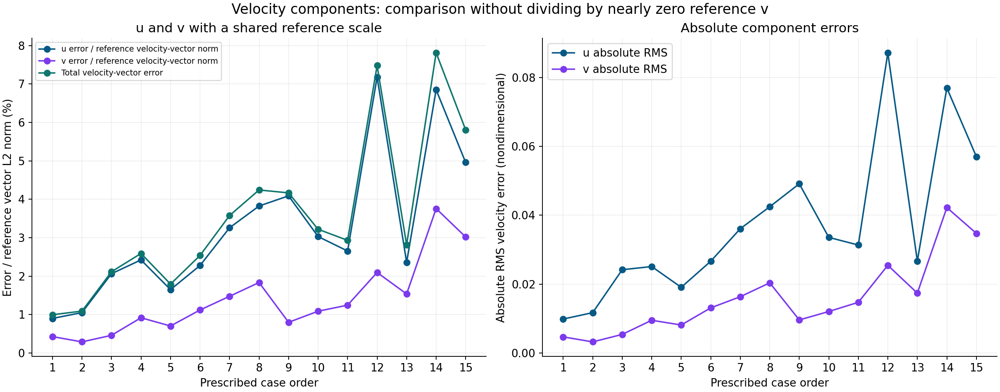

# Error versus prescribed channel complexity order

[Six-panel PDF](error_dashboard.pdf) · [Numerical CSV](errors_by_case.csv) · [Data, source hashes and validation](data.json) · [Original geometry gallery](../channel_chain_15/README.md)

The x-axis preserves the original 01–15 simple-to-structurally-complex design order. It is a **qualitative ordering**, not a calibrated or strictly increasing geometric-complexity score. Markers are actual cases; connecting lines only guide the eye. No fit or smoothing is applied, and cases were not reordered by error. The curves do not establish that complexity alone causes error or that error must rise monotonically. Geometry type and deformation magnitude also vary.

All data come from the already saved FEM/model fields and metrics at **Re=30**, using the **original step-32,216 checkpoint**. No training, prediction or FEM solve was rerun; these are not results from the ongoing continuation. All plotted u/v/p and vector metrics were independently recomputed from saved fields and checked against the original reports. Original 15-case outputs remain unchanged.

## Individual u, v and p curves

[u axial velocity](u_error.png) ([PDF](u_error.pdf)) · [v transverse velocity](v_error.png) ([PDF](v_error.pdf)) · [p pressure](p_error.png) ([PDF](p_error.pdf))

u, p, full velocity and speed use physical-area-weighted **relative L2**. For a field f this is sqrt(sum(w |model−FEM|²) / max(sum(w |FEM|²), 1e−16)); velocity uses the two-component vector norm. Pressure drop uses the original section-average drop comparison with its 1e−8 denominator floor.

**v is plotted as absolute RMS**, sqrt(sum(w (v_model−v_FEM)²)/sum(w)), because reference v vanishes in the straight-channel case and a relative v error would be ill-conditioned. v RMS is not a percentage and cannot be compared numerically to the percent axes in the other panels.

## Direct comparison of velocity components

For a common percent scale, the left panel divides both component error norms by the **full FEM velocity-vector norm**, not by each component norm. Thus u_contribution² + v_contribution² = total_vector_error². The right panel compares absolute u/v RMS in the same velocity units. These common-scale quantities are named explicitly in the CSV and differ from relative u or relative v error. All quantities are nondimensional and use the original common physical quadrature domain.

| Case | Geometry | u relative L2 | v absolute RMS | p relative L2 | Vector relative L2 |
| --- | --- | ---: | ---: | ---: | ---: |
| 01 | Straight channel | 0.90% | 0.00468 | 1.77% | 1.00% |
| 02 | Mild symmetric constriction | 1.05% | 0.00323 | 4.53% | 1.09% |
| 03 | Moderate symmetric constriction | 2.07% | 0.00540 | 2.69% | 2.12% |
| 04 | Symmetric expansion | 2.42% | 0.00951 | 2.73% | 2.59% |
| 05 | One bump on bottom wall | 1.65% | 0.00813 | 2.31% | 1.79% |
| 06 | One bump on top wall | 2.28% | 0.01310 | 2.72% | 2.54% |
| 07 | Constant-gap centerline bend | 3.27% | 0.01634 | 6.27% | 3.58% |
| 08 | Constant-gap S bend | 3.84% | 0.02037 | 7.72% | 4.24% |
| 09 | Two symmetric constrictions | 4.09% | 0.00960 | 10.49% | 4.17% |
| 10 | Constriction followed by expansion | 3.03% | 0.01205 | 7.18% | 3.22% |
| 11 | Staggered independent wall bumps | 2.66% | 0.01472 | 4.92% | 2.93% |
| 12 | Three symmetric constrictions | 7.19% | 0.02546 | 16.09% | 7.48% |
| 13 | Four alternating gap features | 2.36% | 0.01738 | 6.15% | 2.82% |
| 14 | Oscillating centerline and gap | 6.88% | 0.04223 | 6.16% | 7.81% |
| 15 | Mixed independent multiscale walls | 4.98% | 0.03473 | 16.18% | 5.81% |

Reproduce: `MPLBACKEND=Agg MPLCONFIGDIR=/workspace/.cache/matplotlib XDG_CACHE_HOME=/workspace/.cache .venv/bin/python -m scripts.plot_complexity_errors`.
