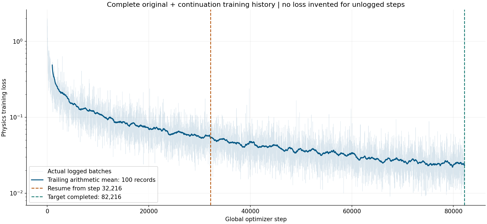
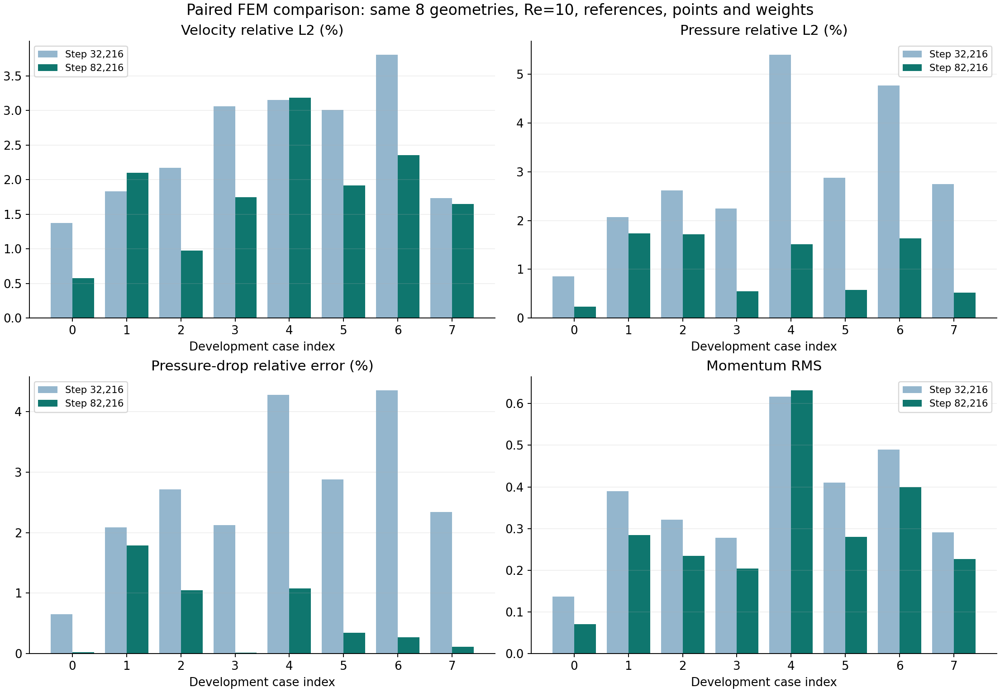

# Completed 50,000-update continuation

**Verified final checkpoint: 82,216; stop_reason=target_completed. Exactly 50,000 updates after step 32,216.** Training duration was 26,840.254 seconds (7 h 27 min 20 s). The complete output archive is in [continue-50k-v1](../../../artifacts/kaggle/continue-50k-v1/README.md). The old checkpoint and all previous geometry results remain available separately.

[Latest training PDF](full_training.pdf) · [Complete-window review](windows_10k/README.md) · [Paired FEM comparison CSV](pilot_comparison.csv) · [Comparison JSON](pilot_comparison.json)

The two logs contain 8,223 records in total. The first resumed update is 32,217. The final logged update is 82,210 with loss 0.018711606; the checkpoint is at 82,216, whose loss is not separately logged. Geometry/Re/physics points are randomly resampled; x is optimizer steps, not actual epochs. A 100-log-record trailing arithmetic mean shows the trend without deleting raw batches. Training loss is not a validation-error curve.

## Paired eight-case FEM pilot

Both checkpoints were evaluated on exactly the same eight development geometries, all at Re=10. Reference SHA-256, geometry identity, coordinates, FEM fields and physical-area weights were verified identical. The following are medians across those eight cases, not a complete 400-case development result.

| Metric | Step 32,216 | Step 82,216 |
| --- | ---: | ---: |
| Relative velocity L2 | 2.587% | 1.831% |
| Relative pressure L2 | 2.682% | 1.049% |
| Relative pressure drop | 2.528% | 0.304% |
| Momentum RMS | 0.35536 | 0.25713 |

The velocity-median gate now passes on this pilot. **Family-median and momentum gates still fail**, and complete-split, final-test and comparison requirements remain incomplete. The model remains **unaccepted**. The pilot establishes improvement on these specific cases; it does not establish full-domain accuracy. All original case-level outputs are preserved, including any worsening metric.

The existing 15-channel gallery, five varied examples and five stress examples still use step 32,216. They have **not** been relabeled as results of the new checkpoint or rerun here. Stress results remain extrapolation results, not evidence of accuracy within the training envelope.

Reproduce plots/comparisons from the archived data: `python -m scripts.report_completed_continuation`. This does not retrain or rerun FEM.
