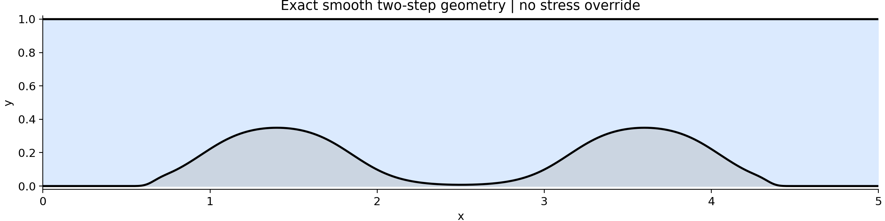
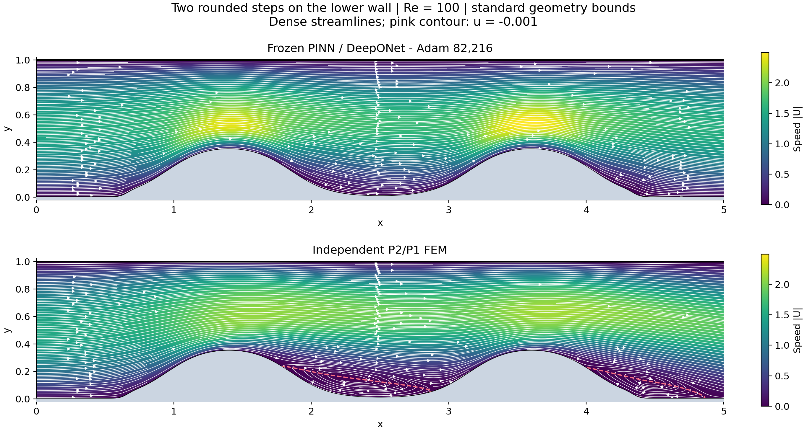
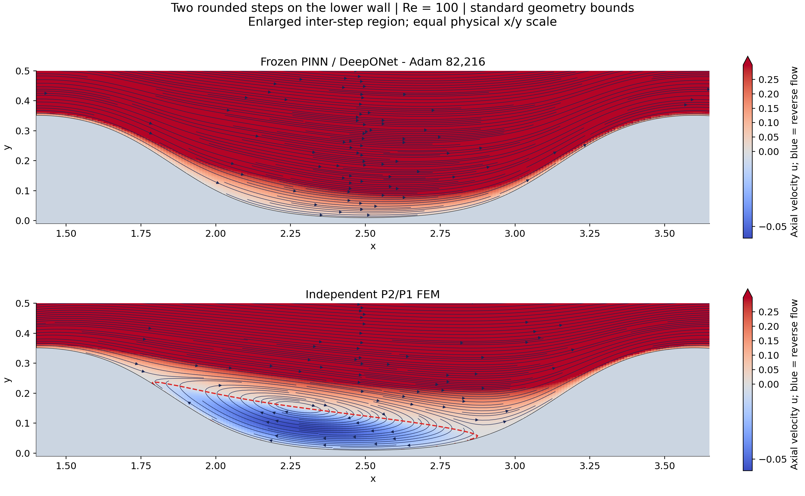

# Two smooth steps on the bottom wall

Two rounded raised floor sections approximate the supplied sketch. Frozen Adam **step 82,216**, **Re=100**, no retraining or Kaggle use. The upper wall is flat; inlet/outlet use the original model boundary conditions. C4 splines and **all standard geometry limits** pass without stress overrides. Sharp vertical steps are outside this model's geometry domain.

[Full flow PNG](streamlines.png) · [Full flow PDF](streamlines.pdf) · [Between-step zoom PNG](between_steps_zoom.png) · [Zoom PDF](between_steps_zoom.pdf) · [Complete ZIP](double_step_82216.zip) · [Fields](fields.npz) · [Metrics/provenance](summary.json)

Minimum gap **0.6507**, maximum gap **1.0000**, maximum slope **0.6578**, maximum centerline deviation **0.1747**. Geometry parameters were fixed before solving.

Velocity relative L2 error **22.99%**; pressure relative L2 error **15.71%**. Physical-area weighted FEM quadrature; no fitted pressure shift. Maximum coarse/fine FEM discrepancy **0.84%**; excluded common-domain area **0.142%**. Mesh checks address global fields and pressure drop; local wall shear and exact reattachment length are not certified.

## Reverse flow between the steps

**FEM shows a clear inter-step recirculating region, while the stored model misses the reversed flow in the diagnostic region.** Standard input validity does not guarantee an accurate flow prediction.

- model: minimum inter-step u = 0.037599; approximate reversed area in the stated diagnostic region = 0.000000.
- fem: minimum inter-step u = -0.057700; approximate reversed area in the stated diagnostic region = 0.080912.

Diagnostics use **1.9<x<3.1**, **bottom(x)+0.02<y<0.36**, and reversal threshold **u<-0.001**. Area is an approximate uniform plot-grid estimate within that region, not the full recirculation-bubble area. Streamlines use evaluated velocity vectors with arrows; red/pink contours delimit u=-0.001. Inspect both streamline direction and the signed axial velocity. A negative-u contour alone does not establish a closed vortex or exact separation/reattachment points. The research checkpoint has no passing full validation benchmark.

Reproduce: `OPENBLAS_NUM_THREADS=1 OMP_NUM_THREADS=1 JAX_ENABLE_X64=true .venv/bin/python -m scripts.double_step_flow`. Re-render existing fields without solving: `from scripts.double_step_flow import render; render()`. Complete ZIP contains fields, geometry, FEM quadrature/reference, plots and metadata; weights remain at the recorded checkpoint path and SHA256.
