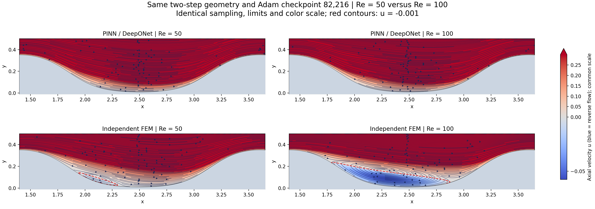

# Same two-step channel at Re=50 and Re=100

Frozen Adam step **82,216**. No retraining. Exact geometry coefficients, plot grid, mask, FEM quadrature points and physical weights are **array-identical** across Reynolds numbers. All normal geometry limits pass. The comparison figure uses common axes and axial-velocity color limits.

[Comparison PNG](re50_vs_re100.png) · [PDF](re50_vs_re100.pdf) · [CSV](comparison.csv) · [Complete comparison ZIP](double_step_re50_vs_re100.zip) · [Re=50 case](../double_step_re50_82216/README.md) · [Re=100 case](../double_step_82216/README.md)

| Re | Velocity relative L2 | Pressure relative L2 | Model min inter-step u | FEM min inter-step u | Max FEM mesh discrepancy |
| --- | ---: | ---: | ---: | ---: | ---: |
| 50 | 18.70% | 9.93% | 0.04178 | -0.00534 | 0.65% |
| 100 | 22.99% | 15.71% | 0.03760 | -0.05770 | 0.84% |

Velocity error changes from 22.99% at Re=100 to 18.70% at Re=50. Pressure error changes from 15.71% to 9.93%.

Reverse-flow diagnostics use 1.9<x<3.1, bottom(x)+0.02<y<0.36 and threshold u<-0.001. The excluded wall band avoids treating tiny near-wall signs as a resolved bubble. The two FEM solves are independent and pass the existing <=1% global mesh checks; these do not certify local wall shear or exact reattachment lengths. Negative-u contours alone do not certify closed streamlines. All quantities are nondimensional; pressure is compared without a fitted gauge shift.

FEM shows a smaller and weaker reverse-flow region at Re=50; the stored model misses inter-step reversal at both Reynolds numbers. The minimum FEM u in the diagnostic region changes from approximately -0.05770 at Re=100 to -0.00534 at Re=50.

A permitted geometry does not guarantee accurate separation prediction. This paired experiment tests the effect of changing Re for one geometry and one checkpoint; it does not establish a general error trend across all channels.

Reproduce Re=50: `OPENBLAS_NUM_THREADS=1 OMP_NUM_THREADS=1 JAX_ENABLE_X64=true .venv/bin/python -m scripts.double_step_flow --re 50`; then `.venv/bin/python -m scripts.compare_double_step_re`. The ZIP includes this comparison and both complete case folders, excluding nested ZIPs and model weights.
