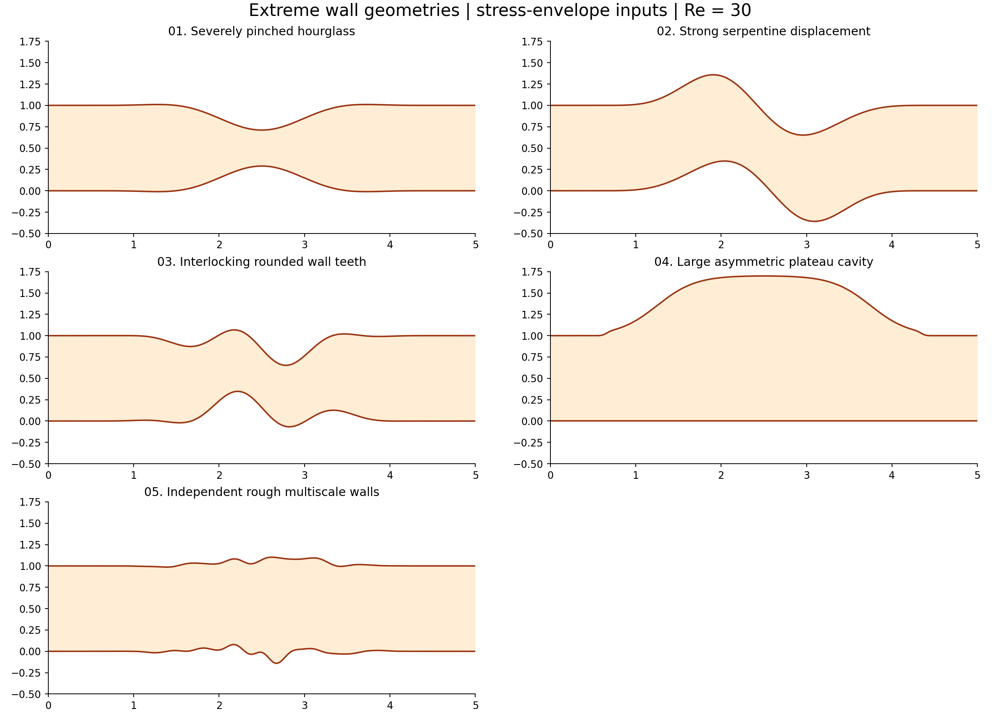
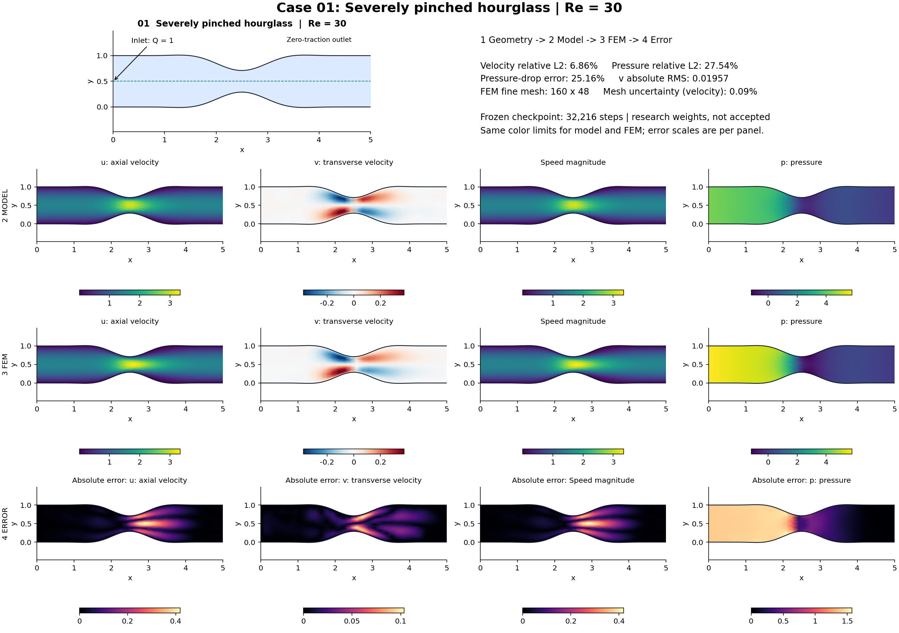
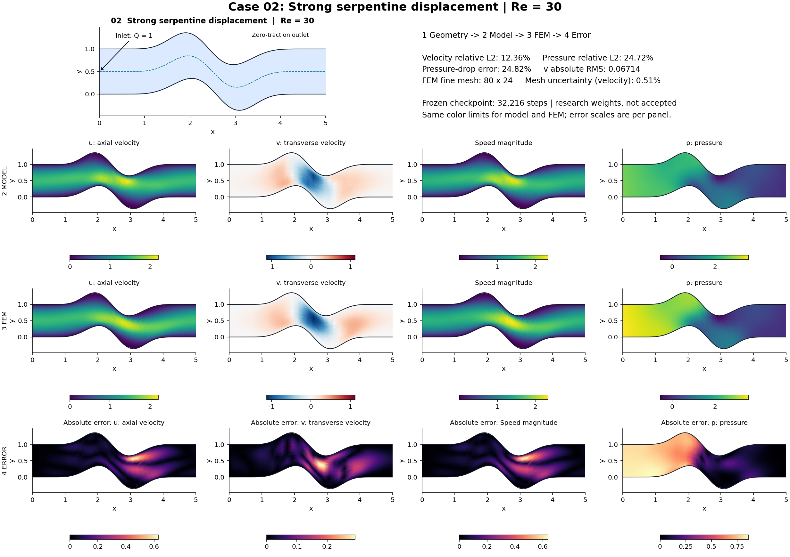
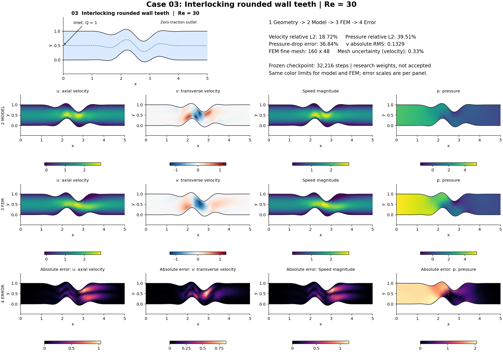
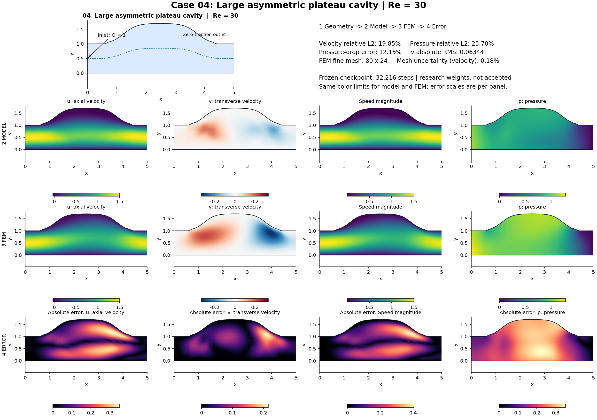
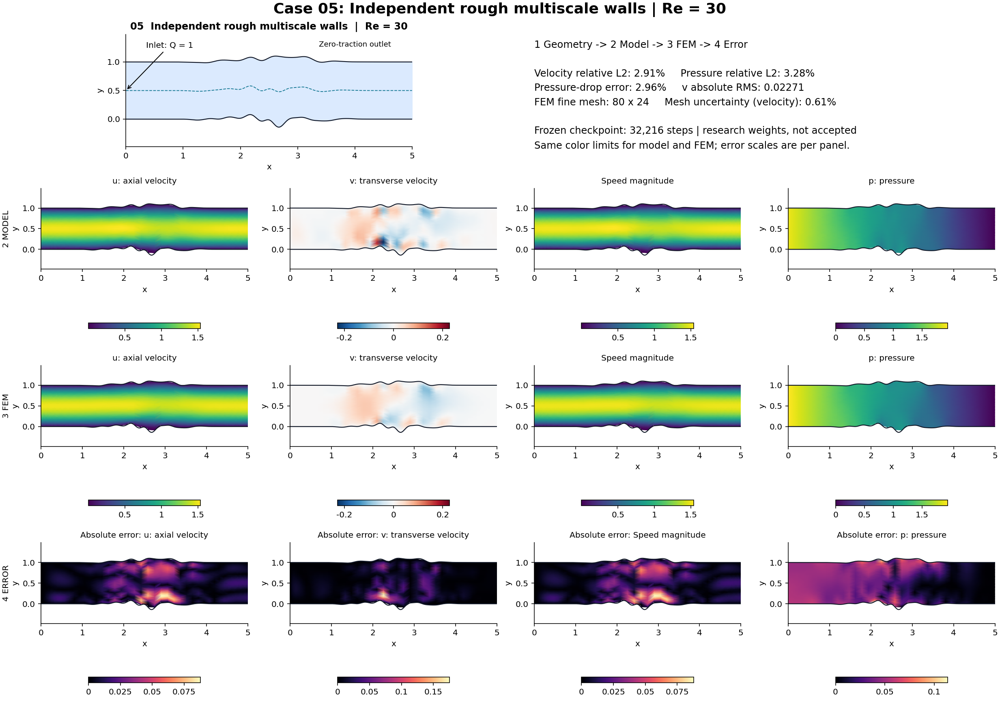

# Five extreme local-CPU channel comparisons

**Kaggle was not accessed.** These calculations use the existing **step-32,216 checkpoint** in the repository, not the ongoing continuation. All cases have Re=30. No training is performed.

[Five-page result PDF](all_5_chains.pdf) · [Numerical CSV](summary.csv) · [Full metrics and FEM metadata](summary.json)

## Domain limits and interpretation

The training geometry envelope is gap 0.60–1.50, centerline deviation ≤0.35 and wall slope ≤0.70. The supported stress-input envelope is gap 0.42–1.70, centerline deviation ≤0.45 and slope ≤1.10. Shapes are designed first and radially scaled until reaching a stress-envelope boundary. Each case is labeled against the training envelope below. Stress permission only permits an extrapolation query; it does **not** establish that the checkpoint was trained on these shapes or is accurate there. The channel remains smooth C4, nonbranching, with flat inlet/outlet strips; overhangs, sharp corners and obstacles are not represented.

FEM is independent P2/P1, checked with coarse/fine meshes and automatic refinement until velocity, pressure and pressure-drop discrepancies are ≤1%. The exact-wall/FEM common-domain area excluded must be ≤0.5%. Errors are physical-area weighted and pressure is not shifted to fit the reference. The [original method definitions](../channel_chain_15/README.md) apply. Model/FEM colors match per case and quantity; absolute-error panels use separate scales. The default API rejects out-of-envelope queries; this experiment explicitly enables the documented stress path. All numerical arrays, signed errors and exact geometries are retained.

| Case | Domain | Min/max gap | Max slope | Velocity L2 | Pressure L2 | Drop error | Max mesh discrepancy |
| --- | --- | --- | ---: | ---: | ---: | ---: | ---: |
| 01 Severely pinched hourglass | Extrapolation | 0.421/1.021 | 0.427 | 6.86% | 27.54% | 25.16% | 0.28% |
| 02 Strong serpentine displacement | Extrapolation | 0.835/1.057 | 1.099 | 12.36% | 24.72% | 24.82% | 0.98% |
| 03 Interlocking rounded wall teeth | Extrapolation | 0.686/1.000 | 1.099 | 18.72% | 39.51% | 36.84% | 0.76% |
| 04 Large asymmetric plateau cavity | Extrapolation | 1.000/1.699 | 0.775 | 19.85% | 25.70% | 12.15% | 0.29% |
| 05 Independent rough multiscale walls | Extrapolation | 0.982/1.239 | 1.099 | 2.91% | 3.28% | 2.96% | 0.92% |

## Area-weighted mean errors

Absolute MAE = sum(w |error|)/sum(w); relative L1 = sum(w |error|)/sum(w |FEM|), with a 1e-16 denominator floor. Velocity uses the Euclidean vector magnitude. MAE is in nondimensional field units, not percent.

| Case | Velocity MAE | Velocity relative L1 | Pressure MAE | Pressure relative L1 |
| --- | ---: | ---: | ---: | ---: |
| 01 | 0.04996 | 4.40% | 0.77296 | 29.32% |
| 02 | 0.09880 | 9.51% | 0.39160 | 23.97% |
| 03 | 0.14445 | 12.89% | 1.02150 | 41.78% |
| 04 | 0.14072 | 18.77% | 0.22487 | 25.10% |
| 05 | 0.02164 | 2.21% | 0.03036 | 3.09% |

Reproduce locally: `python -m scripts.extreme_channel_chain` in the documented CPU environment. Reference caches bind geometry and Re. Out-of-domain results are stress experiments and do not grant model acceptance.

## 01. Severely pinched hourglass

[Geometry](01_hourglass/01_geometry.png) → [Model](01_hourglass/02_model.png) → [FEM](01_hourglass/03_fem.png) → [Error](01_hourglass/04_error.png) · [Metrics](01_hourglass/metrics.json) · [Fields](01_hourglass/fields.npz)

## 02. Strong serpentine displacement

[Geometry](02_serpentine/01_geometry.png) → [Model](02_serpentine/02_model.png) → [FEM](02_serpentine/03_fem.png) → [Error](02_serpentine/04_error.png) · [Metrics](02_serpentine/metrics.json) · [Fields](02_serpentine/fields.npz)

## 03. Interlocking rounded wall teeth

[Geometry](03_interlocking/01_geometry.png) → [Model](03_interlocking/02_model.png) → [FEM](03_interlocking/03_fem.png) → [Error](03_interlocking/04_error.png) · [Metrics](03_interlocking/metrics.json) · [Fields](03_interlocking/fields.npz)

## 04. Large asymmetric plateau cavity

[Geometry](04_wide_cavity/01_geometry.png) → [Model](04_wide_cavity/02_model.png) → [FEM](04_wide_cavity/03_fem.png) → [Error](04_wide_cavity/04_error.png) · [Metrics](04_wide_cavity/metrics.json) · [Fields](04_wide_cavity/fields.npz)

## 05. Independent rough multiscale walls

[Geometry](05_rough_multiscale/01_geometry.png) → [Model](05_rough_multiscale/02_model.png) → [FEM](05_rough_multiscale/03_fem.png) → [Error](05_rough_multiscale/04_error.png) · [Metrics](05_rough_multiscale/metrics.json) · [Fields](05_rough_multiscale/fields.npz)

