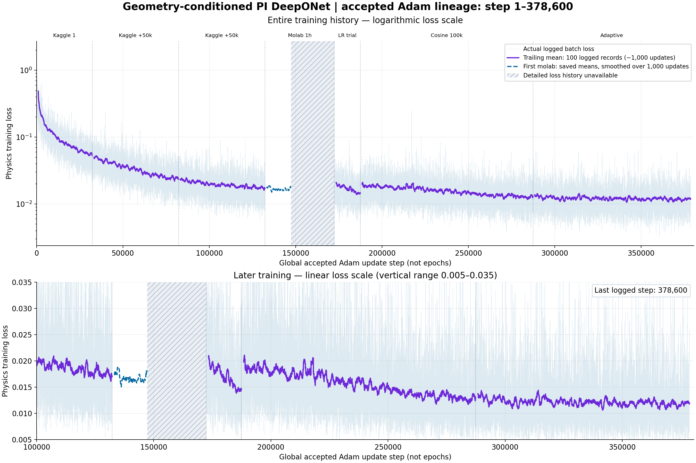

# Training loss from the beginning to step 378,600



[PDF](loss_from_start.pdf) · [All plotted values CSV](training_history.csv) · [Smoothed values CSV](smoothed_history.csv) · [Source hashes and coverage](sources.json) · [Summary](summary.json).

The chart follows the actual accepted checkpoint lineage: Kaggle main (1–32,216), Kaggle +50k (to82,216), next +50k (to132,216), first molab segment (to172,400), the selected cosine LR trial (to187,400), cosine100k (to287,400), then the current adaptive continuation. Parallel LR branches and rejected L-BFGS trajectories do not belong to this lineage and are not concatenated.

- Horizontal axes show **Adam updates, not epochs**: batches resample geometries, Reynolds numbers and collocation points.
- The upper panel uses logarithmic loss; the lower panel shows the later history on a linear scale with an explicitly limited vertical range.
- Faint blue curves show every available raw logged batch. Purple curves are arithmetic means over the preceding100 logged records (approximately1,000 updates), independently within each phase. The first99 smoothed points of each phase are omitted. Averages never cross missing history or a phase boundary.
- **Coverage limitation:** first molab raw history is unavailable in accessible storage. Saved arithmetic means over100-update windows cover132,216–147,216 and are drawn as a separate dashed curve after averaging10 such windows. **147,216–172,400 has no plotted loss values** and is shown as a hatched band. This is missing historical data, not a pause in training. No loss is inferred from checkpoint weights, endpoints or screenshots.
- 33,875 raw logged values and150 aggregate values are included. Snapshot coverage ends at **378,600**; no measurement is invented for unlogged steps or later live progress. Current state can advance during collection.
- Fixed development probes are excluded from the training-loss curve because their cohorts changed. The previous [same-probe/FEM audit](../molab_adaptive_100k/diagnostic/) remains the appropriate checkpoint comparison.
- The selected LR-trial raw log is preserved in the verified [lr-trials archive](../../artifacts/molab/lr-trials-v1/). The consolidated CSV and current-run observation make this chart reproducible without reconnecting to molab. A source hash identifies each input.

Re-render from the saved consolidated CSV:

```bash
MPLCONFIGDIR=/tmp/mpl-full-history .venv/bin/python -m scripts.plot_full_training_history
```

Use `--rebuild-data` only when all archived upstream logs have been restored to the paths recorded in the script. No training was launched or modified to produce this chart.
