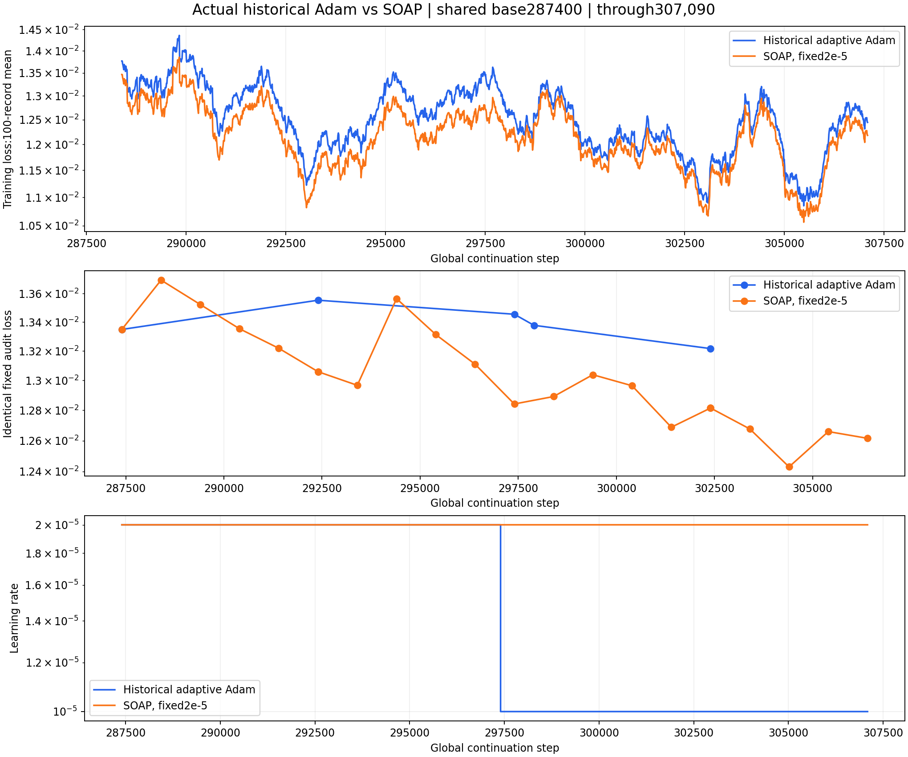

# Historical Adam (logged through378600) versus SOAP

[PDF](comparison.pdf) · [Exact same-step fixed probes CSV](same_step_probes.csv) · [Coverage and source hashes](summary.json).

The previously archived Adam continuation **287400→378600** supplies the blue curve. SOAP restarts from the same287400 weights and is plotted through its latest collected step **307090**. Both curves show actual log data, with a trailing100-record arithmetic mean, without extrapolation. Earlier use of only the separate15k Adam constant-rate trial omitted this available longer history.

The earlier Adam schedule was adaptive (starting2e-5, then1e-5 and lower); SOAP is fixed2e-5. This is a comparison of the two actual optimizer/schedule combinations, not isolation of optimizer alone under identical LR. Both use the original resampling and common fixed control/audit preparation; base probe values agree. Their evaluation cadences differ, so the CSV compares only exactly matching recorded steps. No probe values are invented between evaluations. The historical audit snapshot ends372400, while raw training log ends378600.

The live notebook now uses this historical Adam curve in blue and the growing SOAP curve in orange. The standalone Adam15k trial remains archived and remains the available15k FEM comparison. Historical Adam checkpoint weights at matching later SOAP steps were not archived, so this chart does not manufacture a later FEM comparison. The older recorded373800 FEM diagnostic remains separate.

No new training, optimizer-state modification, or changes to the active SOAP run were made for this presentation correction. Reproduce with `python -m scripts.compare_historical_adam_soap` after restoring the input archives.
