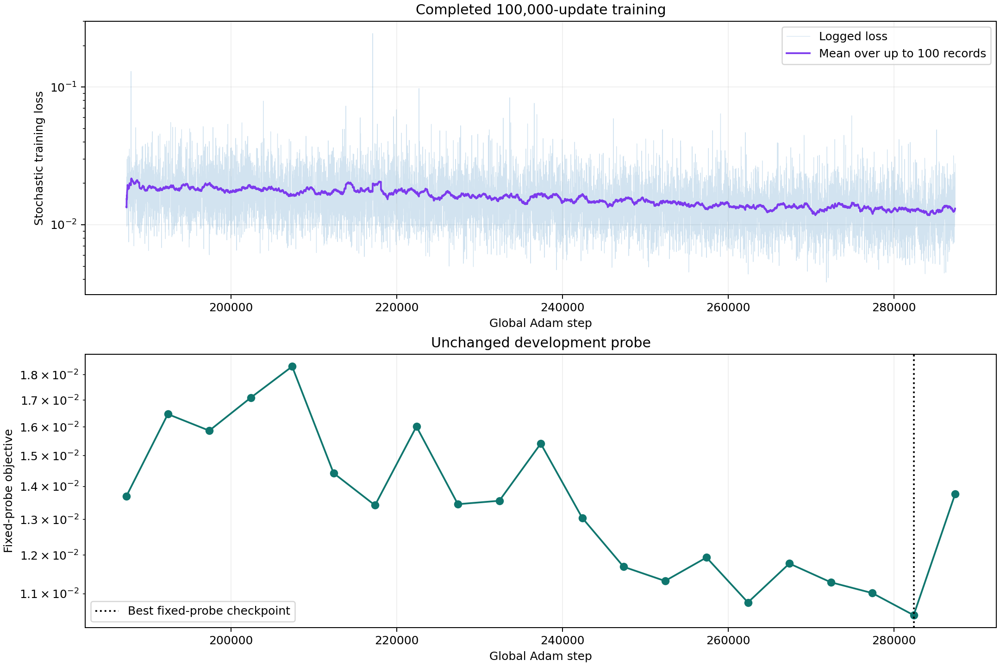
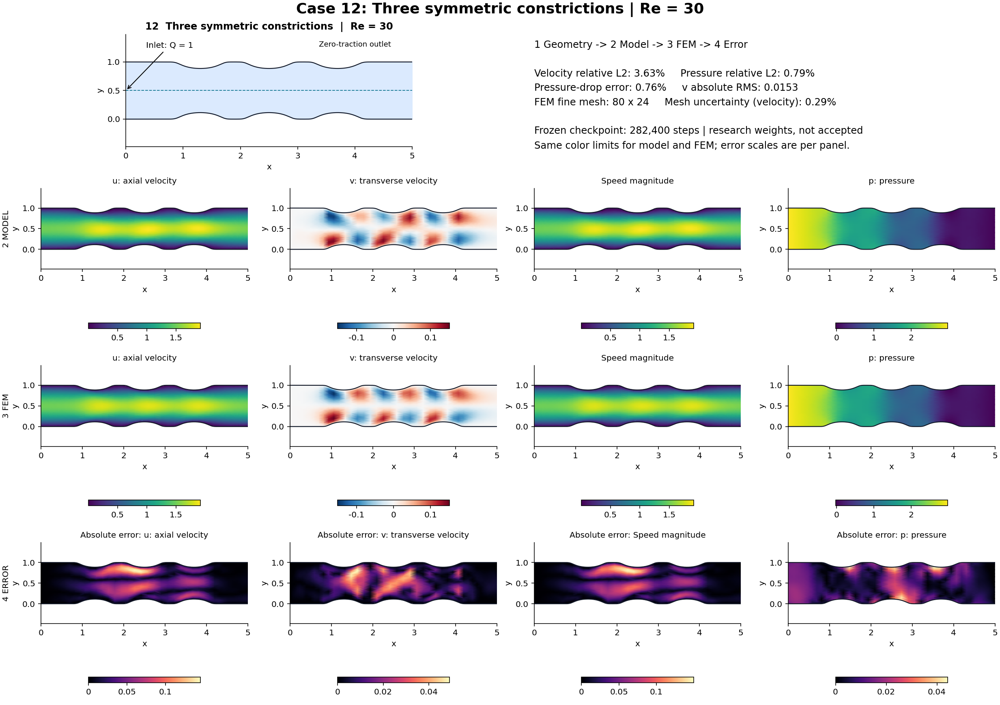
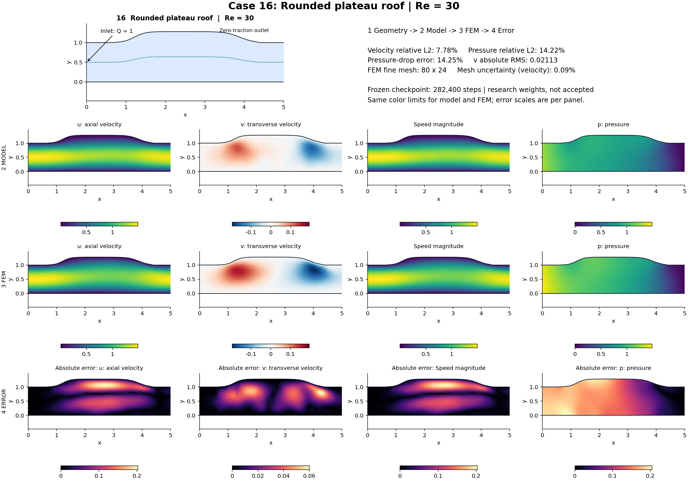

# Completed molab 100k continuation: final and best checkpoints

**187,400 → 287,400: exactly 100,000 updates completed.** Best fixed-probe checkpoint: **282,400**. Both full-state checkpoints and all periodic snapshots are preserved. Selection by the development probe does not imply universal FEM superiority or full benchmark acceptance.

[Two complete result chains PDF](selected/two_result_chains.pdf) · [Comparison CSV](comparison.csv) · [Full metrics](summary.json) · [Download outputs ZIP](results_and_examples.zip)

| Re=30, median over the same 20 saved cases | Start 187,400 | Final 287,400 | Best probe 282,400 |
| --- | ---: | ---: | ---: |
| Velocity L2 | 1.631% | 1.385% | 1.453% |
| Pressure L2 | 2.041% | 1.474% | 1.266% |

All geometry, FEM fields, points and physical weights are reused exactly. Pressure has no fitted shift. These 20 illustrative Re=30 cases and the separate eight-case Re=10 pilot are not the full validation benchmark. All regressions are retained. Final CPU FEM metrics match the saved GPU pilot within tolerance.

## Three symmetric constrictions

## Rounded plateau roof

## What improved and what did not

On these 20 cases, final-weight median velocity error improved **15.1%** and median pressure error **27.7%** relative to the resumed base. Final weights improved velocity in **15/20** and pressure in **17/20** cases. Best-probe weights improved the corresponding medians **10.9%** and **38.0%**; improvements were not universal. The fixed probe improved **23.5% at its best**, but the final probe is **0.46% higher than its initial value**. Mean training loss over the first/last 1,000 records declined from **0.01883 to 0.01287** (~31.7%). These summaries concern different metrics and samples; they should not be conflated.

The eight-case Re=10 pilot medians are base→final→best: velocity **1.279%→1.142%→1.212%**; pressure **0.905%→0.830%→1.052%**. This is another example of a probe-selected checkpoint not being uniformly best for FEM. Both checkpoints are downloadable and labeled explicitly.

[Complete weights, snapshots and raw run archive](../../../artifacts/molab/adam-100k-v1/README.md). [Previous four-trial complete archive](../../../artifacts/molab/lr-trials-v1/README.md).
