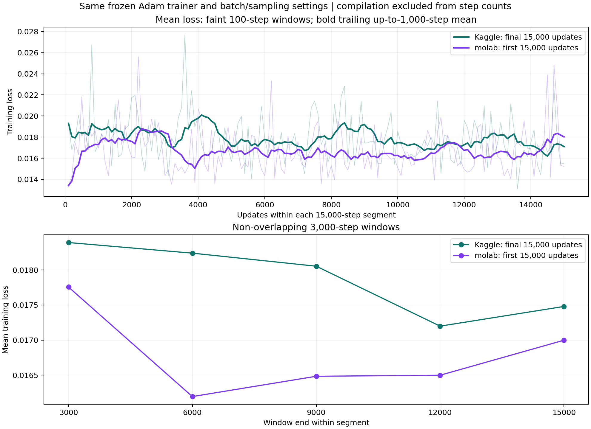

# Check continuation and compare two 15,000-update segments

**Kaggle:** 117,216 < step <= 132,216. **molab:** 132,216 < step <= 147,216. Exactly **1,500 regular ten-step records** in each. The extra resumed-first-step record is excluded for equal sampling. These losses use newly sampled training geometries, Re and points per update; this is not a fixed-probe or FEM accuracy comparison.

[Comparison PNG](comparison.png) · [PDF](comparison.pdf) · [Window CSV](windows.csv) · [molab audit](molab.json) · [Kaggle statistics](kaggle.json)

| Statistic | Kaggle final 15k | molab first 15k |
| --- | ---: | ---: |
| Mean | 0.01787209 | 0.01678670 |
| Median | 0.01631619 | 0.01521611 |
| 10th percentile | 0.01052115 | 0.00982218 |
| Minimum | 0.00549497 | 0.00558724 |

The molab segment mean is **6.07% lower** and its median **6.74% lower**. These are descriptive differences between consecutive segments, not proof of better generalization or a statistical significance claim.

## Trend within each segment

| Updates within segment | Kaggle mean | molab mean |
| --- | ---: | ---: |
| 0–3,000 | 0.01839022 | 0.01775600 |
| 3,000–6,000 | 0.01823894 | 0.01619520 |
| 6,000–9,000 | 0.01805305 | 0.01648458 |
| 9,000–12,000 | 0.01719884 | 0.01649933 |
| 12,000–15,000 | 0.01747941 | 0.01699841 |

The recent molab 3,000-step means are approximately 0.0162, 0.0165, 0.0165 and 0.0170: no sustained decrease in the mean across those windows. The median declines modestly. A locally flat/noisy training-loss trend is a fair description; the data do not support claiming rapid ongoing improvement. They also do not show stopped parameter updates.

## Transfer audit

The base checkpoint hash matches the final Kaggle artifact exactly. All frozen Python source hashes match the archived Kaggle source. Model configuration and training-pool hash match, and preflight checked normalization and restoration of Adam moments and RNG. At checkpoint step 148,300, every one of 56 parameter arrays and every one of 56 arrays in each Adam moment tree had changed and remained finite. Relative parameter L2 change from the base was 1.91%; RNG state had advanced. The run is updating the model.

The original learning-rate schedule is preserved: approximately 3.368e-5 at 132,216 and 2.292e-5 at 147,216, a 31.9% decrease. This small, decreasing rate can contribute to slow progress, but this comparison does not establish the cause of the plateau. New GPU and JAX version mean a bitwise-identical trajectory is not promised. No optimizer, learning-rate schedule or sampling changes were made during this audit. The one-hour run continues under its original limit.
