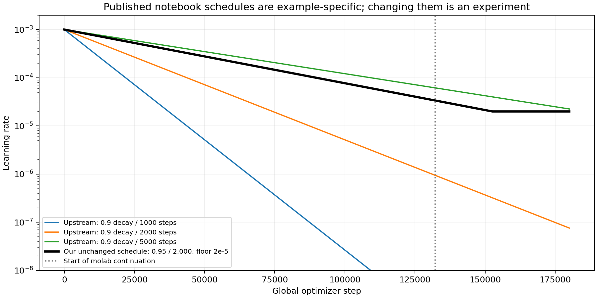

# Upstream notebook review and current optimization diagnosis

Inspected the official repository at immutable commit `77e7c747d653b34e79e43df7d88bad87de5c27d8`. [Primary repository](https://github.com/PredictiveIntelligenceLab/Physics-informed-DeepONets/tree/77e7c747d653b34e79e43df7d88bad87de5c27d8). [Exact optimizer cell excerpts](source-evidence.json).

Scope: all available notebook code, README and the live molab training evidence. The full paper PDF at arxiv.org/2103.10974 could not be retrieved in this environment (proxy CONNECT 403); this report does not claim a fresh full-text paper review. Repository examples are antiderivative, Burgers, diffusion-reaction, advection and Eikonal problems, not the user's geometry-conditioned incompressible Navier–Stokes task.

## What the original code actually specifies

| Notebook example | Adam initial LR | Exponential factor | Decay steps | Iteration setting in notebook |
| --- | ---: | ---: | ---: | --- |
| Eikonal airfoil | 1e-3 | 0.9 | 1,000 | 120,000 |
| Eikonal circle | 1e-3 | 0.9 | 1,000 | 40,000 |
| Burgers | 1e-3 | 0.9 | 2,000 | 200,000, training invocation commented out |
| Diffusion-reaction | 1e-3 | 0.9 | 2,000 | 120,000 |
| Advection | 1e-3 | 0.9 | 2,000 | 300,000, training invocation commented out |
| Fourier-feature antiderivative | 1e-3 | 0.9 | 5,000 | 300,000 |
| Our current continuation | 1e-3 | 0.95 | 2,000 | time-limited; minimum LR 2e-5 |

The inspected notebooks use Adam throughout their shown training loops. No automatic late-iteration L-BFGS transition, cosine restart, ReduceLROnPlateau controller or iteration-dependent loss-weight schedule was found in these notebooks. This is a code-level observation, not a claim about all related publications.

The upstream decay interval varies substantially by example. Our decay is slower than the upstream 1,000/2,000-step examples, but faster than the 5,000-step Fourier-feature example before applying the floor. Simply copying an upstream schedule is not automatically an improvement.

Static loss weighting is example-specific: the Eikonal airfoil code uses `100*loss_bcs + loss_res`; Burgers' shown loss uses `20*loss_ics + loss_bcs + loss_res`. The final `lam=20` variable chooses a saved model filename, not an iteration-triggered weight update. Diffusion-reaction uses `loss_bcs + loss_res`. These weights do not transfer directly to our hard wall/inlet/flux constraints and momentum/outlet-traction loss.

The notebook batch sizes 10,000 or 50,000 count flattened input/query pairs. Our global batch 32 counts geometries, each with 128 interior and 48 outlet samples. They are different units; 32 versus 10,000 is not an equal-workload batch-size comparison. Upstream minibatches select from generated arrays; ours resamples geometry, Re and collocation points each update. Both produce stochastic batch loss.

The Burgers notebook already uses a gated modified MLP, and our model has gated branch/trunk networks. Fourier feature inputs exist in a separate antiderivative example; adding them changes the architecture and is not a drop-in continuation of these weights.

## Live-run evidence

At step **163,120**, molab remained running on the GPU, with approximately **0.068 seconds/update**. The apparent slowdown concerns convergence, not hardware throughput.

| Consecutive molab segment | Mean logged loss |
| --- | ---: |
| 132,216–137,216 | 0.01711662 |
| 137,216–142,216 | 0.01639794 |
| 142,216–147,216 | 0.01684554 |
| 147,216–152,216 | 0.01546025 |
| 152,216–157,216 | 0.01537362 |
| 157,216–162,216 | 0.01566919 |

These complete windows contain 500 regular logged records each. Progress is noisy and slow but not zero. The most recent partial 904-update window is excluded from the table. The isolated loss at 163,120 was 0.00734807, which is not used as proof of convergence.

The unchanged schedule reaches its LR floor at about **152,535 steps**. The current rate is therefore **2e-5**. A small LR can contribute to slow progress, but the plateau's cause is not established. In the most recent 1,500 logged records, maximum gradient norm was **1.69389**, below the clipping threshold **10**; none of those recorded gradients was clipped. Mean momentum loss was **0.01553419**, versus **0.000008728** weighted outlet traction. Momentum accounts for about **99.94%** of the reported objective. Increasing a boundary-loss weight blindly is not justified by these numbers.

[Transfer and optimizer audit](../loss_audit/README.md) already verifies the exact starting checkpoint/source, model/pool configuration, advancing RNG, changing finite parameters and changing Adam moments. This supports correct execution of the specified continuation; it does not establish that these settings are optimal or that FEM error is decreasing.

## Next experiment to distinguish causes

Finish the authorized one-hour baseline unchanged. Then use an identical, fixed non-test diagnostic set of geometries/Re/points and fixed FEM pilot cases to compare base/final checkpoints. For any subsequent short LR comparison, branch from the same checkpoint with identical restored Adam moments and RNG, and compare constant `2e-5`, `5e-5` and `1e-4` over an equal update budget. Retain all results, including divergence or validation regressions; choose using fixed-probe residual and matched FEM error rather than the lowest noisy training loss. This is a proposed experiment, not a paper recommendation or a run already started.

If fixed validation stalls despite LR changes, assess geometry/Re coverage and residual sampling near separated/high-gradient regions. Those changes need separate validation; the paper's examples do not supply a proven late-training recipe for this flow problem. No live-run hyperparameters were changed during this review.
