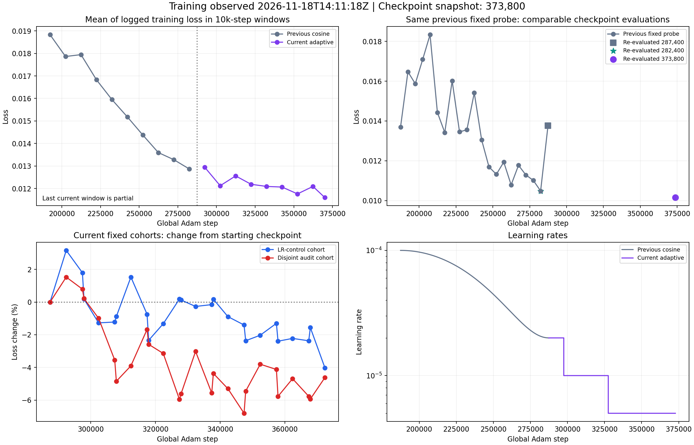

# Audit of the apparently stalled continuation

**The resumed optimizer is updating parameters correctly. Progress is slower and physical accuracy changes are mixed; this is not evidence of a broken checkpoint transfer.** The user correctly identified a flatter training curve. This audit does not establish that the adaptive controller is better than an equal-budget baseline.

[PDF](continuation_diagnostic.pdf) · [10k training windows](training_windows.csv) · [Checkpoint comparison](comparison.json) · [Initial live observation](observation.json) · [Previous run windows](previous_run_windows.json).

## Comparable checkpoint evaluation

All three checkpoints below were evaluated in the **same current JAX runtime**, on the exact same old fixed probe, current control/audit arrays, and eight cached FEM references. The observed checkpoint is a **snapshot at step 373,800**, not the final run result. The first log/status observation was at 372,800; state and log tails can advance while the job is read.

| Metric | Previous final / start 287,400 | Previous best-probe 282,400 | Observed current 373,800 |
| --- | ---: | ---: | ---: |
| Old fixed probe | 0.01376067 | 0.01048246 | 0.01014820 |
| Current control cohort | 0.01294695 | 0.01366252 | 0.01261452 |
| Current disjoint audit cohort | 0.01334894 | 0.01357469 | 0.01258608 |
| Median FEM relative L2 velocity, eight cases | 1.14172% | 1.21153% | 1.10636% |
| Median FEM relative L2 pressure, eight cases | 0.82965% | 1.05169% | 0.69154% |

Relative to the starting checkpoint, the observed old fixed-probe objective is **26.25% lower**. It is also 3.19% lower than the earlier best-probe checkpoint on that same probe. Current control/audit objectives are 2.57% / 5.71% lower. These small development cohorts are not a locked generalization test.

The FEM medians improve by 3.10% for velocity and 16.65% for pressure. **Velocity nevertheless worsens in six of eight individual cases**, while pressure worsens in two. A median alone hides these regressions. Physical-area weighted relative L2 metrics use the same grids, references and pressure convention; no reference re-solving or pressure fitting is introduced.

| FEM case (zero based) | Velocity before → now | Pressure before → now |
| --- | ---: | ---: |
| 0 | 0.2392% → 0.2422% | 0.3510% → 0.1961% |
| 1 | 0.9298% → 0.9664% | 1.0563% → 0.7733% |
| 2 | 0.6724% → 0.7752% | 1.3291% → 0.9383% |
| 3 | 1.0817% → 1.1008% | 0.7949% → 0.6023% |
| 4 | 2.3843% → 2.5404% | 1.0532% → 1.8907% |
| 5 | 1.2018% → 1.1119% | 0.8644% → 0.6098% |
| 6 | 1.8525% → 1.8592% | 0.5629% → 0.7907% |
| 7 | 2.4152% → 2.3238% | 0.6789% → 0.5507% |

Case 4 pressure rises from about 1.05% to 1.89%; this regression must not be hidden by the lower median. Full saved 20-case and recirculation comparisons remain necessary before promoting these weights.

## Why the current plot looks flatter

1. **The LR policy changed.** The previous 100k cosine run started near 1e-4 and ended at 2e-5. This continuation started at 2e-5, selected 1e-5 at anchor 297,400, then 5e-6 at 327,400. The smaller rates reduce update size and stochastic excursions. This can flatten the curve, but the present data cannot establish the counterfactual trajectory at another LR.
2. **The dashboard fixed cohorts changed.** The old single 16-geometry probe was replaced by disjoint 32-geometry control and 32-geometry audit cohorts. Their absolute losses cannot be spliced into the old curve. Re-evaluation on the old probe above resolves this comparison.
3. **Training is already at a lower loss level.** Previous logged training-window means fell from 0.0188295 to 0.0128686 (31.66%); the current first complete window is 0.0129438 and last complete 70k–80k window is 0.0120911 (6.59%). The final partial window in this observation is 0.0115941, and is labeled partial. Windows average logged records, not every individual update. The LR and random batches differ, so these declines do not isolate a causal benefit of the schedule.
4. **A short-pilot controller is limited.** A 500-step control-set advantage can favor a smaller rate with better short-term residual but does not establish the best long-term learning or FEM accuracy. The 0.5% switching rule is a heuristic, not a significance test. The current results do not justify calling this the best possible policy.

## Transfer and implementation checks

- Base NPZ SHA256 exactly matches the archived final checkpoint: `72bbe88ddc539258b9bfb433709aa434776393bd5f7e163d90478cbf7fa0e6c2`.
- Adam moments, global step, RNG, normalization and training-pool hash were restored; no optimizer restart was introduced.
- Read the live core: its only differences from the frozen original are an explicit LR argument and replacement of the schedule expression. [Exact diff](core_source_diff.txt). Physics, loss weights, clipping and Adam equations are unchanged.
- The launch check compared original/dynamic updates on the same production-sized batch at 2e-5; results matched within tolerance. Doubling LR doubled parameter displacement (ratio 1.999999).
- Live worker SHA256 `291fdf1f2e7a3e798432a70a4455c2d56218afebf2aaf192037f97cc06c36080` equals the committed worker source.
- In observed current state, all 56 parameter arrays differ from base; aggregate relative parameter displacement is 1.975%. Parameters/moments are finite and RNG has advanced. Nonzero gradients and active GPU were observed.
- JAX changed from the earlier runtime to 0.11.2. The same old base probe re-evaluates as 0.013760668 versus previously logged 0.013760179, about 0.00355% different; the observed 26% same-probe improvement is much larger. Cross-version trajectories are not claimed bitwise identical.

## Action and limits

No optimizer, LR, sampling or architecture setting was changed by this diagnosis. No new training branch was launched. The existing job remained running toward 387,400 at the last check. The diagnostic GPU evaluation incurs some shared-device overhead, but cannot update the training process's parameters or Adam state.

Do not replace the saved baseline on the basis of a flat/noisy training curve or a single development metric. Preserve this run, finish its authorized budget, then evaluate the full saved cases and compare matched branches from one snapshot. A longer, matched pilot (including physical error and equal wall time) is more informative than treating a 500-step residual winner as a proven long-term choice. The previous baseline and best-probe weights remain archived separately.

## Reproduction and scope

`evaluate_checkpoints.py` runs read-only on the same molab layout and preserves an observed snapshot before evaluation. It pins upstream inputs to Git commit eea5bf1 and verifies the previous-best NPZ hash. The observed NPZ is retained on molab at `/home/marimo/wall_adaptive_100k/diagnostic/observed_checkpoint.npz`; this diagnostic report does not claim to archive the entire still-running job. `render.py` reproduces PNG/PDF from the recorded JSON files. No locked test set was opened. No claims about all geometry/Re combinations follow from this eight-case pilot.
