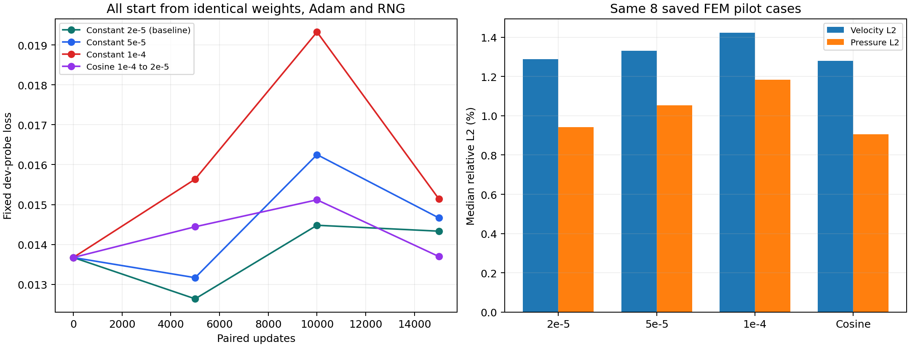

# Completed paired learning-rate trials and selected continuation

**All four completed exactly 15,000 updates: 172,400 → 187,400.** Parameters, Adam moments, RNG and the first sampled batch started identically. The suite verified matching first-batch hashes and initial losses (tolerance 1e-6). No FEM labels entered training. [Detailed observations](results-observation.json) · [CSV](comparison.csv) · [JSON](comparison.json).

| Controller | Mean train loss, last 3k updates | Final fixed-probe loss | Median velocity FEM L2 | Median pressure FEM L2 |
| --- | ---: | ---: | ---: | ---: |
| Constant 2e-5 (baseline) | 0.014441 | 0.014333 | 1.288% | 0.942% |
| Constant 5e-5 | 0.015476 | 0.014666 | 1.331% | 1.054% |
| Constant 1e-4 | 0.017962 | 0.015141 | 1.423% | 1.184% |
| Cosine 1e-4 to 2e-5 | 0.014465 | 0.013698 | 1.279% | 0.905% |

## Interpretation

Cosine has the best **terminal** fixed-probe loss and both median FEM errors among the four endpoints. However its fixed-probe loss is **0.18% higher**, not lower, than the common starting checkpoint (~0.0136732). The baseline constant rate has a marginally lower mean training loss (0.0144408 vs 0.0144653). Higher constant rates are worse. This experiment does not demonstrate that increasing LR resolves the plateau.

The original common checkpoint's matched FEM pilot medians were **1.3263% velocity** and **0.8494% pressure**, measured separately after the trials. Cosine's endpoint improves the velocity median to **1.2788%** but worsens pressure to **0.9048%**. There is no all-metric improvement or full-domain acceptance claim. The probe uses 16 fixed development draws; the eight FEM cases are a small Re=10 pilot, not the 400-case development benchmark.

The 5k intermediate probe minimum under constant 2e-5 was lower, but full-state intermediate checkpoints were not retained by the prior trial worker. It cannot be represented as an available continuation weight. The selected deployable endpoint is cosine. Earlier base and candidate endpoints remain preserved.

## Authorized 100k run

The new continuation starts from the cosine endpoint **187,400** with its own Adam moments and RNG and targets **287,400**, exactly **100,000 additional updates**. It uses a single cosine schedule 1e-4 → 2e-5 across the new 100k horizon. Extending the schedule from 15k to 100k is a new experiment, not a result validated by the short trials. Fixed-probe checks every 5k retain the best full-state checkpoint separately; periodic full-state copies every 10k and the latest checkpoint remain available. No automatic public model acceptance is implied.

[100k launch report](../molab_adam_100k/README.md) · [Experiment code](../../notebooks/molab_lr_trials/).

Complete remote artifacts remain under `/home/marimo/wall_lr_trials`; the verified result archive is being collected into the local ignored `runs/molab-lr-completed` workspace. The data in this report were read directly from completed trial outputs.
