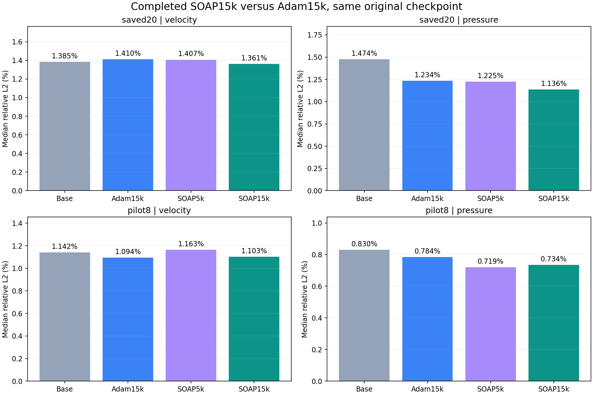

# Completed SOAP10k continuation: SOAP15k total

**292400→302400 completed,10000 additional updates, exit0.** The complete SOAP state was preserved, reaching optimizer count15001 for15000 parameter updates plus its original zero-update basis initialization. No restart, loss reweighting, RAD or model architecture change was introduced. The regression guard did not stop the run; this only means its specified thresholds were not triggered, not that every case improved.

[PDF](fem_comparison.pdf) · [Every-case CSV](per_case_errors.csv) · [Analysis JSON](analysis.json) · [Original combined training curves](../../../artifacts/molab/soap-continue10k-v1/comparison.png) · [Snapshots and raw results](../../../artifacts/molab/soap-continue10k-v1/).

| Median relative L2 | Original287400 | Adam15k | SOAP5k | SOAP15k |
| --- | ---: | ---: | ---: | ---: |
| 20 Re30: velocity | 1.3848% | 1.4104% | 1.4068% | 1.3609% |
| 20 Re30: pressure | 1.4744% | 1.2341% | 1.2253% | 1.1358% |
| 8 Re10: velocity | 1.1417% | 1.0941% | 1.1631% | 1.1027% |
| 8 Re10: pressure | 0.8296% | 0.7837% | 0.7194% | 0.7342% |

SOAP15k lowers the20-case velocity/pressure medians by **1.72% / 22.97%** relative to the original checkpoint, and **3.51% / 7.97%** versus Adam at the same15000-update budget. These are relative changes in median relative-L2 metrics, not percentage-point changes. On the Re10 pilot, SOAP has better pressure median but slightly worse velocity median than Adam; it is not superior in every metric.

Worst20-case velocity/pressure errors remain **7.490% / 13.857%**. The pilot worst pressure error increased versus the original checkpoint. Thus an aggregate improvement does not resolve difficult geometries or establish whole-domain accuracy. The20Re30 and8Re10 cohort gives no direct validation atRe60/100. The complete per-case CSV retains regressions.

Observed branch times total **22.34min SOAP** versus **17.82min Adam** (about25.4% longer for SOAP). Extra separate setup/preflight time is excluded, and checkpoint/evaluation schedules differ. No equal-wall-time or large multiplicative speedup is established.

## Decision and next step

Keep SOAP at **2e-5** as the preferred optimizer candidate. Preserve the original and Adam checkpoints; do not claim universal model promotion. The latest full SOAP state302400 is the continuation source, not a fresh optimizer.

Before investing in another long run, expand the **development FEM validation to32 fresh cases balanced across8 geometry families and Re10,30,60,100**, excluding the existing pilot and fixed control/audit geometry IDs. Use independent mesh-converged FEM, not new labels in training; keep locked test unopened. Compare original287400, Adam15k and SOAP15k on exactly these same inputs. This addresses the current coverage gap and tells us whether pressure gains extend beyond the repeatedly examined cases.

If the broader cases confirm improvement without material systematic regression, a **bounded20k continuation** at2e-5 from302400 is the next training candidate, with periodic FEM and retained states. If higher-Re or difficult-case velocity still regresses, diagnose residual/field maps before adding compute or changing architecture. Do not return to LR1e-4, add RAD, change loss weights, or launch100k simply because the stochastic training curve is lower.

**No new validation batch or training continuation was launched by this analysis.** This report records a concrete next proposal, not completed validation or an authorized model release.
