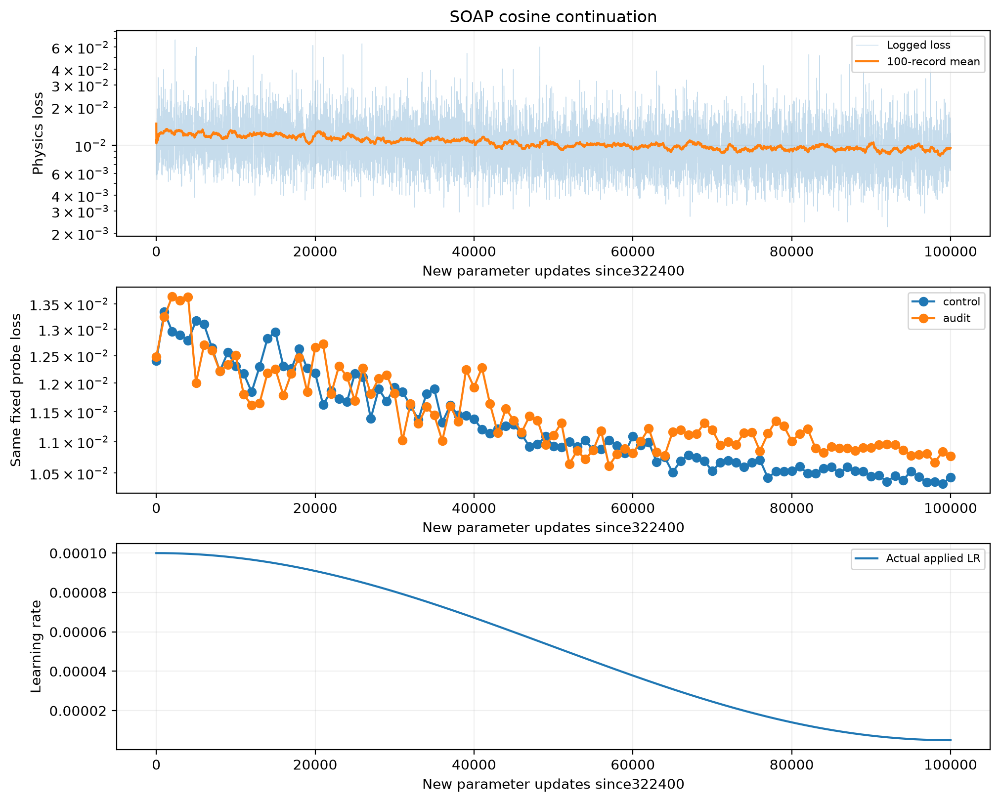

# خروجی بازیابی‌شدهٔ ران کسینوسی — ۲۲ نوامبر ۲۰۲۶

اتصال به Molab با نشانی جدید برقرار شد. نوت‌بوک و خروجی تصویری ذخیره‌شده باقی مانده‌اند، اما ماشین فعلی پوشه‌های ران قبلی، وزن نهایی، لاگ کامل و ارزیابی نهایی FEM را ندارد. جست‌وجوی فایل‌های ران در `/home`، `/marimo` و `/tmp` نیز نتیجه‌ای نداشت؛ هیچ فرایند آموزشی فعال نبود. از روی این بررسی نمی‌توان دربارهٔ نسخه‌های پشتیبان احتمالی در سرویس Molab نتیجه گرفت.

تصویر ذخیره‌شده، پایان **۱۰۰هزار گام جدید تا گام ۴۲۲٬۴۰۰** را گزارش می‌کند. این شاهدِ باقی‌مانده از پایان ران است؛ دریافت وزن نهایی یا بازتولید نتیجه را ثابت نمی‌کند.

[دانلود تصویر اصلی](retained_plot_0.png) · [نسخهٔ HTML نوت‌بوک](notebook.html) · [کد نوت‌بوک](notebook.py) · [حافظهٔ ذخیره‌شدهٔ خروجی‌ها](session.json) · [بررسی صحت دریافت فایل‌ها](collection_verification.json)

## آیا loss خوب کم شده است؟

بله، در نمودار هر دو مجموعهٔ ثابت control و audit روند کاهشی دیده می‌شود. این شواهد از نگاه‌کردن به چند کمینهٔ تصادفی در batchهای آموزش قوی‌تر است. کاهش تدریجی است و نوسان همچنان وجود دارد.

| معیار | شروعِ ثبت‌شده در لاگ | انتهای برآوردشده از تصویر | کاهش تقریبی |
|---|---:|---:|---:|
| loss ثابت control | ۰٫۰۱۲۴۰۴ | حدود ۰٫۰۱۰۴۲ | ۱۶٪ |
| loss ثابت audit | ۰٫۰۱۲۴۸۴ | حدود ۰٫۰۱۰۷۵ | ۱۴٪ |
| میانگین ۱۰۰ رکورد loss آموزش | ۰٫۰۱۲۸۸۳ | حدود ۰٫۰۰۹۴۰ | ۲۷٪ |

اعداد انتهای جدول **از تصویر استخراج شده‌اند، نه از لاگ عددی انتهای ران**. محور لگاریتمی تصویر با نقاط دقیقِ بخش موجود از همان نمودار کالیبره شد. داده‌های برآورد و دامنهٔ تغییر ناشی از جابه‌جایی سه پیکسل در [image_estimates.json](image_estimates.json) و کد بازتولید در [analyse_retained_cosine.py](../../../scripts/analyse_retained_cosine.py) هستند. دامنهٔ پیکسلی، فاصلهٔ اطمینان آماری نیست. تصویر PNG از base64 خروجی نوت‌بوک عیناً استخراج شده و منحنی‌های مفقود دوباره ساخته نشده‌اند.

نمودار نرخ نیز کاهش پیوستهٔ کسینوسی تا نزدیکی `5e-6` را نشان می‌دهد. مقدار `0.0001` در سربرگ HTML یک ایراد نمایش در پایان است: وضعیت نهاییِ worker فیلد نرخ را نمی‌نویسد و داشبورد از مقدار پیش‌فرض استفاده می‌کند. نمودار نرخ، از لاگ نرخ‌های اعمال‌شده رسم شده است؛ سربرگ را نباید به‌عنوان نرخ نهایی تفسیر کرد.

## چه چیزی از دقت میدان‌ها می‌دانیم؟

کاهش physics loss را نمی‌توان برابر با کاهش خطای L2 سرعت یا فشار دانست. ارزیابی FEM انتهای ۴۲۲٬۴۰۰ در فایل‌های فعلی موجود نیست. آخرین FEM ذخیره‌شده مربوط به **۳۴۲٬۴۰۰**، یعنی فقط ۲۰هزار گام جدید، است:

| خطای نسبی L2 | گام ۳۲۲٬۴۰۰ | گام ۳۴۲٬۴۰۰ |
|---|---:|---:|
| میانهٔ سرعت، ۲۰ نمونهٔ Re30 | ۱٫۳۴۰۴٪ | ۱٫۳۷۱۸٪ |
| میانهٔ فشار، ۲۰ نمونهٔ Re30 | ۱٫۱۷۰۹٪ | ۱٫۳۰۹۳٪ |
| میانهٔ سرعت، ۸ نمونهٔ Re10 | ۱٫۰۷۸۰٪ | ۱٫۱۱۲۲٪ |
| میانهٔ فشار، ۸ نمونهٔ Re10 | ۰٫۶۵۵۸٪ | ۰٫۴۳۶۹٪ |

این نتایج میانی یکدست بهتر نشده‌اند و دربارهٔ میدان نهایی داوری نمی‌کنند. بنابراین پیشرفت loss در کل تصویر امیدوارکننده است، اما بهبود نهایی سرعت/فشار هنوز تأیید نشده است. هیچ FEM جدیدی از روی تصویر تخمین زده نشده است.

## چه چیزهایی برای ادامهٔ کار موجود است؟

- پنج وزن کامل این شاخه در گام‌های ۳۲۲٬۵۰۰، ۳۲۷٬۴۰۰، ۳۳۲٬۴۰۰، ۳۳۷٬۴۰۰ و **۳۴۲٬۴۰۰** در گیت‌هاب محفوظ‌اند؛ اندازه، SHA256 و وجود وضعیت کامل SOAP دوباره بررسی شد.
- ۲۵۰۱ رکورد آموزش تا **۳۴۷٬۴۰۰** و ارزیابی ثابت تا **۳۴۶٬۴۰۰** موجود است.
- وزن‌ها و گزارش‌های مراحل قدیمی‌تر در آرشیوهای قبلی مخزن باقی مانده‌اند.
- وزن نهایی ۴۲۲٬۴۰۰ و خروجی‌های بعد از محدودهٔ فوق از این اتصال بازیابی نشدند. تصویر و HTML، وزن شبکه را در خود ندارند؛ ادامهٔ آموزش از گام ۴۲۲٬۴۰۰ به فایل وزن آن نیاز دارد. بالاترین وزن قابل‌استفادهٔ فعلی این شاخه، ۳۴۲٬۴۰۰ است؛ این به معنی برتر بودن آن در همهٔ معیارها نیست.

[آرشیو وزن‌ها و داده‌های موجود](../../../artifacts/molab/soap-cosine100k-v1/) · [گزارش راه‌اندازی ران](../README.md). هیچ ران جدیدی در این بررسی شروع نشد.
