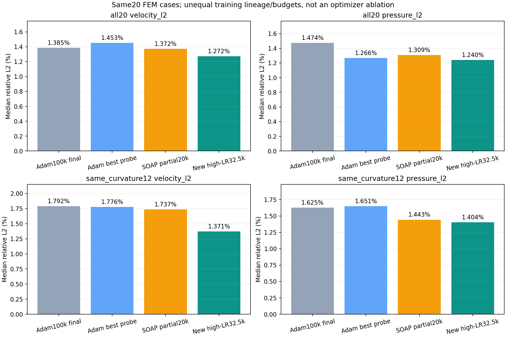

# مقایسهٔ همین حالات با ران‌های قبلی

**وزن نهایی ران ۱۰۰هزارگامی SOAP اخیر در گام ۴۲۲٬۴۰۰ موجود نیست. بنابراین مقایسهٔ خطای میدان با پایان آن ران ممکن نیست.** آخرین وزن محفوظ از آن شاخه ۳۴۲٬۴۰۰ است، یعنی فقط ۲۰هزار گام از آن اجرای ۱۰۰هزارتایی. تصویر پایان ران صرفاً loss فیزیکی را دارد و نمی‌توان از آن خطای FEM یا وزن مدل را بازسازی کرد.

دو مقایسهٔ قابل انجام در این گزارش جدا شده‌اند:

1. مقایسهٔ ران جدید با وزن ۳۴۲٬۴۰۰، آخرین مرحلهٔ محفوظِ همان شاخهٔ SOAP و نقطهٔ شروع ران جدید.
2. مقایسه با ران ۱۰۰هزارگامی قدیمی‌تر **Adam از ۱۸۷٬۴۰۰ تا ۲۸۷٬۴۰۰** که نتایج و وزن نهایی آن کامل محفوظ است. وزن انتخاب‌شده با probe در گام۲۸۲٬۴۰۰ هم جدا گزارش شده تا فقط یک وزن دلخواه انتخاب نشود.

مدل جدید این گزارش مربوط به **گام ۳۷۴٬۹۰۰، پس از ۳۲٬۵۰۰ گام جدید** است؛ ارزیابی زنده از Molab دریافت شد. این گزارش نتیجهٔ نهایی۵۰هزارگام نیست.

## آیا دقیقاً همان مسائل مقایسه شده‌اند؟

بله. برای هر۲۰کیس، هندسه، مختصات نقاط، وزن‌های انتگرال‌گیری و میدان‌های FEM ذخیره‌شدهٔ گزارش قدیمی با فایل‌هایی که ارزیاب جدید مصرف می‌کند، **آرایه‌به‌آرایه و دقیقاً برابر** بررسی شدند. همهٔ موارد Re30 هستند. داده‌های پیش‌بینی ذخیره‌شدهٔ مدل Adam دوباره با همان فرمول خطا محاسبه و با گزارش قبلی تطبیق داده شدند. برای گروه۱۲تایی نیز همان شناسه‌های گروه پرانحناترِ ارزیاب جدید به مدل‌های قدیمی اعمال شدند؛ دو زیرمجموعهٔ متفاوت با هم مقایسه نشده‌اند.

این تحلیل هیچ پاسخی به آموزش نمی‌دهد و هیچ تغییر، شیفت یا برازش تازه‌ای روی فشار انجام نمی‌دهد. معیار، L2 نسبی با وزن مساحت فیزیکی است. مؤلفهٔ v با مرجع تقریباً صفر در کانال مستقیم undefined باقی مانده و از میانهٔ آن مؤلفه حذف شده است.

[PDF](comparison.pdf) · [خطای هر کیس برای هر مدل](per_case_errors.csv) · [آمار و تعداد کیس‌های بهترشده](analysis.json) · [ارزیابی جدید دریافت‌شده](current_fem.json) · [کد بازتولید](../../../scripts/compare_highlr_to100k.py)

## آخرین وزن محفوظ از ران کسینوسی اخیر در برابر ران جدید

| معیار | وزن۳۴۲٬۴۰۰ | مدل جدید۳۷۴٬۹۰۰ | کاهش نسبی معیار |
|---|---:|---:|---:|
| میانهٔ سرعت،۲۰کیس |۱٫۳۷۱۸٪|۱٫۲۷۱۶٪|۷٫۳۰٪|
| میانهٔ فشار،۲۰کیس |۱٫۳۰۹۳٪|۱٫۲۴۰۳٪|۵٫۲۷٪|
| میانهٔ سرعت،همان۱۲کیس پرانحناتر |۱٫۷۳۷۴٪|۱٫۳۷۱۵٪|۲۱٫۰۶٪|
| میانهٔ فشار،همان۱۲کیس پرانحناتر |۱٫۴۴۳۲٪|۱٫۴۰۳۶٪|۲٫۷۴٪|
| بیشینهٔ سرعت،۱۲کیس |۴٫۳۴۳۲٪|۳٫۰۱۷۳٪|۳۰٫۵۳٪|
| بیشینهٔ فشار،۱۲کیس |۶٫۵۶۶۹٪|۲٫۷۴۷۶٪|۵۸٫۱۶٪|

از۲۰کیس، سرعت در۱۳ و فشار در۱۲کیس بهتر شده‌اند. بهبود همگانی نیست. میانهٔ خطای v در کل۱۹کیس دارای مرجع غیرصفر، **۹٫۸۷۱٪→۱۰٫۵۶۷٪** شده و۷٫۰۶٪ پسرفت نسبی دارد؛ در همان۱۲کیس پرانحناتر، v از۱۳٫۶۰۳٪ به۱۰٫۳۰۰٪ رسیده و۲۴٫۲۸٪ بهتر شده است. پس بهبود بردار سرعت را نباید به بهبود تمام مؤلفه‌ها در همهٔ حالت‌ها تعمیم داد.

## ران۱۰۰هزارگامی قدیمی‌تر Adam در برابر مدل جدید

| معیار | Adam نهایی۲۸۷٬۴۰۰ | مدل جدید۳۷۴٬۹۰۰ | کاهش نسبی معیار |
|---|---:|---:|---:|
| میانهٔ سرعت،۲۰کیس |۱٫۳۸۴۸٪|۱٫۲۷۱۶٪|۸٫۱۷٪|
| میانهٔ فشار،۲۰کیس |۱٫۴۷۴۴٪|۱٫۲۴۰۳٪|۱۵٫۸۸٪|
| میانهٔ سرعت،۱۲کیس |۱٫۷۹۲۰٪|۱٫۳۷۱۵٪|۲۳٫۴۷٪|
| میانهٔ فشار،۱۲کیس |۱٫۶۲۵۲٪|۱٫۴۰۳۶٪|۱۳٫۶۴٪|

سرعت۱۴از۲۰ و فشار۱۲از۲۰کیس بهتر شده‌اند. میانهٔ v در۱۹کیس از۱۱٫۱۱۵٪ به۱۰٫۵۶۷٪ رسیده، حدود۴٫۹۲٪ بهتر شده است.

در مقایسه با **وزن best-probe همان ران Adam در۲۸۲٬۴۰۰**، بهبود میانهٔ سرعت۲۰کیس۱۲٫۵۰٪ است، ولی بهبود فشار فقط۲٫۰۳٪ است؛ وزن best-probe فشار بهتری از وزن نهایی Adam داشت. این تفاوت در نمودار و داده‌های کامل حفظ شده است.

## نتیجه و حدود استنتاج

مدل جدید تا این نقطه روی همین هندسه‌ها پیشرفت واقعی FEM نشان می‌دهد، مخصوصاً در سرعت و بعضی بیشینه‌های گروه پرانحناتر. فشار و مؤلفهٔ v بهبود یکدستی ندارند. این نتیجه ثابت نمی‌کند سیاست LR1e-3 برتر از همهٔ سیاست‌هاست: مدل جدید ادامهٔ آموزشِ طولانی‌تری دارد و تاریخچهٔ optimizer، checkpoint و بودجهٔ اجراها یکسان نیست. این مقایسهٔ دقت مدل‌های محفوظ است، نه آزمون هم‌بودجهٔ Adam در برابر SOAP.

همهٔ این۲۰کیس در توسعه بارها بررسی شده‌اند و فقطRe30 را پوشش می‌دهند. نتایج کل محدودهٔ حل یا یک test دست‌نخورده را نمایندگی نمی‌کنند. مقایسه با **پایان۱۰۰هزارگامی SOAP در۴۲۲٬۴۰۰** تا زمان دستیابی به وزن/پیش‌بینی‌های همان پایان، ناممکن باقی می‌ماند. هیچ ران تازه‌ای برای این تحلیل شروع یا متوقف نشد.
