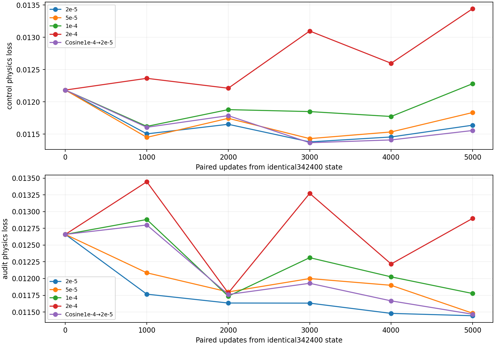

# نتیجهٔ مقایسهٔ برابر پنج حالت SOAP

هر پنج حالت از **وزن کامل یکسان ۳۴۲٬۴۰۰** با ۵۰۰۰ گام، batch32 و جریان نمونه‌برداری یکسان اجرا شده‌اند. هش و اندازهٔ پنج وزن انتهایی بررسی شد و وضعیت RNG انتهای هر پنج دقیقاً یکسان بود. هیچ آموزش جدیدی برای این تحلیل اجرا یا از سر گرفته نشد. ادامهٔ بدون انتخابِ `1e-4` و supervisor روی Molab متوقف و وضعیت زندهٔ آن‌ها حفظ شده است.

**جمع‌بندی: نامزد متعادل‌تر، کسینوسی `1e-4 → 2e-5` است؛ ثابت `2e-5` نامزد دوم و مرجع کم‌نوسان‌تر است. ثابت `1e-4` برای ادامهٔ خودکار انتخاب مناسبی نبود. هنوز تنظیم برنده برای ۲۰۰هزار گام ثابت نشده است.**

## مقایسهٔ هم‌بودجه

| حالت | Control | Audit | میانهٔ L2 سرعت،۲۰Re30 | میانهٔ L2 فشار،۲۰Re30 |
|---|---:|---:|---:|---:|
| وزن شروع |۰٫۰۱۲۱۸۳|۰٫۰۱۲۶۶۰|۱٫۳۷۱۸٪|۱٫۳۰۹۳٪|
| ثابت2e-5 |۰٫۰۱۱۶۳۸|**۰٫۰۱۱۴۴۴**|۱٫۲۹۶۴٪|۱٫۲۳۶۷٪|
| ثابت5e-5 |۰٫۰۱۱۸۳۴|۰٫۰۱۱۴۸۲|۱٫۲۷۸۵٪|۱٫۱۵۷۴٪|
| ثابت1e-4 |۰٫۰۱۲۲۸۱|۰٫۰۱۱۷۷۶|۱٫۲۷۳۷٪|**۱٫۰۷۴۳٪**|
| ثابت2e-4 |۰٫۰۱۳۴۴۲|۰٫۰۱۲۸۹۹|۱٫۴۴۲۶٪|۱٫۰۹۹۴٪|
| کسینوسی1e-4→2e-5 |**۰٫۰۱۱۵۵۵**|۰٫۰۱۱۴۶۷|**۱٫۲۶۲۴٪**|۱٫۱۲۶۶٪|

[PDF روندها](fixed_probes.pdf) · [نمودار FEM چهار معیار](fem_comparison.png) · [PDF FEM](fem_comparison.pdf) · [جدول کامل معیارها](common5k.csv) · [خطای تک‌تک کیس‌ها](per_case_fem.csv) · [تحلیل و بررسی وزن‌ها](analysis.json) · [کد بازتولید](../../../scripts/analyse_soap_screens.py)

## تفسیر نتایج

**کسینوسی:** control حدود۵٫۱۵٪ و audit حدود۹٫۴۳٪ نسبت به شروع کم شد. در۲۰ نمونه، میانهٔ سرعت۷٫۹۷٪ و فشار۱۳٫۹۶٪ بهبود نسبی داشتند. چهار میانهٔ FEM آن از ثابت2e-5 بهتر است، ولی audit ثابت2e-5 حدود۰٫۲٪ پایین‌تر است؛ این اختلاف کوچک را برتری قطعی آماری نمی‌دانیم. کسینوسی در همهٔ کیس‌ها بهتر نیست: درRe10 میانهٔ فشار۲٫۷۸٪ نسبت به شروع بدتر و بیشینهٔ فشار۲۰کیس۵٫۶۵٪ بالاتر شده است.

**ثابت2e-5:** بهترین audit انتهایی و بهترین میانگین audit در سه بررسی آخر را دارد. میانگین سه بررسی آخر، برایcontrol/audit به‌ترتیب۰٫۰۱۱۴۹۱/۰٫۰۱۱۵۱۹ است؛ برای کسینوسی۰٫۰۱۱۴۴۴/۰٫۰۱۱۶۸۷. control این حالت از گام۳۰۰۰ تا۵۰۰۰ روند نزولی روشنی ندارد، درحالی‌که audit هنوز اندکی کم می‌شود. پس این حالت هم به‌تنهایی نگرانی plateau در بازهٔ طولانی را رفع نمی‌کند.

**ثابت1e-4:** بهترین میانهٔ فشارRe30 و سرعت خوب دارد، اما control انتهایی حدود۰٫۸۱٪ از شروع بدتر است. در۸ نمونهٔRe10 میانهٔ فشار از۰٫۴۳۶۹٪ به۰٫۵۵۹۹٪ رسیده؛ **۲۷٫۲۵٪ پسرفت نسبی**. بنابراین انتخاب آن فقط به دلیل یک معیار خوب، مناسب نیست.

**ثابت2e-4:** control حدود۱۰٫۳۴٪ و audit حدود۱٫۸۹٪ بدتر شده‌اند. با وجود بهترین میانهٔ سرعتRe10، بیشینهٔ خطای فشارRe10 از۲٫۰۲۷۹٪ به۲٫۸۵۴۲٪ رسیده، حدود۴۰٫۷۵٪ پسرفت نسبی. این نتیجه پشتوانه‌ای برای انتخاب نرخ بزرگ‌تر نیست؛ درعین‌حال1e-3 آزمایش نشده و از این داده‌ها نمی‌توان نامناسب‌بودن قطعی آن را اثبات کرد.

**ثابت5e-5:** بینابینی است؛ در میانه‌های FEM وcontrol از کسینوسی بهتر نیست. دلیلی برای اولویت‌دادن آن نسبت به دو نامزد بالا در بودجهٔ محدود باقی‌مانده دیده نمی‌شود.

## ادامهٔ اضافیِ1e-4، جدا از غربال

قبل از توقف، حداقل۵۴۹۰ گام اضافی اجرا شده است. آخرین ارزیابی ثابت/FEM کامل این شاخه پس از۵۰۰۰ گام اضافی، یعنی **۱۰۰۰۰گام از نقطهٔ شروع مشترک**، است:

- Control برابر۰٫۰۱۲۰۹۴ وaudit برابر۰٫۰۱۱۹۰۱؛ هر دو از نتیجهٔ کسینوسی۵۰۰۰گامی بالاترند، با وجود بودجهٔ بیشتر. نسبت به انتهای۵۰۰۰گامی خودِ1e-4، control حدود۱٫۵۲٪ بهتر ولیaudit حدود۱٫۰۶٪ بدتر است.
- میانهٔ سرعتRe30 برابر۱٫۳۴۶۸٪ و فشار۱٫۲۲۹۴٪ است؛ نسبت به پایان۵۰۰۰گامی همان مسیر پسرفت دارند. برخی بیشینه‌ها بهتر شده‌اند؛ نتیجه یکدست بدتر نیست.

این مشاهده از ادامهٔ اجباری1e-4 پشتیبانی نمی‌کند، اما اثبات نمی‌کند که هر ادامهٔ طولانیِ نرخ ثابت حتماً بی‌فایده است. این قسمت یک مشاهدهٔ نابرابر از نظر بودجه است و وارد رتبه‌بندی هم‌بودجه نشده است.

## نتیجه برای تصمیم بعدی

برای۲۰۰هزار گام هنوز تصمیم قطعی نمی‌گیریم: این تنها یک وزن شروع، یک جریان تصادفی و۵۰۰۰گام برای هر حالت است. نرخ کسینوسی در۵۰۰۰گام فشرده شده؛ افق کاهش مناسب۲۰۰هزارگام از این آزمون مشخص نمی‌شود. مجموعه‌های control/audit و۲۸FEM بارها برای توسعه دیده شده‌اند؛ FEM فقطRe10/30 را پوشش می‌دهد و test دست‌نخورده باز نشده است.

حداقل۳۰۴۹۰ گام از بودجه مصرف شده؛ لاگ هر۱۰گام است و حداکثر۹گامِ ثبت‌نشده ممکن است وجود داشته باشد. پیشنهاد مرحلهٔ بعد **۹۵۰۰گام برای هرکدام از دو نامزد** است: ادامهٔ کسینوسی از وزن انتهایی خودش با ثابت2e-5، و ادامهٔ مرجع ثابت2e-5 از وزن انتهایی خودش با همان نرخ. هر دو به۱۴۵۰۰گام از نقطهٔ مشترک می‌رسند و تفاوت «شروع پرنرخ و کاهش» با «شروع کم‌نرخ» را در افق بلندتر می‌سنجند. این تخصیص۱۹هزارگامی در بودجهٔ باقی‌مانده جا می‌شود. **این پیشنهاد هنوز اجرا نشده است.**

برای مقایسهٔ مرحلهٔ بعد باید مقدار و شیب loss در چند پنجرهٔ آخر، همهٔ معیارهای FEM و پسرفت‌های تک‌کیس بررسی شود؛ اگر هردو صاف شدند، هیچ‌کدام را صرفاً به خاطر loss کوتاه‌مدت به۲۰۰هزار گام تعمیم نمی‌دهیم. وزن‌ها و داده‌های همهٔ حالت‌ها حفظ شده‌اند.
