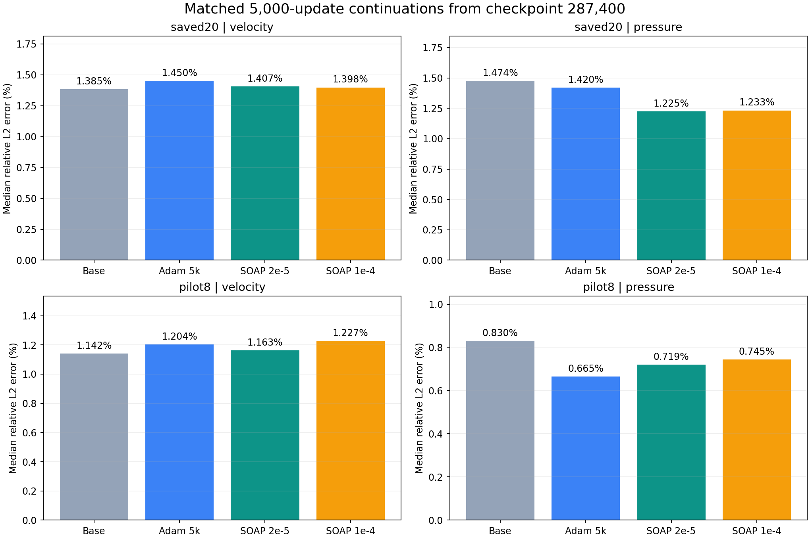

# Completed SOAP experiment: analysis and next step

**Both 5k branches completed with exit0.** From identical287400 parameters and common baseline batch RNG, each reached292400. The original model, the completed Adam/RAD trials, and all14 new full SOAP-state snapshots are retained. All14 NPZ sizes/SHA256 hashes were rechecked; tracked local HEAD was matched to remote during collection. No automatic model promotion or new long training occurred.

[PDF](fem_comparison.pdf) · [Every case CSV](per_case_errors.csv) · [Analysis JSON](analysis.json) · [Original curves](../../../artifacts/molab/soap-trials-v1/comparison.png) · [Full original metrics and checkpoints](../../../artifacts/molab/soap-trials-v1/).

## Physical errors: same saved references

| Median relative L2 | Base287400 | Adam5k | SOAP2e-5,5k | SOAP1e-4,5k |
| --- | ---: | ---: | ---: | ---: |
| 20 Re30: velocity | 1.3848% | 1.4495% | 1.4068% | 1.3978% |
| 20 Re30: pressure | 1.4744% | 1.4200% | 1.2253% | 1.2328% |
| 8 Re10: velocity | 1.1417% | 1.2035% | 1.1631% | 1.2270% |
| 8 Re10: pressure | 0.8296% | 0.6649% | 0.7194% | 0.7447% |

SOAP2e-5 lowers the20-case pressure median by **16.90%** versus the base, but raises the velocity median by **1.59%**. Against Adam at the same5k budget, its20-case velocity/pressure medians are 2.95% / 13.71% lower. On the Re10 pilot its pressure median is worse than Adam's. This is a tradeoff, not uniform improvement.

Compared with base, SOAP2e-5 improves velocity in12/20 saved cases and1/8 pilot cases, and pressure in12/20 plus6/8. Thus even a better aggregate hides regressions. Its worst saved velocity/pressure errors remain **7.819% / 13.893%**. SOAP1e-4 has a higher worst pressure error and less favorable audit performance, so it is not the preferred continuation.

## Fixed probe and elapsed time

| Method | Fixed control | Disjoint audit | Seconds to last5000-step log |
| --- | ---: | ---: | ---: |
| adam | 0.01335648 | 0.01355316 | 366.9 |
| soap_2e5 | 0.01297145 | 0.01305924 | 460.7 |
| soap_1e4 | 0.01336948 | 0.01327423 | 431.0 |

Base control/audit were0.01294696 /0.01334894. SOAP2e-5 audit falls about2.17%, while control is nearly unchanged (slightly higher). A steep-looking local training-loss segment is not evidence of100k-equivalent progress.

These are measured branch wall times, including different checkpoint/evaluation work; SOAP shares compiled preflight kernels, and the later branch can benefit from caching. They are not isolated optimizer timings or a matched wall-time convergence experiment. Initialization and the common production preflight add one-time cost. SOAP2e-5 takes about26% longer to reach the5k log than the reused Adam reference; final FEM/serialization adds further time. No20x speedup is established.

## Additional read-only gradient diagnostic

[Diagnostic data](gradient_diagnostic.json) · [Code](gradient_diagnostic.py). On the same32-geometry training batch, x/y momentum gradient norms at base are0.304/0.202; after SOAP they are0.282/0.205. Their ratio is about1.4–1.5, not orders of magnitude. Their cosine changes from-0.160 to-0.293, indicating some opposing directions on this batch. Outlet gradients are much smaller, while their losses are already tiny. This single-batch diagnostic does not establish a global bottleneck or justify boosting outlet weights to match gradients blindly. No parameters were changed by the diagnostic.

## Decision

Prefer **SOAP2e-5** as the next candidate; retain287400 as the velocity baseline and retain the completed Adam15k pressure candidate separately. Do not restart from zero, increase LR to1e-4, change architecture or loss weights based only on these results, or launch another100k blindly.

The concrete next proposal is **10k additional updates from the saved SOAP2e-5 state at292400**, keeping LR2e-5 and the same resampling, to reach302400 (15k total). This matches the already completed Adam15k budget. Evaluate identical per-case FEM every2500 updates, retain all full states, and stop/reassess if errors persistently regress. It is an experiment, not a claim that longer SOAP must repair velocity. Before any long run or acceptance, add balanced development FEM coverage at higher Re; the current20Re30 plus8Re10 cohort does not validate the whole Re10–100 range. Locked test remains unopened.

**This analysis has not launched that additional10k run.** Checkpoint restoration must use full SOAP state with pinned code, not Adam resume. Source and results remain under distinct paths.
