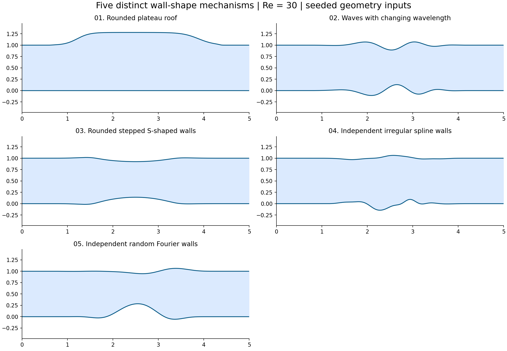
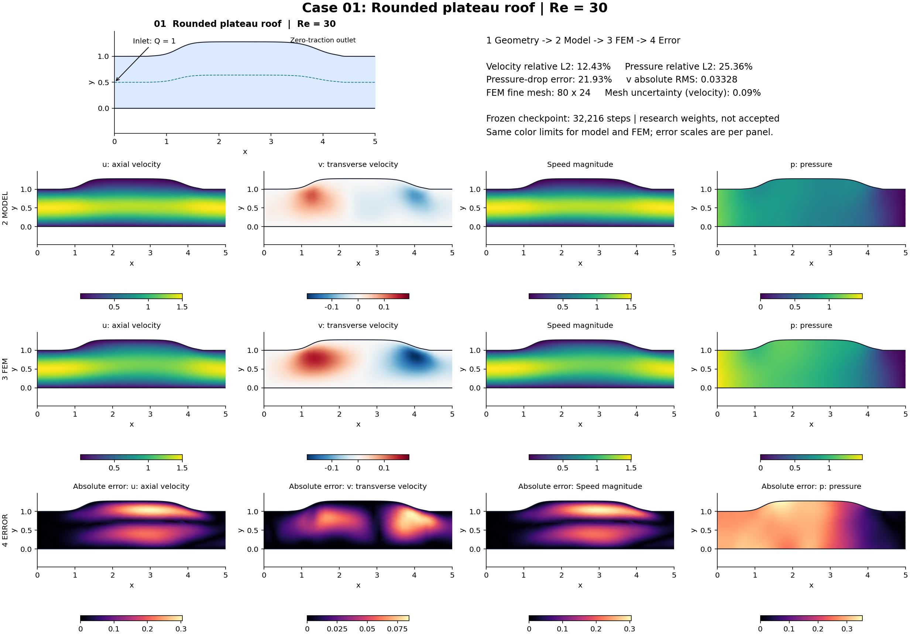
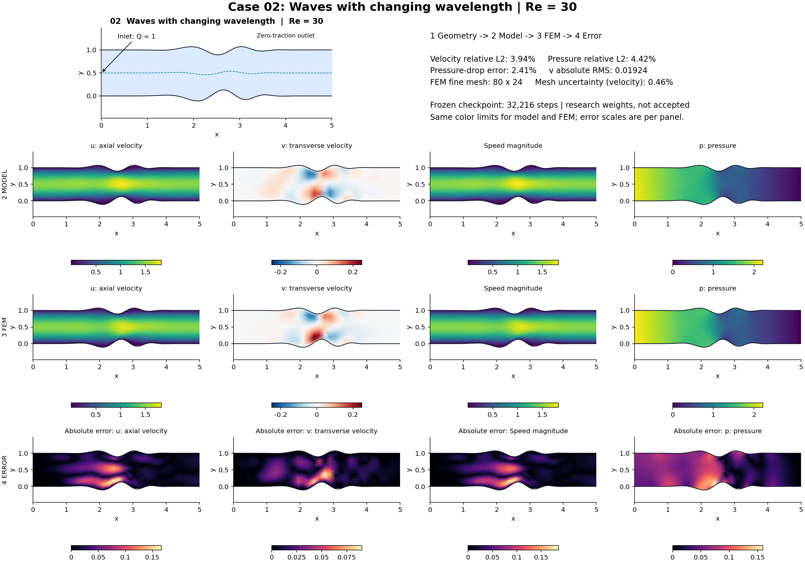
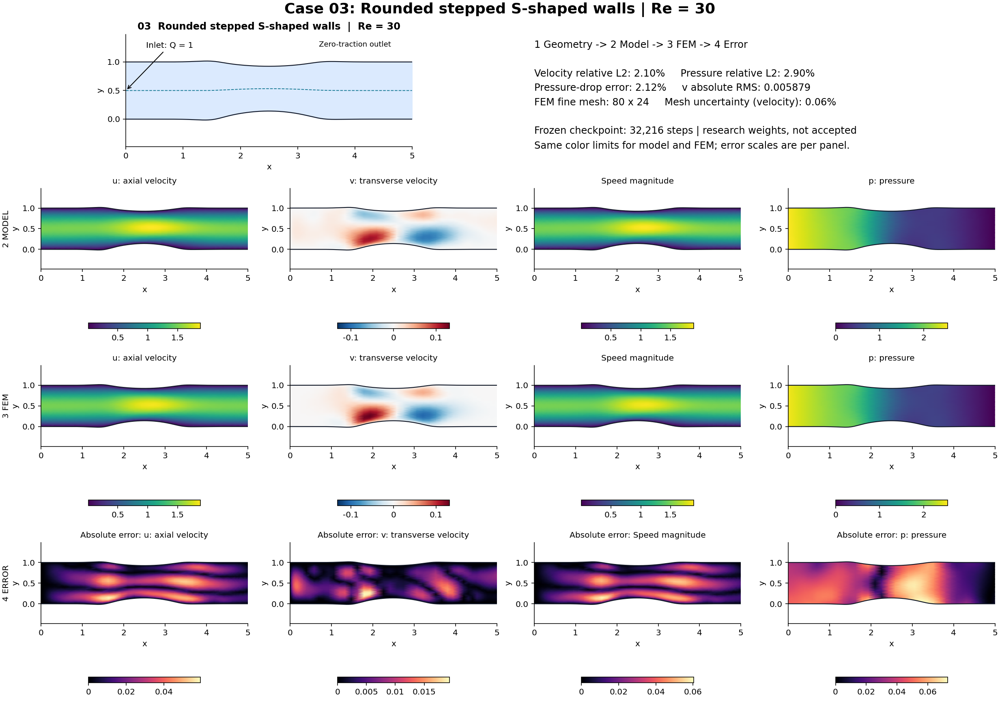
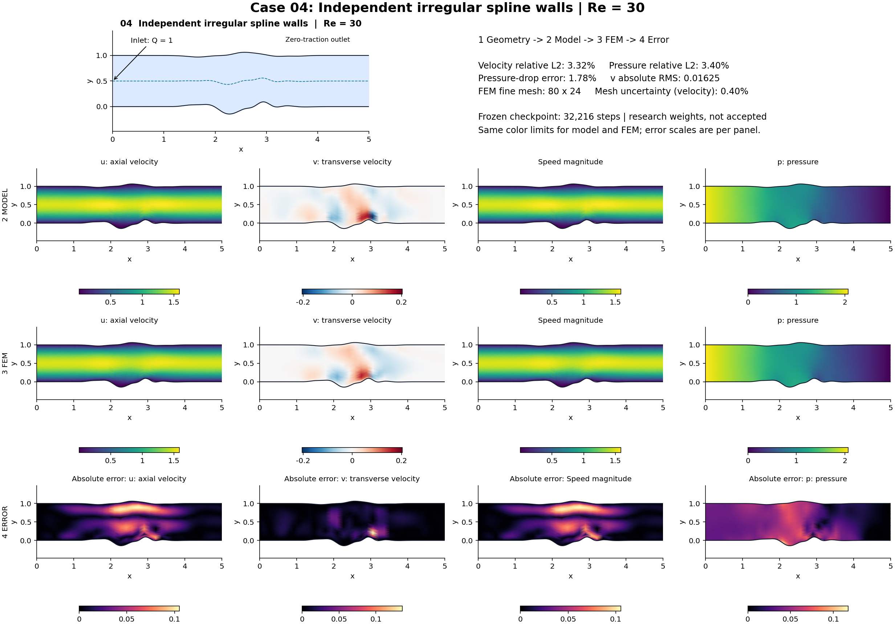
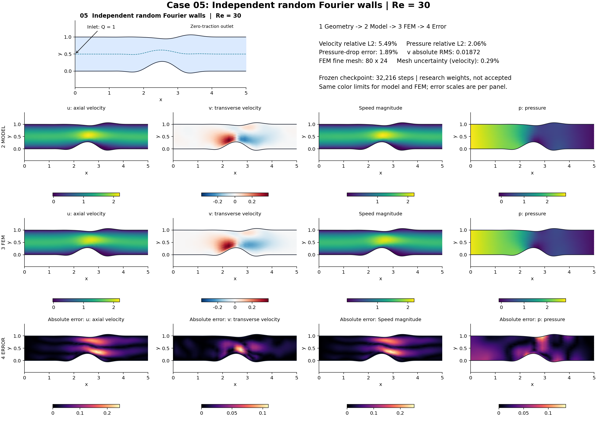

# Five varied random channel inputs and flow predictions

[Mean absolute MAE and relative L1 errors](mean_errors/README.md)

The flow operator predicts velocity and pressure **given wall geometry**; it is not a geometry generator. The previous 15 shapes used repeated compact bump functions by design. This set uses rounded plateaus, chirped sinusoidal waves, rounded steps, smoothed random spline coefficients and independent Fourier mixtures instead. All use the exact canonical C4 quintic wall representation, flat inlet/outlet strips and the declared gap/centerline/slope envelope. Sharp corners, discontinuous steps, branching channels and obstacles are not supported by this model.

Random seed: `2026111505`. Parameters and shapes were fixed before evaluation. These are illustrative custom inputs, not a certified held-out benchmark or an exhaustive random sample. All cases use **Re=30** and the **original step-32,216 research checkpoint**. The ongoing continuation is not used. Input validity does not guarantee accurate predictions; the FEM comparisons below determine the observed errors.

[All five result chains PDF](all_5_chains.pdf) · [CSV errors](summary.csv) · [Full metrics JSON](summary.json)

| Case | Velocity L2 error | Pressure L2 error | Pressure-drop error | Max mesh discrepancy |
| --- | ---: | ---: | ---: | ---: |
| 01 Rounded plateau roof | 12.43% | 25.36% | 21.93% | 0.13% |
| 02 Waves with changing wavelength | 3.94% | 4.42% | 2.41% | 0.82% |
| 03 Rounded stepped S-shaped walls | 2.10% | 2.90% | 2.12% | 0.09% |
| 04 Independent irregular spline walls | 3.32% | 3.40% | 1.78% | 0.57% |
| 05 Independent random Fourier walls | 5.49% | 2.06% | 1.89% | 0.55% |

## Method

The same independent P2/P1 FEM and error protocol as the [15-case report](../channel_chain_15/README.md) is used: coarse/fine mesh discrepancies ≤1% for velocity, pressure and pressure drop; common-domain excluded area ≤0.5%; positive physical-area quadrature weights; pressure compared without fitted gauge shift. All quantities are nondimensional. Model/FEM color limits match per case; absolute-error scales differ per panel. Field maxima refer to saved quadrature samples. Errors and signed fields, exact geometry coefficients, references and metadata are retained. The checkpoint remains unaccepted, and the locked test is not opened.

Reproduce: `python -m scripts.random_channel_chain` in the documented CPU environment. Cached references bind geometry and Re. The original 15-case output files are retained unchanged.

## 01. Rounded plateau roof

[Geometry](01_roof_plateau/01_geometry.png) → [Model](01_roof_plateau/02_model.png) → [FEM](01_roof_plateau/03_fem.png) → [Error](01_roof_plateau/04_error.png) · [Metrics](01_roof_plateau/metrics.json) · [Fields](01_roof_plateau/fields.npz)

## 02. Waves with changing wavelength

[Geometry](02_chirped_wave/01_geometry.png) → [Model](02_chirped_wave/02_model.png) → [FEM](02_chirped_wave/03_fem.png) → [Error](02_chirped_wave/04_error.png) · [Metrics](02_chirped_wave/metrics.json) · [Fields](02_chirped_wave/fields.npz)

## 03. Rounded stepped S-shaped walls

[Geometry](03_stepped_s_bend/01_geometry.png) → [Model](03_stepped_s_bend/02_model.png) → [FEM](03_stepped_s_bend/03_fem.png) → [Error](03_stepped_s_bend/04_error.png) · [Metrics](03_stepped_s_bend/metrics.json) · [Fields](03_stepped_s_bend/fields.npz)

## 04. Independent irregular spline walls

[Geometry](04_random_spline/01_geometry.png) → [Model](04_random_spline/02_model.png) → [FEM](04_random_spline/03_fem.png) → [Error](04_random_spline/04_error.png) · [Metrics](04_random_spline/metrics.json) · [Fields](04_random_spline/fields.npz)

## 05. Independent random Fourier walls

[Geometry](05_random_fourier/01_geometry.png) → [Model](05_random_fourier/02_model.png) → [FEM](05_random_fourier/03_fem.png) → [Error](05_random_fourier/04_error.png) · [Metrics](05_random_fourier/metrics.json) · [Fields](05_random_fourier/fields.npz)

