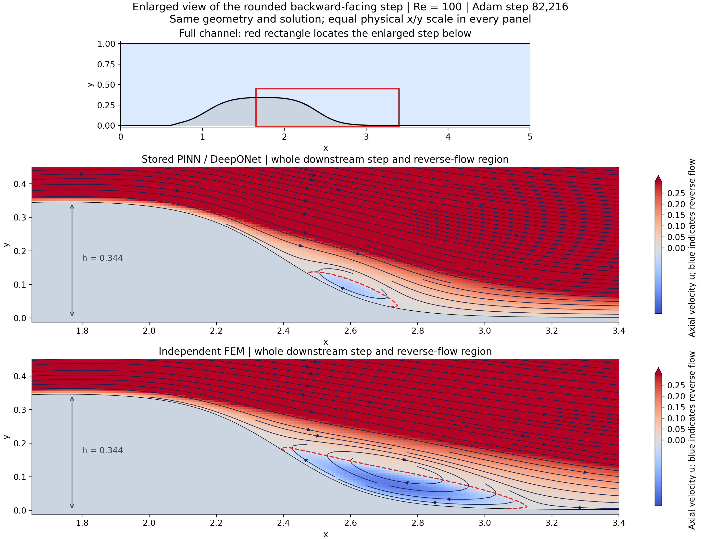
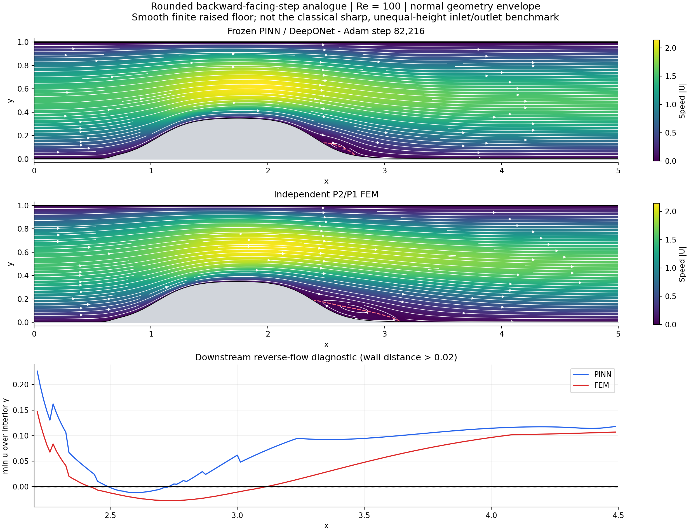
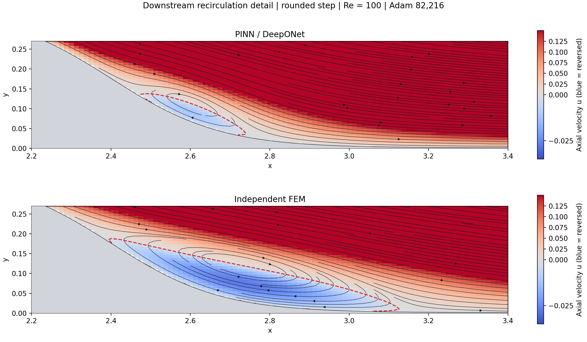

# Rounded backward-facing-step analogue

Frozen Adam checkpoint **82,216**, Re=100. No retraining or Kaggle access. This is a **smooth analogue**, not the classical sharp-step benchmark: C4 walls, slope <=0.7, and equal flat inlet/outlet heights are mandatory. The raised upstream floor must therefore rise smoothly after the inlet and descend smoothly downstream. It cannot reproduce the classical vertical corner or arbitrary expansion ratio.

[Streamlines PNG](streamlines.png) · [PDF](streamlines.pdf) · [Numerical fields](fields.npz) · [Metrics and provenance](summary.json) · [Download complete case](rounded_step_82216.zip)

[Enlarged whole-step view](step_enlarged.png) · [Enlarged view PDF](step_enlarged.pdf)

The enlarged view includes the full descending floor and downstream reverse-flow region. The red rectangle locates the crop in the full channel. Both axes retain equal physical scale; geometry, weights and numerical results are unchanged. Reproduce this view with `python -m scripts.plot_step_focus`.

[Recirculation close-up PDF](recirculation_zoom.pdf)

Velocity relative L2 error: **9.15%**. Pressure relative L2 error: **14.98%**. Errors use physical-area weighted FEM quadrature, no fitted pressure shift. Maximum FEM mesh discrepancy: **0.58%**.

Both solutions show downstream reverse flow. The model predicts a weaker, smaller reversed-flow region: minimum u approximately -0.01168 versus FEM -0.02738 on the saved grid. Closed-looking streamline loops are visible in the plots; exact separation/reattachment lengths and wall shear are not certified.

White curves are streamlines integrated through the evaluated velocity field, with arrows for direction. Pink contours, when present, delimit u=-0.001. Downstream diagnostics use 2.2<x<4.5 and distance >0.02 from each wall. A local negative velocity or a drawn streamline alone does not certify a closed recirculation bubble. The model remains an unaccepted research checkpoint.

Geometry gap range: 0.6559–1.0000; maximum wall slope 0.6314; centerline deviation 0.1721. All standard geometry checks passed without stress overrides.

Other compatible **benchmark analogues**: plane Poiseuille flow (exact straight channel); smooth converging-diverging channel / Venturi; symmetric smooth stenosis; smooth asymmetric diffuser; smooth S-shaped channel. These retain this model's inlet profile, Reynolds range and outlet condition. Lid-driven cavity, cylinder flow, sharp backward-facing step, and branching channels need different geometry or boundary conditions.

Reproduce: `OPENBLAS_NUM_THREADS=1 OMP_NUM_THREADS=1 JAX_ENABLE_X64=true .venv/bin/python -m scripts.rounded_step_flow` from the repository root. See the repository CPU environment pins. The checkpoint is referenced by its SHA256 above and in summary.json; it is not bundled in the result ZIP.
