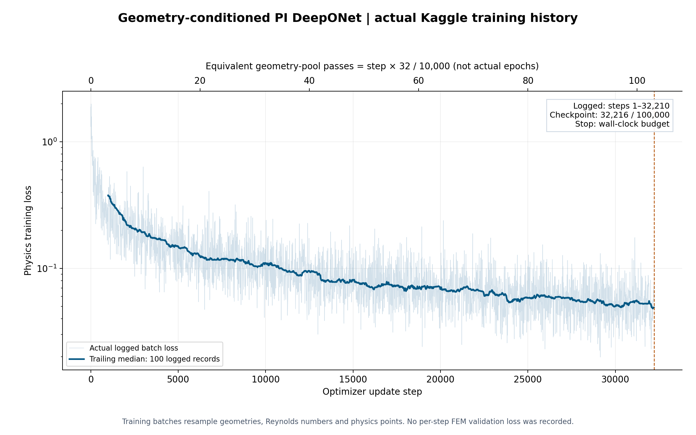
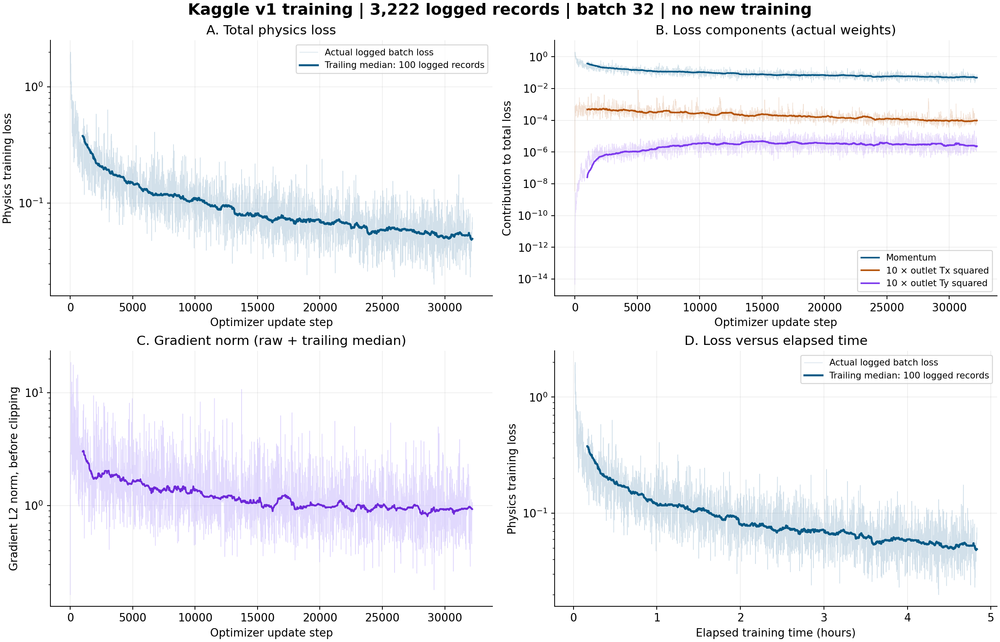

# Actual training history



[Download curve PDF](loss_vs_step.pdf) · [Dashboard PDF](training_dashboard.pdf) · [All logged numerical records CSV](training_history.csv) · [Summary](summary.json)



## Steps, not epochs

This is physics-only training. Each optimizer update draws a batch of **32 geometries with replacement** from a 10,000-geometry training pool, resamples Re and draws new interior/outlet collocation points. There is no ordered complete dataset traversal defining an actual epoch. FEM targets are not training labels.

The primary x-axis is the actual optimizer step. The secondary axis is only **equivalent geometry-pool passes = step × 32 / 10,000**. At checkpoint step 32,216 this equals **103.0912** pool passes (1,030,912 geometry draws). This does not mean every geometry was visited equally, nor 103 actual training epochs. It does not count a fixed collection of Re/physics-point examples.

## What the records establish

- All **3,222** log records are plotted, from step 1 through **32,210**. The final checkpoint is at **32,216**; no loss measurement is invented for the last six steps.
- The job stopped at its **17,400-second wall-clock budget**, before its **100,000-step** target.
- First logged loss: **1.8896835**. Last logged loss: **0.075033166**. These come from different random batches.
- Median of first 100 logged batches: **0.37756594**. Median of last 100: **0.049093867**.
- Raw batches are shown faintly; the dark curve is a trailing median over **100 log records**, roughly 1,000 updates. No missing log records are synthesized. The first 99 median values are absent until a full window exists.
- Total loss = momentum mean-square + **10 × (Tx mean-square + Ty mean-square)**. This identity was checked against every logged record. The divergence-squared value is a diagnostic, not another loss contribution. Gradient norms are the pre-clipping norms from the trainer.
- There is **no validation/FEM error curve versus training step** in these logs. The collected eight-case FEM evaluation and later 15-channel examples evaluate the final checkpoint; they cannot be relabeled as training-time validation histories. Lower physics loss alone does not certify solution accuracy or model acceptance.

The plotted records are from the actual archived Kaggle v1 log, not a new training run. Original log SHA-256: `617431210ec6d172b50f06991736a028f7454d6a23c58de320dec7d0ecb25a10`.

## Reproduce

From the repository root in its documented CPU environment:

```bash
MPLBACKEND=Agg MPLCONFIGDIR=/workspace/.cache/matplotlib XDG_CACHE_HOME=/workspace/.cache .venv/bin/python -m scripts.plot_training
```

The original [JSONL log](../../artifacts/kaggle/main-v1/training.jsonl), [final status](../../artifacts/kaggle/main-v1/status.json) and [collection report](../KAGGLE_COMPLETED_RUN.md) remain unchanged.
