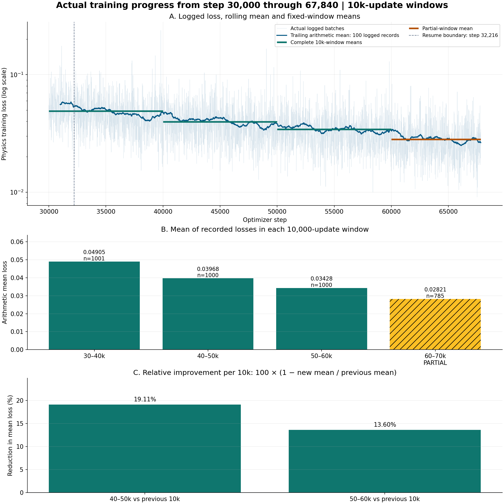

# Training slowdown review: fixed 10,000-update windows

[PDF](training_windows.pdf) · [Window CSV](window_summary.csv) · [Exact summary and hashes](window_summary.json) · [All plotted records](history.csv) · [Live snapshot observation](observation.json)

**These are optimizer steps, not actual epochs.** Each 10,000-step window equals 32 equivalent geometry-pool passes (batch 32 / pool 10,000), not 100 epochs. The rolling display uses 100 logged records, approximately 1,000 steps. A hypothetical 100 equivalent pool passes would span 31,250 steps.

Original-run logs and resumed-run numerical logs are merged by global step without resetting the x-axis. The resume boundary is marked. No training or validation computation is rerun. The snapshot stops at the last actual recorded step; it is not a live-updating chart.

## Arithmetic means

| Window (steps) | Complete? | Records | Mean loss | Median loss | Reduction from previous full window |
| --- | --- | ---: | ---: | ---: | ---: |
| 30,000 ≤ step < 40,000 | Yes | 1001 | 0.049050 | 0.045105 | — |
| 40,000 ≤ step < 50,000 | Yes | 1000 | 0.039676 | 0.037124 | 19.11% |
| 50,000 ≤ step < 60,000 | Yes | 1000 | 0.034281 | 0.031663 | 13.60% |
| 60,000 ≤ step < 70,000 | No; partial | 785 | 0.028210 | 0.025967 | — |

Averages are over actual **logged batches**, normally recorded every 10 steps, not all individual optimizer steps. The extra first resumed update at 32,217 is retained; no missing values are filled. All batches are equally weighted in this arithmetic mean. Random geometry, Re and collocation sampling create batch variability.

Only complete adjacent windows are used for the percent-reduction chart. Positive values mean lower mean loss; a smaller positive value means slower relative improvement over that pair of 10k windows. Negative values mean a higher window mean. The JSON also contains ln(previous mean / new mean), the decrease in log mean per 10k steps. Partial-window means are provisional and excluded from rate comparisons. This is descriptive training-loss progress, not a validation/FEM accuracy curve or a statistical guarantee of convergence.

Reproduce the frozen snapshot: `python -m scripts.plot_training_windows`. To update, capture fresh live logs using the existing collector and pass `--live-log path/to/live-log.jsonl`.
